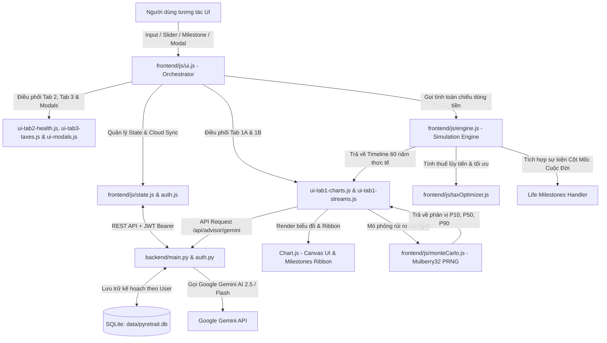

# Kiến Trúc Hệ Thống pyRetrait (Architecture Documentation)

Tài liệu này mô tả chi tiết kiến trúc kỹ thuật, luồng dữ liệu, các module tính toán và cấu trúc mã nguồn của nền tảng **pyRetrait**.

---

## 1. Tổng quan Kiến trúc (High-Level Overview)

pyRetrait được thiết kế theo triết lý **Local-First & Reactive Realtime Architecture kết hợp Cloud Multi-Tenant Sync**:
- **Bảo mật & Quyền riêng tư tối đa**: Dữ liệu tài chính hỗ trợ 2 chế độ: Chế độ Khách (Guest) lưu trữ độc quyền trên `localStorage` và Chế độ Tài khoản (Cloud) lưu trữ độc lập trên SQLite (`data/pyretrait.db`), mật khẩu mã hóa PBKDF2/SHA-256 + muối an toàn.
- **Phản hồi tức thì (<16ms)**: Mọi thao tác thay đổi tham số (lương, tỷ lệ tiết kiệm, tuổi nghỉ hưu, lạm phát, tỷ suất sinh lời, thêm sự kiện cột mốc) đều kích hoạt engine tính toán lại toàn bộ dòng đời (life-cycle projection) và vẽ lại biểu đồ ngay lập tức mà không cần tải lại trang.
- **Tính toán 2 tầng (Client-Side Deterministic Engine & Server-Side Heavy Compute)**:
  - **Tầng 1 (Frontend Engine - Vanilla JS)**: Thực hiện mô phỏng dòng tiền 50-80 năm, áp dụng các chiến lược rút tiền, tính thuế lũy tiến, phân bổ chi tiêu/tiết kiệm và mô phỏng Monte Carlo xác định bằng thuật toán **Mulberry32 PRNG (Seed 42)**.
  - **Tầng 2 (Backend Engine - Python FastAPI & SQLite)**: Xử lý xác thực người dùng (JWT), lưu trữ đa tài khoản, và proxy AI phân tích chiến lược qua Google Gemini Flash.



---

## 2. Chi tiết các Module Frontend (`frontend/js/`) theo Kiến trúc 3 Tầng

### 2.1. `engine.js` — Tầng 1: Lõi Tính toán Dòng tiền & Tích lũy (Core Projection Engine)
- **Chu kỳ vòng lặp theo từng năm tuổi (`age` từ `startWorkAge` đến `lifeExpectancy`)**:
  1. **Timeline quá khứ thực tế**: Tính toán trung thực dựa trên thu nhập và cấu hình thực tế, loại bỏ hoàn toàn các hàm ước lượng đa thức giả định.
  2. **Tính tổng thu nhập (`annualIncome`)**: Tổng hợp từ tất cả các luồng thu nhập chủ động và thụ động (`plan.incomes`) đang có hiệu lực tại độ tuổi đó, áp dụng tỷ lệ tăng lương riêng biệt của từng luồng.
  3. **Ước tính thuế thu nhập (`estimatedTax`)**: Chuyển giao sang `taxOptimizer.js` để tính theo Biểu thuế lũy tiến Pháp (IR 2024), Mỹ (US Federal), hoặc Việt Nam.
  4. **Phân bổ giai đoạn tích lũy (`!isRetired`)**:
     - Áp dụng **Tỷ lệ Tiết kiệm (`savingsRate`)**:
       - `Tiết kiệm năm = Thu nhập sau thuế * (savingsRate / 100)`
       - `Chi tiêu sinh hoạt = Thu nhập sau thuế * (1 - savingsRate / 100)`
     - Tài sản danh mục tăng trưởng theo lãi kép hàng năm:
       - `Portfolio(t+1) = (Portfolio(t) + Tiết kiệm) * (1 + r_pre)`
  5. **Tích hợp Sự kiện Cột Mốc Cuộc Đời (`plan.milestones`)**:
     - Nếu năm đó có cột mốc chi tiêu đột xuất (ví dụ mua nhà, sinh con):
       - `Portfolio(t) = max(0, Portfolio(t) - MilestoneExpense)`
     - Nếu năm đó có cột mốc thu nhập đột xuất (ví dụ thừa kế, bán tài sản):
       - `Portfolio(t) = Portfolio(t) + MilestoneIncome`
  6. **Phân bổ giai đoạn hưu trí (`isRetired`)**:
     - Áp dụng chiến lược rút tiền được chọn (`bengen_4pct`, `guyton_klinger`, `vpw`, `fixed_pct`).
     - Tự động cộng các nguồn thu nhập tuổi già (Lương hưu Pháp CNAV/Agirc-Arrco từ 64–67 tuổi, BHXH Việt Nam, cổ tức, bất động sản).
     - **Tái đầu tư thặng dư**: Nếu thu nhập thụ động > Chi tiêu sinh hoạt, thặng dư được tái đầu tư trở lại vào danh mục. Ngược lại, khoản thiếu hụt (`deficit`) sẽ được rút từ danh mục đầu tư.
  7. **Mô hình Chi tiêu Spending Smile**: Tích hợp trực tiếp tại thẻ *Dòng Chi Tiêu Hàng Tháng Khi Về Hưu* trong Tab 1 (Dòng tiền & Tài sản). Điều chỉnh chi tiêu theo 3 chặng: Go-Go (+15%), Slow-Go (-10%), và No-Go (-20%).

### 2.2. `taxOptimizer.js` — Tầng 1: Bộ Tối ưu Hóa Thuế & Phúc lợi Xã hội
- **Biểu thuế lũy tiến Pháp (IR 2024)**:
  - Tự động trừ **10% Abattement forfaitaire pour frais professionnels** (trần 14,171 €).
  - 5 bậc thuế chính thức: 0% (`<= 11,294 €`), 11%, 30%, 41%, 45%.
  - Thuế suất ưu đãi cho tài khoản PEA (miễn thuế thu nhập sau 5 năm).
- **Bộ tính Lương hưu Pháp (French Pension Reform 2023)**:
  - Tính toán dựa trên số quý đóng góp (`trimestres`), tuổi tối thiểu (64 tuổi theo cải cách 2023) và tuổi hưởng tỷ lệ tối đa không bị phạt (67 tuổi).
- **Roth Conversion Ladder & ACA Subsidy**: Hỗ trợ thị trường Mỹ với chiến lược chuyển đổi quỹ truyền thống sang Roth IRA vào các năm trũng thu nhập.

### 2.3. `monteCarlo.js` — Tầng 1: Mô Phỏng Monte Carlo Xác Định (Deterministic Mulberry32 PRNG)
- Sử dụng thuật toán sinh số giả ngẫu nhiên xác định **Mulberry32** với hạt giống cố định (`seed = 42`):
  - Triệt tiêu hoàn toàn sự chênh lệch ngẫu nhiên giữa các trình duyệt khác nhau (Google Chrome vs Brave Browser vs Safari).
  - Đảm bảo 1,000 chuỗi mô phỏng cho cùng một bộ dữ liệu đầu vào sẽ cho kết quả P10/P50/P90 và tỷ lệ thành công giống hệt nhau trên mọi thiết bị.
- Kết hợp biến đổi **Box-Muller** để chuyển đổi số ngẫu nhiên đều `[0, 1)` thành phân phối chuẩn Gaussian với kỳ vọng sinh lời và độ biến động lịch sử.

### 2.4. `state.js`, `auth.js` & `i18n.js` — Tầng 2: Quản Lý State, Xác Thực & Đa Ngôn Ngữ
- `state.js`: Quản lý trạng thái trung tâm (`window.AppState.state`), lưu trữ `localStorage` (`pyretrait_plans`), đồng bộ đám mây và Event Bus.
- `auth.js`: Quản lý trạng thái người dùng (Chế độ Khách vs Chế độ Tài khoản Đám mây), lưu trữ JWT Token và tự động đồng bộ kế hoạch khi nâng cấp từ Guest sang Cloud.
- `i18n.js`: Quản lý từ điển đa ngôn ngữ (`vi`, `en`, `fr`) và cơ chế Dropdown Selector linh hoạt.

### 2.5. `scenarios.js` & `patrimoine.js` — Tầng 1: Stress Test, BĐS LMNP & Đội Xe Turo
- `scenarios.js`: Cung cấp các kịch bản kiểm thử rủi ro (Khủng hoảng thị trường sớm -35%, Lạm phát cao kéo dài, Cú sốc y tế, Thu gọn BĐS).
- `patrimoine.js`: Tính toán lịch trả nợ vay ngân hàng (*amortissement*), phí công chứng 7.5%, tỷ lệ phòng trống, thuế đất *taxe foncière*, khấu hao LMNP, mô hình định giá tách biệt Nhà mặt đất vs Chung cư 30 năm, và đồng bộ 1-click vào luồng thu nhập FIRE.

### 2.6. Bộ 6 File Giao Diện Tầng 3 (`ui.js`, `ui-tab1-charts.js`, `ui-tab1-streams.js`, `ui-tab2-health.js`, `ui-tab3-taxes.js`, `ui-modals.js`)
- **`ui.js` (Nhạc trưởng điều phối trung tâm ~877 dòng)**:
  - Khởi tạo ứng dụng (`initApp`), gắn sự kiện toàn cục (`bindEvents`), điều hướng chuyển Tab (`switchTab`, `renderActiveTab`), đồng bộ thanh nhập liệu bên trái (`renderActivePlanInputs`), cập nhật toàn diện (`updateAll`), chuyển đổi tiền tệ (`EUR <-> VND <-> USD`) và chế độ Sáng/Tối.
- **`ui-tab1-charts.js` (Tab 1A — Biểu đồ & Dự báo ~1,871 dòng)**:
  - Render biểu đồ Tài sản ròng (`renderNetWorthChart`), ghim sự kiện (`drawMilestoneMarkers`), dải băng cột mốc (`renderMilestonesRibbon`), thẻ sức chống chịu biến cố (`renderStressResilienceCard`), biểu đồ Dòng tiền (`renderCashFlowChart`), Monte Carlo Fan Chart (`renderMonteCarloTab`), Kịch bản What-If (`renderScenarioTab`) và Bảng dự phóng từng năm (`renderProjectionsTable`).
- **`ui-tab1-streams.js` (Tab 1B — Luồng Thu/Chi, Phân bổ & Chiến lược ~2,224 dòng)**:
  - Quản lý danh sách và bảng tóm tắt giai đoạn Thu nhập / Chi tiêu (`renderIncomePeriodsSummary`, `renderExpensePeriodsSummary`), cân đối thu chi (`updateCashflowBalanceUI`), phân bổ danh mục tài sản (`updateAssetAllocationUI`), lạm phát kép 2 chặng (`updateDualInflationUI`), địa điểm nghỉ hưu và so sánh 4 chiến lược rút vốn (`renderWithdrawalComparison`).
- **`ui-tab2-health.js` (Tab 2 — Sức khỏe, Gia đình & Di sản ~1,361 dòng)**:
  - Tính toán Tuổi sinh học (`updateBioAge`), Điểm sức khỏe & Thanh 3 giai đoạn (`updateHealthspanScore`), Quỹ chăm sóc tuổi già 78t+ (`updateSeniorCareUI`), Mô phỏng con cái & Trợ cấp CAF Pháp (`updateFamilyChildrenSimulation`, `renderFamilyCashFlowChart`), Tiến độ Di sản (`updateEstateMilestones`) và Danh mục Y tế Pháp – Việt (`updateCrossBorderChecklist`).
- **`ui-tab3-taxes.js` (Tab 3 — Tối ưu Thuế, Lương hưu & BĐS LMNP ~1,476 dòng)**:
  - Bóc tách Thuế lũy tiến & Thác rút tiền tài khoản Pháp (`PEA`, `Assurance-Vie`, `Livret A`), mô phỏng Lương hưu Pháp 172 quý (`updatePensionDecoteUI`), BHXH tự nguyện Việt Nam (`updateBhxhVnUI`), và đồng bộ danh mục BĐS LMNP (`applyPatrimoineToPlan`).
- **`ui-modals.js` (Hệ thống Hộp thoại Modal & Quick Wizard ~1,471 dòng)**:
  - Quản lý toàn bộ hộp thoại Modal chống tràn màn hình (Confirm, Formula Guide, Feature Intro, Thêm/Sửa Thu nhập, Chi tiêu, Cột mốc, Tài sản thực tế, Quản lý Kế hoạch) và Trình thiết lập nhanh 4 bước (`Quick Setup Wizard`).

---

## 3. Kiến trúc Backend (`backend/`)

Backend được viết bằng **Python 3.10+** với framework **FastAPI**, giữ vai trò:
1. **Xác thực Đa Người Dùng (`backend/auth.py`)**:
   - Quản lý tài khoản trong SQLite (`data/pyretrait.db`).
   - Mã hóa mật khẩu an toàn bằng `hashlib.pbkdf2_hmac` với muối ngẫu nhiên (salt) 32 bytes và 100,000 vòng lặp.
   - Cấp phát và xác thực JWT token (HS256) có thời hạn 30 ngày.
2. **Quản lý Dữ liệu Kế hoạch Theo User (`backend/main.py`)**:
   - Lưu trữ các kế hoạch độc lập theo từng `user_id`. Đảm bảo an toàn, không rò rỉ dữ liệu giữa các người dùng khi dùng chung đường link web.
3. **Gemini AI Strategy Advisor Proxy (`/api/advisor/gemini`)**:
   - Kết nối trực tiếp với Google Gemini 2.5 / Flash API, hỗ trợ tự động dò tìm model mới nhất từ Google và chế độ Heuristic Fallback khi offline.
4. **Lưu trữ Patrimoine (BĐS / Turo)**:
   - Backend chỉ lưu/đọc dữ liệu thô theo `user_id`. Toàn bộ công thức (trả góp, cashflow, yield, Turo) chạy client-side trong `frontend/js/patrimoine.js`.

### Các Endpoint API chính:
- `POST /api/auth/register`: Đăng ký tài khoản mới.
- `POST /api/auth/login`: Đăng nhập và nhận JWT Bearer Token.
- `GET /api/auth/me`: Kiểm tra phiên làm việc người dùng hiện tại.
- `GET /api/plans`: Trả về toàn bộ danh sách kế hoạch của tài khoản.
- `POST /api/plans`: Lưu toàn bộ trạng thái kế hoạch vào SQLite database.
- `POST /api/advisor/gemini`: Nhận xét và đánh giá kế hoạch FIRE từ Gemini AI.
- `GET /api/patrimoine`: Lấy dữ liệu thô `{apartments, turo, wealth}` (khách nhận dữ liệu mẫu).
- `POST /api/patrimoine`: Lưu dữ liệu thô BĐS/Turo (yêu cầu đăng nhập).

---

## 4. Mô hình Dữ liệu (Plan Schema Mới Nhất)

Cấu trúc đối tượng kế hoạch bao gồm đầy đủ các luồng thu nhập và mốc sự kiện:

```json
{
  "id": "plan_franco_viet",
  "name": "Kế hoạch Franco-Viet FIRE",
  "currency": "EUR",
  "currentAge": 29,
  "retirementAge": 42,
  "lifeExpectancy": 85,
  "currentSavings": 10000,
  "savingsRate": 33.33,
  "annualSavings": 26667,
  "annualExpenses": 53333,
  "retirementExpenses": 10000,
  "inflationRate": 2.5,
  "investmentReturnPre": 8.0,
  "investmentReturnPost": 7.5,
  "withdrawalStrategy": "vpw",
  "initialWithdrawalRate": 4.0,
  "targetLegacy": 100000,
  "taxRegime": "france_vietnam",
  "incomes": [
    {
      "name": "Lương tại Pháp (Net après impôt)",
      "amount": 80000,
      "startAge": 29,
      "endAge": 42,
      "growth": 3.5,
      "taxable": true
    }
  ],
  "milestones": [
    {
      "id": "ms_house_35",
      "name": "Mua nhà / Đặt cọc BĐS",
      "age": 35,
      "type": "expense",
      "amount": 50000,
      "note": "Trích tiền từ danh mục đầu tư",
      "enabled": true
    },
    {
      "id": "ms_baby_33",
      "name": "Sinh con đầu lòng",
      "age": 33,
      "type": "none",
      "amount": 0,
      "note": "Mốc kỷ niệm gia đình",
      "enabled": true
    }
  ]
}
```
