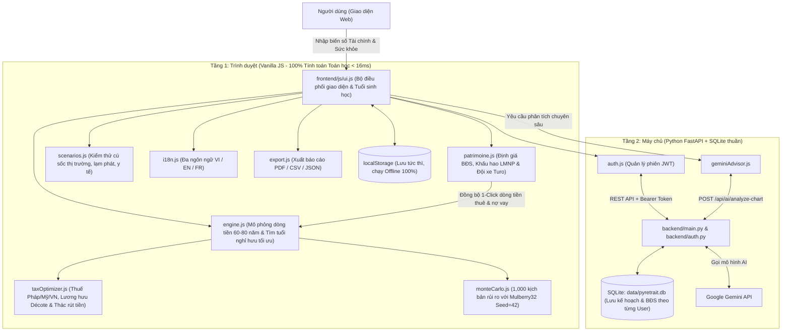

# Báo Cáo Nghiên Cứu Hệ Thống & Đánh Giá Mô Hình Dự Án pyRetrait

Tài liệu này tổng hợp kết quả nghiên cứu chuyên sâu về mã nguồn của dự án **pyRetrait**, tập trung vào hai trọng tâm lớn:
1. **Kiến trúc tổng thể của hệ thống** xoay quanh mục tiêu cốt lõi: giúp người dùng nhìn rõ bức tranh tương lai về cả **Tài chính** lẫn **Sức khỏe** để đưa ra quyết định chính xác **bao giờ nên nghỉ hưu**.
2. **Hệ thống các biến số người dùng** mà ứng dụng đang thu thập, kèm theo phân tích chuyên môn về **những biến số còn thiếu** để mô hình chính xác hơn và **những điểm phi thực tế hoặc chưa logic** đang tồn tại trong thuật toán hiện tại.

---

## Phần 1: Mục Tiêu Cốt Lõi & Kiến Trúc Hệ Thống

### 1.1. Tầm Nhìn & Mục Tiêu Của Dự Án
Hầu hết các công cụ lập kế hoạch nghỉ hưu truyền thống chỉ trả lời câu hỏi *"Khi nào tôi có đủ tiền?"* mà bỏ quên câu hỏi quan trọng không kém: *"Lúc có đủ tiền thì cơ thể tôi còn đủ khỏe mạnh để tận hưởng cuộc sống tự do đó hay không?"*.

**pyRetrait** được xây dựng để giải quyết bài toán kép này (đặc biệt tối ưu cho cộng đồng người Việt tại Pháp, châu Âu, Mỹ và Việt Nam):
- **Bức tranh Tài chính (Financial Lifespan)**: Mô phỏng dòng tiền từng năm từ tuổi đi làm (18 tuổi) đến cuối đời (85–110 tuổi), kết hợp thu nhập chủ động, bất động sản cho thuê (LMNP), đội xe Turo, lương hưu nhà nước (Pháp CNAV/Agirc-Arrco & BHXH Việt Nam), tối ưu thuế lũy tiến và kiểm thử rủi ro thị trường qua 1,000 kịch bản Monte Carlo.
- **Bức tranh Sức khỏe (Healthspan & Longevity)**: Đo lường tuổi sinh học thực tế (Biological Age), dự báo số năm sống khỏe mạnh tự lập (Healthspan) so với tuổi thọ tổng thể (Lifespan), từ đó lượng hóa **Khoảng cách suy yếu cuối đời (Healthspan Gap)** và dự trù ngân sách y tế, tầm soát bệnh lý cũng như chi phí an dưỡng tuổi già (viện dưỡng lão EHPAD tại Pháp so với điều dưỡng tại gia ở Việt Nam).
- **Điểm hội tụ — Quyết định "Bao giờ nên nghỉ hưu?"**: Giúp người dùng tìm ra **Tuổi nghỉ hưu tối ưu (`optimalFireAge`)** — thời điểm sớm nhất mà tài sản tích lũy đủ vượt qua mọi biến cố thị trường và bệnh tật, đồng thời người dùng vẫn đang ở giai đoạn sung sức nhất của cuộc đời để tận hưởng tự do.

---

### 1.2. Kiến Trúc Kỹ Thuật (Local-First & Cloud Multi-Tenant Sync)

Dự án áp dụng kiến trúc **Local-First (Ưu tiên xử lý cục bộ trên trình duyệt)** kết hợp với **Đồng bộ Đám mây Đa người dùng (Cloud Sync)**:



#### Phân tách trách nhiệm các thành phần cốt lõi:
1. **Tầng Frontend (`frontend/`) — Không dùng Framework (100% Vanilla JS + Chart.js)**:
   - [`engine.js`](file:///Users/canhhung/Documents/pyRetrait/frontend/js/engine.js): Trái tim của hệ thống. Chạy vòng lặp từng năm tuổi, cân đối thu – chi – tiết kiệm – nợ vay, áp dụng 4 chiến lược rút tiền, kiểm tra lưới an toàn 3 biến cố (`evaluateStressResilience`) và duyệt tìm tuổi nghỉ hưu tối ưu (`findOptimalRetirementAge`).
   - [`monteCarlo.js`](file:///Users/canhhung/Documents/pyRetrait/frontend/js/monteCarlo.js): Bộ mô phỏng xác suất 1,000 kịch bản biến động thị trường bằng thuật toán sinh số giả ngẫu nhiên xác định **Mulberry32 (Seed = 42)** kết hợp biến đổi chuẩn Box-Muller, đảm bảo kết quả phân vị P10, P50, P90 nhất quán 100% trên mọi thiết bị.
   - [`patrimoine.js`](file:///Users/canhhung/Documents/pyRetrait/frontend/js/patrimoine.js): Quản lý danh mục bất động sản cho thuê tại Pháp (LMNP), lịch trả góp ngân hàng, điểm hòa vốn (Break-Even) và lợi nhuận đội xe cho thuê Turo.
   - [`taxOptimizer.js`](file:///Users/canhhung/Documents/pyRetrait/frontend/js/taxOptimizer.js): Tính thuế thu nhập lũy tiến (Pháp IR 2024, Mỹ, Việt Nam), lương hưu Pháp theo cải cách 2023 (172 quý, phạt décote), và mô phỏng thứ tự rút vốn ưu đãi thuế (Livret A ➔ Assurance-Vie ➔ PEA ➔ CTO).
   - [`ui.js`](file:///Users/canhhung/Documents/pyRetrait/frontend/js/ui.js): Quản lý toàn bộ trạng thái giao diện, vẽ biểu đồ tương tác Chart.js, chuyển đổi tiền tệ (EUR ↔ VND ↔ USD), và chứa trực tiếp bộ tính **Tuổi sinh học (`updateBioAge`)** cùng **Điểm tuổi thọ khỏe mạnh (`updateHealthspanScore`)**.
   - [`i18n.js`](file:///Users/canhhung/Documents/pyRetrait/frontend/js/i18n.js), [`scenarios.js`](file:///Users/canhhung/Documents/pyRetrait/frontend/js/scenarios.js), [`geminiAdvisor.js`](file:///Users/canhhung/Documents/pyRetrait/frontend/js/geminiAdvisor.js), [`auth.js`](file:///Users/canhhung/Documents/pyRetrait/frontend/js/auth.js), [`export.js`](file:///Users/canhhung/Documents/pyRetrait/frontend/js/export.js): Đảm nhiệm đa ngôn ngữ, kịch bản giả định, tư vấn AI, xác thực và xuất dữ liệu.

2. **Tầng Backend (`backend/`) — Tinh gọn, Bảo mật & Không chứa logic tính toán tài chính**:
   - [`backend/main.py`](file:///Users/canhhung/Documents/pyRetrait/backend/main.py) & [`backend/auth.py`](file:///Users/canhhung/Documents/pyRetrait/backend/auth.py): Sử dụng Python FastAPI và `sqlite3` thuần (không dùng ORM). Mật khẩu người dùng được băm bằng `PBKDF2-HMAC-SHA256` với 100,000 vòng lặp và muối ngẫu nhiên (salt 32 bytes). Backend chỉ lưu trữ dữ liệu JSON thô của kế hoạch và đóng vai trò cầu nối (proxy) gọi Google Gemini API để phân tích biểu đồ.

---

## Phần 2: Các Biến Số Của Người Dùng Mà Web Đang Thu Thập

Để xây dựng bức tranh tương lai, ứng dụng hiện đang thu thập **7 nhóm biến số đầu vào** từ người dùng:

### 2.1. Nhóm biến Nhân khẩu học & Mốc thời gian cốt lõi
| Tên biến trong code | Nhãn hiển thị trên Web | Ý nghĩa & Vai trò trong mô hình |
| :--- | :--- | :--- |
| `birthYear` / `currentAge` | Năm sinh / Tuổi hiện tại | Xác định điểm xuất phát của dòng thời gian dự báo và tính tuổi của con cái theo năm lịch. |
| `retirementAge` | Tuổi nghỉ hưu | Thời điểm ngừng thu nhập lương chính và bắt đầu kích hoạt rút vốn từ danh mục đầu tư. |
| `lifeExpectancy` | Kỳ vọng tuổi thọ | Điểm kết thúc của mô phỏng (mặc định 85 tuổi). Quyết định độ dài kỳ nghỉ hưu (`Horizon`) và hệ số nhân an toàn (25x, 28x hay 30x). |
| `startWorkAge` | Tuổi bắt đầu đi làm | Dùng để tính tổng số quý đóng bảo hiểm hưu trí tại Pháp (`trimestres = (retireAge - startWorkAge) * 4`). |

### 2.2. Nhóm biến Tài sản, Danh mục đầu tư & Tài khoản Pháp
| Tên biến trong code | Nhãn hiển thị trên Web | Ý nghĩa & Vai trò trong mô hình |
| :--- | :--- | :--- |
| `currentSavings` | Tài sản ròng đầu tư hiện có | Số vốn thanh khoản ban đầu tại tuổi hiện tại để bắt đầu tính lãi kép. |
| `actualRecords[]` | Nhật ký Số dư Thực tế | Mảng lưu `{date, amount, note}` để vẽ đường tài sản thực tế đối chiếu sai số với đường dự báo. |
| `assetAllocation` | Phân bổ Danh mục (%) | Tỷ trọng 4 lớp tài sản: Cổ phiếu (`stocks` - lợi suất 9.5%), Trái phiếu (`bonds` - 3.5%), BĐS/Vàng (`realEstate` - 6.5%), Tiền mặt (`cash` - 1.5%), cộng thưởng kỷ luật tái cân bằng (+0.3%/năm). |
| `frenchAccounts` | Số dư PEA, Assurance-Vie, Livret A | Số dư từng loại tài khoản ưu đãi thuế tại Pháp (`peaBalance`, `assuranceVieBalance`, `livretABalance`, `ctoBalance`) phục vụ bài toán tối ưu thứ tự rút tiền. |

### 2.3. Nhóm biến Thu nhập Chủ động, Thụ động & Lương hưu (Pháp – Việt)
| Tên biến trong code | Nhãn hiển thị trên Web | Ý nghĩa & Vai trò trong mô hình |
| :--- | :--- | :--- |
| `incomes[]` | Các Luồng Thu nhập | Danh sách nguồn thu gồm: Tên (`name`), Số tiền/năm (`amount`), Tuổi bắt đầu (`startAge`), Tuổi kết thúc (`endAge`), Tốc độ tăng trưởng hàng năm (`growth` %/năm). |
| `enableFrenchPension`, `socialSecurityAge`, `socialSecurityAnnual` | Lương hưu Pháp (CNAV + Agirc-Arrco) | Tuổi bắt đầu nhận lương hưu (mặc định 64 tuổi) và mức lương hưu cơ sở khi đóng đủ 172 quý (43 năm). Tự động tính tỷ lệ hưởng thực tế (`prorata`) và mức phạt nghỉ sớm (`décote` -1.25%/quý thiếu trước 67 tuổi). |
| `chk-enable-bhxh-vn`, `sel-calc-bhxh-income`, `sel-calc-bhxh-years` | Lương hưu BHXH Tự nguyện Việt Nam | Mức thu nhập chọn đóng (5–30 triệu ₫/tháng), số năm đóng (15, 20, 25 năm theo Luật BHXH 2024), tuổi bắt đầu đóng và tuổi nhận lương hưu kèm thẻ BHYT 95%. |

### 2.4. Nhóm biến Bất động sản cho thuê (LMNP) & Đội xe Turo (`patrimoine.js`)
| Tên biến trong code | Nhãn hiển thị trên Web | Ý nghĩa & Vai trò trong mô hình |
| :--- | :--- | :--- |
| `property_category`, `typology`, `surface`, `dpe_rating` | Hình thức BĐS, Phân hạng, Diện tích, DPE | Phân biệt **Căn hộ chung cư (`apartment`)** và **Nhà mặt đất (`house`)** để áp dụng 2 công thức định giá tài sản khác nhau theo thời gian. |
| `start_year`, `property_price`, `notary_fees`, `renovation_cost`, `furniture_cost` | Năm mua, Giá mua, Phí công chứng, Cải tạo, Nội thất | Xác định tổng chi phí dự án (`total_project_cost`) và số vốn vay ngân hàng. |
| `down_payment_input`, `loan_duration`, `annual_interest_rate`, `annual_insurance_rate`, `monthly_loan_payment` | Vốn tự có, Thời hạn vay, Lãi suất, Bảo hiểm vay, Trả góp thực tế | Tính lịch trả góp hàng tháng, dư nợ gốc giảm dần và vốn chủ sở hữu (`homeEquity`) qua từng năm. |
| `monthly_rent`, `vacancy_pct`, `annual_mgmt_pct`, `annual_tf`, `annual_coop`, `annual_pno`, `annual_maintenance` | Giá thuê, Phòng trống, Phí quản lý, Thuế đất TF, Phí Coop, Bảo hiểm PNO, Bảo trì | Tính dòng tiền ròng 2 pha: **Pha 1 (Đang trả nợ vay)** và **Pha 2 (Sau khi tất toán nợ - dòng tiền thụ động thuần cho FIRE)**. |
| `turo` (`num_cars`, `price`, `gross_gain`, `decote`, `insurance`, `repairs`, `holding_years`) | Đội xe Turo cho thuê | Tính dòng tiền ròng sau thuế micro-BIC (15%) và giá trị thanh lý đội xe sau thời gian khai thác. |

### 2.5. Nhóm biến Chi tiêu, Gia đình, Y tế tuổi già & Cột mốc cuộc đời
| Tên biến trong code | Nhãn hiển thị trên Web | Ý nghĩa & Vai trò trong mô hình |
| :--- | :--- | :--- |
| `retirementExpenses` & `rad-retire-location` | Chi tiêu/tháng khi về hưu & Địa điểm PPP | Mức chi tiêu cơ sở tại Pháp và hệ số quy đổi ngang giá sức mua theo nơi nghỉ hưu: **Pháp (`1.00x`)**, **Song hành Pháp – Việt (`0.70x`)**, **Việt Nam (`0.45x`)**. |
| `spendingPhases` (`gogoAge`, `gogoFactor`, `slowgoAge`, `slowgoFactor`, `nogoFactor`) | Mô hình Chi tiêu 3 Giai đoạn (Spending Smile) | Điều chỉnh chi tiêu hưu trí theo sức khỏe và tuổi tác: **Go-Go** (mặc định đến 60t, hệ số `1.15x`), **Slow-Go** (60–75t, hệ số `0.90x`), **No-Go** (sau 75t, hệ số `0.80x`). |
| `familyPlan` (`kidsCount`, `kid1Birth`..`kid4Birth`, `kidCostMonthly`, `kidUniMonthly`) | Kế hoạch Con cái & Gia đình | Tự động cộng chi phí nuôi con (0–18 tuổi), chi phí học đại học (18–23 tuổi) và đối trừ trợ cấp gia đình CAF tại Pháp (khi có từ 2 con trở lên). |
| `seniorCareAge`, `seniorCareMonthly` | Dự phòng Chăm sóc Tuổi Già (78t+) | Ngân sách y tế, điều dưỡng tại nhà hoặc viện dưỡng lão kích hoạt từ tuổi 78 trở đi. |
| `expenses[]` | Các Luồng Chi tiêu & Nợ vay | Các khoản chi cố định hoặc trả nợ ngân hàng theo độ tuổi bắt đầu/kết thúc, tự động chấm dứt khi tất toán nợ (`isDebt: true`). |
| `milestones[]` & `targetLegacy` | Sự kiện Cột mốc Cuộc đời & Mục tiêu Di sản | Các khoản thu/chi đột xuất một lần tại một độ tuổi cụ thể (mua nhà, thừa kế...) và mục tiêu tài sản để lại cho con cháu ở tuổi cuối đời. |

### 2.6. Nhóm biến Vĩ mô, Chiến lược Rút tiền & Thuế
| Tên biến trong code | Nhãn hiển thị trên Web | Ý nghĩa & Vai trò trong mô hình |
| :--- | :--- | :--- |
| `inflationRate` & `dualInflation` (`inflationPre`, `inflationPost`, `eurVndInitialRate`, `eurVndAnnualDrift`) | Lạm phát bình quân & Lạm phát 2 chặng EUR/VND | Mô phỏng tốc độ trượt giá chi tiêu trước/sau nghỉ hưu và dự phóng tỷ giá EUR/VND trong tương lai. |
| `withdrawalStrategy` & `initialWithdrawalRate` | Chiến lược Rút tiền & Tỷ lệ rút khởi điểm (SWR %) | Chọn 1 trong 4 thuật toán rút tiền: **Guyton-Klinger (Lan can động)**, **Bengen 4%**, **VPW (Thay đổi theo tuổi thọ)**, **Fixed %**. |
| `taxRegime` | Chế độ Thuế | Lựa chọn hệ thống thuế: `france_vietnam` (Biểu thuế lũy tiến Pháp IR 2024), `us` (Federal Tax Mỹ), hoặc `international` (Thuế suất phẳng tùy chỉnh). |

### 2.7. Nhóm biến Sức khỏe, Chỉ số Sinh học & Lối sống (Tab Sức khỏe & Y tế dự phòng)
| Tên biến trong code | Nhãn hiển thị trên Web | Ý nghĩa & Vai trò trong mô hình |
| :--- | :--- | :--- |
| `sel-bio-rhr` | 1. Nhịp tim nghỉ (RHR) | Đánh giá sức bền tim mạch (`<60 bpm`: -1.5 tuổi sinh học; `60-70`: 0; `71-80`: +1.0; `>80`: +2.5 tuổi). |
| `sel-bio-bp` | 2. Huyết áp tâm thu | Đánh giá sức khỏe mạch máu (`<120 mmHg`: -1.5 tuổi; `120-129`: +0.5; `130-139`: +1.5; `>=140`: +3.0 tuổi). |
| `sel-bio-whtr` | 3. Tỷ lệ Vòng eo / Chiều cao | Đánh giá mỡ nội tạng & kháng insulin (`<0.5`: -1.5 tuổi; `0.5-0.59`: +1.0; `>=0.6`: +2.5 tuổi). |
| `sel-bio-strength` | 4. Sức mạnh nắm tay / Hít đất | Đánh giá khối lượng cơ bắp (`>20 cái`: -1.5 tuổi; `10-20 cái`: 0; `<10 cái`: +2.0 tuổi). |
| `chk-habit-exercise`, `chk-habit-sleep`, `chk-habit-diet`, `chk-habit-checkup`, `chk-habit-social` | 5 Trụ cột Lối sống Vàng | Tập luyện, Ngủ 7–8h, Ăn giảm viêm, Tầm soát định kỳ, Gắn kết xã hội. Mỗi thói quen cộng thêm `+1.5 năm` vào kỳ vọng sống khỏe (`Healthspan`). |
| `chk-cross-vitale`, `chk-cross-cfe`, `chk-cross-ordonnance`, `chk-cross-espace`, `chk-cross-tiers` | Danh mục Y tế Xuyên biên giới Pháp – Việt | Theo dõi tiến độ chuẩn bị hồ sơ bảo hiểm y tế khi nghỉ hưu song hành giữa Pháp và Việt Nam. |

---

## Phần 3: Những Biến Số Còn Thiếu Để Mô Hình Chính Xác Hơn

Dựa trên mục tiêu giúp người dùng nhìn rõ tương lai **Tài chính + Sức khỏe** để quyết định thời điểm nghỉ hưu, hệ thống hiện tại đang thiếu **8 biến số quan trọng** sau đây:

### 3.1. Các biến còn thiếu về Sức khỏe & Nhân khẩu học Y khoa
1. **Giới tính sinh học (`gender`: Nam / Nữ)**:
   - **Tại sao cần thiết?**: Giới tính tác động trực tiếp đến cả 2 trụ cột:
     - *Về mặt hưu trí (BHXH Việt Nam)*: Theo Luật BHXH 2024, cùng đóng 15 năm nhưng lao động Nữ được hưởng **45%**, trong khi lao động Nam chỉ được hưởng **40%** mức bình quân thu nhập đóng. Tuổi nghỉ hưu chuẩn tại Việt Nam của Nam (62 tuổi) và Nữ (60 tuổi) cũng khác nhau.
     - *Về mặt sức khỏe & tuổi thọ*: Tuổi thọ trung bình của nữ giới cao hơn nam giới 4–6 năm, nhưng tỷ lệ cần chăm sóc dài hạn cuối đời lại cao hơn. Ngoài ra, tiêu chuẩn đánh giá sức mạnh cơ bắp (như số cái hít đất `>20 cái`) cần phân tách theo giới tính để tránh chấm điểm bất công cho người dùng nữ.
2. **Tiền sử bệnh lý nền cá nhân & Di truyền gia đình (`medicalHistory` & `familyLongevity`)**:
   - **Tại sao cần thiết?**: 4 chỉ số lâm sàng hiện tại (nhịp tim, huyết áp, vòng eo, hít đất) mới chỉ phản ánh thể trạng tức thời. Nếu người dùng có bệnh nền mạn tính (tiểu đường tuýp 2, hen suyễn, bệnh tuyến giáp, thoát vị đĩa đệm) hoặc gia đình có tiền sử bệnh tim mạch/ung thư sớm, ngân sách y tế định kỳ và tuổi thọ kỳ vọng cần được hiệu chỉnh sát thực tế hơn.
3. **Tình trạng Hút thuốc lá, Rượu bia & Mức độ Căng thẳng nghề nghiệp (`smokingStatus`, `workStressLevel`)**:
   - **Tại sao cần thiết?**: Hút thuốc lá làm giảm trung bình 7–10 năm tuổi thọ khỏe mạnh. Đặc biệt, biến số **Mức độ kiệt sức / áp lực công việc (Burnout Level)** là chất xúc tác lớn nhất khiến một người muốn nghỉ hưu sớm hoặc chuyển sang nghỉ hưu bán thời gian (Barista FIRE / Coast FIRE).
4. **Cấu trúc Bảo hiểm Y tế đang sở hữu (`healthInsuranceType`, `annualPremium`, `copayRate`)**:
   - **Tại sao cần thiết?**: Khi nghỉ hưu sớm (ví dụ ở tuổi 42 tại Việt Nam hoặc Pháp), người dùng không còn được công ty đóng bảo hiểm sức khỏe cao cấp. Chi phí tự mua bảo hiểm y tế quốc tế (như CFE + Mutuelle hoặc bảo hiểm sức khỏe tư nhân Bảo Việt, Dai-ichi, April) tăng theo cấp số nhân ở các mốc tuổi 50, 60, 70. Cần biến số thu thập gói bảo hiểm và mức trần chi trả nội trú để biết cú sốc y tế có thực sự làm hao hụt tài sản hay đã có bảo hiểm gánh đỡ.

### 3.2. Các biến còn thiếu về Tài chính, Gia đình & Thuế
5. **Tình trạng hôn nhân & Số phần tính thuế hộ gia đình Pháp (`maritalStatus`, `taxParts` / `Quotient Familial`)**:
   - **Tại sao cần thiết?**: Tại Pháp, thuế thu nhập cá nhân (IR) không tính theo cá nhân riêng lẻ mà tính theo **Hộ gia đình thuế (`Foyer Fiscal`)** chia cho số phần (`Parts fiscales`: Độc thân = 1 part, Vợ chồng = 2 parts, 2 con đầu mỗi con +0.5 part, từ con thứ 3 mỗi con +1.0 part). Thiếu biến này khiến mô hình tính thuế cho người đã lập gia đình bị sai lệch rất lớn.
6. **Thông số của Người phối ngẫu (`spouseAge`, `spouseIncome`, `spousePension`)**:
   - **Tại sao cần thiết?**: Quyết định nghỉ hưu trong thực tế hầu như luôn là quyết định của cả hai vợ chồng. Rất nhiều trường hợp một người nghỉ hưu sớm ở tuổi 42 nhưng người kia vẫn tiếp tục đi làm đến 50 tuổi (giúp duy trì bảo hiểm y tế gia đình và dòng tiền đệm).
7. **Giá vốn gốc (`costBasis`) và Ngày mở tài khoản của `PEA`, `Assurance-Vie`, `CTO`**:
   - **Tại sao cần thiết?**: Thuế lãi vốn tại Pháp chỉ đánh trên **phần tiền lãi sinh ra (Plus-value)**, hoàn toàn không đánh trên phần vốn gốc nạp vào. Bên cạnh đó, cần biết số năm đã mở tài khoản (PEA đã đủ 5 năm chưa, Assurance-Vie đã đủ 8 năm chưa) để kích hoạt đúng ưu đãi thuế theo dòng thời gian.
8. **Lộ trình dịch chuyển tài sản an toàn theo tuổi (`glidePath` / Phân bổ danh mục sau nghỉ hưu)**:
   - **Tại sao cần thiết?**: Khi còn trẻ (30 tuổi), nhà đầu tư có thể giữ 80% cổ phiếu. Nhưng khi đã 70 tuổi, việc giữ nguyên 80% cổ phiếu là quá rủi ro. Cần có biến cho phép thiết lập tỷ lệ phân bổ tài sản riêng cho giai đoạn sau nghỉ hưu (hoặc tự động giảm dần tỷ trọng cổ phiếu khi tuổi tăng lên).

---

## Phần 4: Phân Tích Phản Biện — Những Điểm Phi Thực Tế & Chưa Logic Trong Mô Hình Hiện Tại

Qua kiểm tra chi tiết mã nguồn tại [`engine.js`](file:///Users/canhhung/Documents/pyRetrait/frontend/js/engine.js), [`monteCarlo.js`](file:///Users/canhhung/Documents/pyRetrait/frontend/js/monteCarlo.js), [`taxOptimizer.js`](file:///Users/canhhung/Documents/pyRetrait/frontend/js/taxOptimizer.js), [`patrimoine.js`](file:///Users/canhhung/Documents/pyRetrait/frontend/js/patrimoine.js) và [`ui.js`](file:///Users/canhhung/Documents/pyRetrait/frontend/js/ui.js), dưới đây là **7 điểm bất hợp lý và thiếu kết nối logic** cần được lưu ý và khắc phục:

### 4.1. Sự Đứt Gãy Hoàn Toàn Giữa Mô Hình Sức Khỏe (`ui-tab2-health.js`) Và Mô Hình Tài Chính (`engine.js`)
- **Hiện trạng trong code**:
  - Tại [`ui-tab2-health.js` (dòng 89–291)](file:///Users/canhhung/Documents/pyRetrait/frontend/js/ui-tab2-health.js#L89-L291), hàm `updateBioAge()` và `updateHealthspanScore()` thu thập 4 chỉ số sinh học và 5 thói quen sống để tính ra `Tuổi sinh học (bioAge)` và `Tuổi thọ khỏe mạnh dự kiến (estimatedHealthspan)`, cũng như chia thanh trạng thái thành 3 giai đoạn: *Khỏe mạnh*, *Chuyển tiếp* và *Phụ thuộc*.
  - Tuy nhiên, toàn bộ kết quả tính toán này **chỉ dừng lại ở việc đổi chữ hiển thị trên Tab Sức khỏe**, hoàn toàn **không được lưu vào dữ liệu kế hoạch (`plan`)** và **không hề truyền sang [`engine.js`](file:///Users/canhhung/Documents/pyRetrait/frontend/js/engine.js)**!
- **Tại sao chưa logic & phi thực tế?**:
  - Dù một người dùng khai báo sức khỏe rất yếu (huyết áp độ 2, nhịp tim > 80, béo bụng, không tập thể dục ➔ `estimatedHealthspan` giảm xuống chỉ còn **66 tuổi**), thì bên mô hình tài chính [`engine.js`](file:///Users/canhhung/Documents/pyRetrait/frontend/js/engine.js#L698-L716):
    1. Quỹ chăm sóc tuổi già (`seniorCareAge`) vẫn mặc định đợi đến năm **78 tuổi** mới kích hoạt, bỏ trống 12 năm bệnh tật (từ 66 đến 78 tuổi) không có dự phòng chi phí y tế!
    2. Mô hình chi tiêu 3 giai đoạn (`Spending Smile`) vẫn giữ nguyên mốc tuổi cố định mà không tự động co ngắn giai đoạn ăn chơi du lịch (`Go-Go`) theo mốc suy giảm sức khỏe thực tế (`estimatedHealthspan`).
    3. Thuật toán tìm `Tuổi nghỉ hưu tối ưu (`findOptimalRetirementAge`)` chỉ nhìn vào con số tài sản và xác suất Monte Carlo, chưa hề cảnh báo nếu người dùng chọn tuổi nghỉ hưu quá muộn (ví dụ nghỉ hưu ở tuổi 65 trong khi tuổi thọ khỏe mạnh chỉ đến 68 tuổi — tức là chỉ còn đúng 3 năm khỏe mạnh để tận hưởng thành quả lao động!).

---

### 4.2. Sự Bất Nhất Nghiêm Trọng Giữa Engine Dòng Tiền Chính (`engine.js`) Và Mô Phỏng Monte Carlo (`monteCarlo.js`)
- **Hiện trạng trong code**:
  - [`engine.js`](file:///Users/canhhung/Documents/pyRetrait/frontend/js/engine.js#L640-L999) tính toán dòng tiền vô cùng chi tiết: có trừ thuế thu nhập lũy tiến, có chi phí nuôi con và học đại học (`familyPlan`), có quỹ chăm sóc tuổi già (`seniorCareCost`), có lịch trả nợ vay (`activeDebtsSum`), có các cột mốc mua nhà/thừa kế (`milestones`), có mô hình chi tiêu `Spending Smile` và lạm phát 2 chặng (`dualInflation`).
  - Thế nhưng khi sang [`monteCarlo.js` (dòng 73–125)](file:///Users/canhhung/Documents/pyRetrait/frontend/js/monteCarlo.js#L73-L125) để chạy 1,000 kịch bản tính xác suất thành công (`successRate`), thuật toán lại dùng một công thức rút gọn sơ sài và **bỏ qua toàn bộ các biến trên**:
    - Giai đoạn đi làm (`age < retireAge`): Chỉ cộng `annualSavings` cố định, bỏ qua biến động thu nhập thực tế, bỏ qua thuế, bỏ qua chi phí nuôi con và bỏ qua các cột mốc mua nhà/trả nợ.
    - Giai đoạn nghỉ hưu (`age >= retireAge`): Chỉ lấy `effectiveRetireExpenses * cumInflation`, hoàn toàn **không cộng** chi phí con học đại học, **không cộng** chi phí chăm sóc tuổi già 78t+, **không cộng** các khoản nợ vay chưa trả xong, và **không áp dụng** hệ số `Spending Smile`!
- **Hệ quả thực tế**:
  - Khi người dùng thêm một cột mốc *"Mua nhà 100.000 € ở tuổi 35"* hoặc *"Nuôi 3 người con học đại học"*, biểu đồ đường chính (`engine.js`) tụt giảm mạnh hoặc báo cạn tiền, nhưng con số **Tỷ lệ thành công Monte Carlo** ở thanh bên trái vẫn báo **95% – 100% thành công** vì `monteCarlo.js` không hề biết đến sự tồn tại của các khoản chi đó!

---

### 4.3. Nghịch Lý Kinh Tế Học: "Lấy Lạm Phát Tiền Đồng (VND 4%) Nhân Kép Cho Đồng Euro (€)"
- **Hiện trạng trong code**:
  - Trong [`engine.js` (dòng 645–654 và 781)](file:///Users/canhhung/Documents/pyRetrait/frontend/js/engine.js#L645-L654), mọi tính toán nội bộ của kế hoạch Franco-Viet đều quy về đơn vị tiền tệ gốc là **EUR (€)**.
  - Khi người dùng bật "Lạm phát 2 chặng" (`inflationPre = 2.2%` ở Pháp, `inflationPost = 4.0%` khi về Việt Nam), kể từ năm nghỉ hưu trở đi, hệ thống gán `currentInflation = 4.0%` và nhân tích lũy vào `cumInflation`. Sau đó, chi phí sinh hoạt tính bằng đồng EUR bị nhân với `cumInflation` (tức là tăng **4.0%/năm bằng đồng EUR**).
  - Đồng thời, ở dòng 654, tỷ giá `currentEurVndRate` lại tiếp tục được nhân trượt giá thêm `+1.2%/năm` (`forexDrift`).
- **Tại sao phi thực tế (Lỗi tính trùng lạm phát - Double Counting)?**:
  - Theo quy luật Ngang giá sức mua (Purchasing Power Parity - PPP) và hiệu ứng Fisher quốc tế: Sở dĩ tỷ giá EUR/VND tăng ~1.2% – 1.8%/năm là **bởi vì** lạm phát của VND (4.0%) cao hơn lạm phát của EUR (2.2%).
  - Một bát phở hay chi phí sinh hoạt tại Việt Nam tăng giá 4.0%/năm là tăng theo **đồng VND**. Khi quy đổi sang **đồng EUR** (vốn đã mạnh lên 1.5%/năm so với VND), thì chi phí sinh hoạt tại Việt Nam tính bằng đồng EUR chỉ tăng khoảng `4.0% - 1.5% = 2.5%/năm`.
  - Việc lấy lạm phát 4.0% của VND áp trực tiếp lên số tiền EUR, rồi khi hiển thị sang VND lại nhân thêm tỷ giá trượt giá 1.2%/năm khiến chi phí tính bằng VND bị phình to thành `4.0% + 1.2% = 5.2%/năm`, làm mô hình đòi hỏi số tiền tiết kiệm bằng EUR cao hơn thực tế rất nhiều trong dài hạn.

---

### 4.4. Lỗi Logic Rút Tiền Khi Danh Mục Tăng Trưởng Mạnh ("Tiền Rút Thừa Tự Động Bốc Hơi")
- **Hiện trạng trong code**:
  - Tại [`engine.js` (dòng 934–939)](file:///Users/canhhung/Documents/pyRetrait/frontend/js/engine.js#L934-L939), khi người dùng bật Chiến lược rút tiền (`isStrategyActive = true`) và thu nhập thụ động nhỏ hơn chi tiêu (`deficit = currentExpenses - incomeAfterTax`), số tiền thực tế rút ra khỏi danh mục được tính bằng:
    ```
    actualWithdrawal = Math.min(portfolio, Math.max(withdrawalAmount, deficit))
    portfolio = Math.max(0, (portfolio - actualWithdrawal) * (1.0 + returnRate))
    ```
- **Tại sao chưa logic?**:
  - Giả sử ở tuổi 65, chi tiêu sinh hoạt thiếu hụt (`deficit`) chỉ cần rút **10.000 €** từ danh mục. Nhưng nhờ lãi kép hoặc chọn chiến lược VPW (rút theo tuổi thọ, tỷ lệ rút ở tuổi 75 là 8%), số tiền theo công thức chiến lược (`withdrawalAmount`) lên tới **60.000 €**.
  - Hàm `Math.max(withdrawalAmount, deficit)` sẽ ép rút đủ **60.000 €** ra khỏi danh mục đầu tư. Tuy nhiên, chi tiêu thực tế năm đó chỉ hết **10.000 €**, còn **50.000 € rút dư ra hoàn toàn biến mất** (không được cộng vào tiền mặt hay tái đầu tư sinh lời)!
  - Hệ quả là nếu người dùng bấm tắt nút "Chiến lược rút tiền", tài sản cuối đời lập tức tăng vọt lên hàng triệu Euro, còn khi bật "Chiến lược rút tiền" (đặc biệt là VPW hoặc Fixed %) thì tài sản bị hao hụt giả tạo do phần tiền rút vượt nhu cầu chi tiêu bị xóa sổ khỏi tổng tài sản.

---

### 4.5. Đánh Thuế Hai Lần Trên Lương Ròng (Net) & Thiếu Công Thức Giảm Trừ Gia Cảnh Pháp (`Quotient Familial`)
- **Hiện trạng trong code**:
  - Trong dữ liệu mẫu (`default_plans.json` và `DOCS_ARCHITECTURE.md`), nguồn thu nhập chính được đặt tên là `"Lương tại Pháp (Net après impôt)"` (nghĩa là lương thực nhận sau khi đã nộp thuế), hoặc trong modal thêm thu nhập ([`index.html` dòng 3348](file:///Users/canhhung/Documents/pyRetrait/frontend/index.html#L3348)) hướng dẫn người dùng nhập *"Thu nhập sau thuế (Net)"*.
  - Thế nhưng tại [`engine.js` (dòng 658–672 và 839–849)](file:///Users/canhhung/Documents/pyRetrait/frontend/js/engine.js#L839-L849), hệ thống cộng gộp toàn bộ mọi nguồn thu vào `annualIncome` (không hề kiểm tra cờ `stream.taxable` hay nguồn thu đó là Gross hay Net, cũng không tách riêng tiền thuê nhà LMNP vốn được miễn thuế nhờ khấu hao), rồi đem toàn bộ `annualIncome` đó đưa vào `TaxOptimizer.calculateProgressiveTax()` để **trừ thuế thu nhập cá nhân thêm một lần nữa**!
  - Đồng thời, trên giao diện thẻ Kế hoạch Con cái ([`index.html` dòng 1283](file:///Users/canhhung/Documents/pyRetrait/frontend/index.html#L1283)) có ghi rõ: *"Được bù đắp bởi Trợ cấp CAF Pháp và Giảm thuế Quotient Familial (tối đa ~3.518 €/năm)"*. Tuy nhiên, trong [`taxOptimizer.js` (dòng 63–86)](file:///Users/canhhung/Documents/pyRetrait/frontend/js/taxOptimizer.js#L63-L86), hàm tính thuế Pháp chỉ tính cứng cho `1 part` (độc thân), hoàn toàn **chưa chia thu nhập chịu thuế cho số phần gia đình (`nombre de parts`)** khi người dùng có vợ/chồng và con cái.

---

### 4.6. Mô Hình Thác Rút Tiền Pháp (`simulateWithdrawalWaterfall`) Không Cho Tài Khoản Tăng Trưởng Lãi Kép
- **Hiện trạng trong code**:
  - Trong [`engine.js` (dòng 553 và 941–946)](file:///Users/canhhung/Documents/pyRetrait/frontend/js/engine.js#L941-L946), biến `frenchAccs` (`livretABalance`, `assuranceVieBalance`, `peaBalance`, `ctoBalance`) được khởi tạo bằng số dư ở tuổi hiện tại (ví dụ năm 29 tuổi có tổng cộng 50.000 €).
  - Trong suốt các năm đi làm tích lũy (từ 29 đến 43 tuổi) và các năm nghỉ hưu, biến `portfolio` tổng thì được cộng tiết kiệm mới và nhân lãi kép 8%/năm, nhưng các số dư thành phần trong `frenchAccs` **đứng yên tuyệt đối, không được cộng tiền tiết kiệm mới và không được nhân lãi suất tăng trưởng hàng năm**!
  - Đến khi nghỉ hưu và gọi `simulateWithdrawalWaterfall(frenchAccs, actualWithdrawal)`, chỉ sau 2–3 năm rút tiền là số dư `Livret A`, `Assurance-Vie` và `PEA` (vốn giữ nguyên giá trị từ năm 29 tuổi) bị trừ về `0 €`, khiến toàn bộ số tiền rút trong 40 năm hưu trí còn lại bị đẩy hết vào `CTO` (chịu thuế 30%).
  - Ngoài ra, trong [`taxOptimizer.js` (dòng 417–438)](file:///Users/canhhung/Documents/pyRetrait/frontend/js/taxOptimizer.js#L417-L438), tỷ lệ lãi cấu thành trong tài khoản đang bị gán cứng (`0.40` cho Assurance-Vie, `0.45` cho PEA) thay vì tính động theo tỷ lệ `(Số dư hiện tại - Vốn gốc nạp vào) / Số dư hiện tại`.

---

### 4.7. Giả Định Khấu Hao Căn Hộ Chung Cư Tại Pháp Quá Khắc Nghiệt & Chưa Đồng Bộ Chi Phí Đại Tu
- **Hiện trạng trong code**:
  - Tại [`engine.js` (dòng 133–148)](file:///Users/canhhung/Documents/pyRetrait/frontend/js/engine.js#L133-L148) và [`patrimoine.js` (dòng 694–700)](file:///Users/canhhung/Documents/pyRetrait/frontend/js/patrimoine.js#L694-L700), mọi bất động sản phân loại là **Căn hộ chung cư (`apartment`)** có tỷ lệ điều chỉnh mặc định `0%` sẽ bị áp công thức:
    ```
    Phần Đất (20% giá mua): Tăng 2.0%/năm
    Phần Xác nhà (80% giá mua): Giảm tuyến tính 3%/năm trong 30 năm về mức sàn 10%
    ```
- **Tại sao chưa sát thực tế thị trường Pháp?**:
  - Theo công thức này, một căn hộ mua tại Pháp với giá `100.000 €` vào năm 2023, sau 30 năm (năm 2053) sẽ có:
    - Phần Đất = `20.000 € * (1.02)^30 = 36.227 €`
    - Phần Xác nhà = `80.000 € * 10% = 8.000 €`
    - Tổng giá trị danh nghĩa của căn hộ sau 30 năm tụt xuống chỉ còn **`44.227 €`** (mất 56% giá danh nghĩa, và nếu tính thêm lạm phát 2%/năm thì mất tới **76% giá trị thực**!).
  - Trong khi đó, ở chiều thu nhập, mô hình vẫn cho phép căn hộ này thu tiền thuê đều đặn (thậm chí tăng 1.5%/năm theo lạm phát suốt 50 năm) mà không cần chi phí trùng tu lớn.
  - **Thực tế kinh tế bất động sản**: Mô hình "xác nhà chung cư mất 90% giá trị sau 30 năm" chỉ đúng với một số chung cư chất lượng thấp không có quỹ bảo trì tại các thị trường mới nổi. Còn tại Pháp (nơi các tòa nhà chung cư 50–150 năm tuổi vẫn giao dịch sôi động và giữ giá theo lạm phát), chủ nhà bắt buộc phải đóng phí đồng sở hữu (`Charges de copropriété` và `Fonds de travaux Luật ALUR`) cùng các đợt trùng tu mặt tiền/mái nhà định kỳ 10–15 năm (`Ravalement de façade`) để duy trì giá trị công trình. Thay vì mặc định cho giá chung cư bốc hơi 56% sau 30 năm, mô hình nên cho phép chọn giữa *"Chung cư có bảo trì định kỳ (giữ giá theo lạm phát, trừ phí đại tu mỗi 12 năm)"* và *"Chung cư xuống cấp theo niên hạn"*.

---

## Phần 5: Tổng Kết & Khuyến Nghị Lộ Trình Nâng Cấp

Để **pyRetrait** thực sự trở thành một hệ thống hoạch định **Tài chính – Sức khỏe** hoàn chỉnh và chặt chẽ về mặt toán học, dự án nên ưu tiên nâng cấp theo 4 bước sau:

1. **Khớp nối trực tiếp Engine Sức khỏe vào Engine Tài chính (`Health-to-Wealth Coupling`)**:
   - Lưu các biến sức khỏe (`biomarkers`, `habits`, `gender`, `medicalHistory`) vào thẳng cấu trúc dữ liệu `plan` của người dùng.
   - Cho phép `estimatedHealthspan` (Tuổi thọ khỏe mạnh) tự động điều chỉnh mốc tuổi chuyển giao giữa các giai đoạn chi tiêu `Go-Go ➔ Slow-Go ➔ No-Go` và tự động dời mốc kích hoạt `Quỹ chăm sóc tuổi già (seniorCareAge)` về đúng năm bắt đầu suy giảm sức khỏe.
   - Bổ sung chỉ số **"Số năm tự do khỏe mạnh (`Healthy Retirement Years = estimatedHealthspan - retirementAge`)"** ngay trên thẻ Mục tiêu Độc lập để người dùng thấy rõ đánh đổi: *Đi làm thêm 1 năm thì có thêm bao nhiêu tiền, nhưng mất đi bao nhiêu phần trăm thời gian sống khỏe còn lại*.
2. **Đồng bộ hóa 100% logic giữa `monteCarlo.js` và `engine.js`**:
   - Cho `monteCarlo.js` gọi trực tiếp hàm tính dòng tiền năm của `engine.js` (với biến suất sinh lời ngẫu nhiên từng năm) thay vì viết một vòng lặp rút gọn riêng biệt, đảm bảo mọi khoản thuế, chi phí con cái, nợ vay và cột mốc cuộc đời đều được kiểm thử trong 1,000 kịch bản.
3. **Chuẩn hóa Kinh tế học Đa tiền tệ & Thuế Pháp**:
   - Sửa công thức lạm phát 2 chặng theo đúng nguyên lý ngang giá sức mua (không lấy lạm phát VND áp trực tiếp lên gốc tiền EUR khi đã tính trượt giá tỷ giá EUR/VND).
   - Bổ sung biến số phần thuế gia đình (`Quotient Familial` từ tình trạng hôn nhân + số con) và tôn trọng cờ `taxable` / phân biệt lương `Brut` vs `Net`.
4. **Sửa cơ chế Tái đầu tư và Tăng trưởng các tài khoản Pháp (`frenchAccounts`)**:
   - Đảm bảo khi rút tiền theo chiến lược (`withdrawalAmount > deficit`), phần tiền rút vượt quá chi tiêu thực tế hoặc là không cần rút ra khỏi danh mục, hoặc phải được giữ lại trong tài sản thanh khoản của người dùng thay vì bị xóa bỏ.
   - Cho các tài khoản `PEA`, `Assurance-Vie`, `Livret A` tăng trưởng theo lãi suất tương ứng qua từng năm trước khi tính thác rút tiền ưu đãi thuế.
