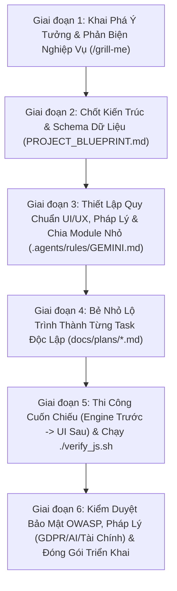

# Cẩm Nang Toàn Diện: Quy Trình Phát Triển App Bằng Antigravity (Tối Ưu Token, Kiến Trúc, Bảo Mật & Pháp Lý)

Tài liệu này là **cẩm nang hợp nhất duy nhất** của dự án `pyRetrait`, kết hợp giữa **Quy trình Kiến trúc Chuẩn (Blueprint & Spec-First)**, **Thói quen Tối ưu Token Thực chiến hàng ngày**, **Bảo mật Hạ tầng OWASP** và **Kiểm thử Tuân thủ Pháp lý Tự động (Legal, GDPR & AI Compliance-as-Code)**. Áp dụng đúng cẩm nang này giúp bạn **tiết kiệm từ 65% đến 85% lượng token tiêu thụ**, đồng thời **ngăn ngừa 95% lỗi hồi quy (regressions), ảo giác (hallucinations) và rủi ro pháp lý khi vận hành thực tế**.

---

## Phần I. Nguyên Lý Cốt Lõi: Vì Sao Token Bị Tiêu Tốn Nhanh?

1. **Hiệu Ứng Tuyết Lăn Của Ngữ Cảnh (Cumulative Context):**
   - Mỗi khi bạn gửi một tin nhắn mới, hệ thống không chỉ gửi riêng câu nói đó mà phải **đóng gói và gửi lại toàn bộ lịch sử từ đầu phiên chat**, bao gồm:
     - Quy tắc hệ thống (`.agents/rules/GEMINI.md`).
     - Toàn bộ các câu hỏi – đáp trước đó.
     - Lịch sử các công cụ đã chạy (`view_file`, `grep_search`, lệnh terminal).
     - Ảnh chụp màn hình từ Browser Subagent (mỗi ảnh ngốn hàng ngàn token).
   - **Hệ quả:** Ở lượt chat thứ 1, một câu lệnh ngắn chỉ tốn ~5.000 token. Nhưng đến lượt chat thứ 30, **cùng một câu lệnh 5 chữ ("sửa tiếp chỗ này") có thể ngốn 150.000 – 250.000 token** vì phải cõng toàn bộ lịch sử phía trước!

2. **Mò Mẫm Tìm Kiếm Trong File Khổng Lồ (Context Hunting):**
   - Trước đây `ui.js` từng dài hơn 8.200 dòng, nay đã được tách thành **bộ 6 file UI theo từng Tab độc lập** (`ui.js`, `ui-tab1-charts.js`, `ui-tab1-streams.js`, `ui-tab2-health.js`, `ui-tab3-taxes.js`, `ui-modals.js`) cùng với `frontend/index.html` (~4.614 dòng) và `frontend/css/styles.css` (~8.500+ dòng).
   - Kết hợp với bản đồ chỉ mục dòng code (`docs/CODEBASE_MAP.md`), mỗi lần bạn yêu cầu sửa 1 nút bấm hay 1 hàm ở Tab nào, AI chỉ cần mở đúng file của Tab đó và nhảy thẳng tới đúng 50–100 dòng cần sửa, giảm 90% token đọc file!

3. **Vòng Lặp Thử – Sai Mù Quáng & Gửi Tin Nhắn Vụn Vặt (Micro-Prompts):**
   - Yêu cầu code ngay khi chưa chốt thiết kế hoặc gửi liên tiếp 3–4 tin nhắn ngắn rời rạc (*"đổi chữ A"*, rồi lại *"xóa dòng B"*, rồi lại *"cho mục C xuống dòng"*) khiến AI phải nạp lại toàn bộ lịch sử 100k+ token nhiều lần liên tiếp.

---

## Phần II. Hệ Thống File Hạ Tầng Chống Đốt Token Của Dự Án

Dự án `pyRetrait` đã được trang bị sẵn 4 lớp bảo vệ token tự động:

| File hạ tầng | Vai trò bảo vệ Token |
| :--- | :--- |
| **`PROJECT_BLUEPRINT.md`** | Bản thiết kế gốc chứa toàn bộ mục tiêu, ràng buộc kỹ thuật và **Schema dữ liệu chuẩn (Tài chính + Sức khỏe + Bảo hiểm + BĐS)** để AI nắm ngay cấu trúc mà không cần đọc mò code. |
| **`docs/CODEBASE_MAP.md`** | **Bản đồ tọa độ dòng code (`StartLine` – `EndLine`) tự động 100%** của mọi hàm, thẻ HTML, phân mục CSS và khối từ điển trong bộ 6 file UI (`ui.js`, `ui-tab1-charts.js`, `ui-tab1-streams.js`, `ui-tab2-health.js`, `ui-tab3-taxes.js`, `ui-modals.js`), `index.html`, `styles.css`, `i18n.js`, `engine.js`, `patrimoine.js`, `taxOptimizer.js`, `monteCarlo.js`, `geminiAdvisor.js`. Giúp AI nhảy thẳng tới đúng 50–100 dòng cần sửa. |
| **`./verify_js.sh`** | **Công cụ kiểm thử & đồng bộ chỉ mục tự động (tốn 0 token cập nhật map, chạy 100% trong Sandbox):** Kiểm tra cú pháp 16 file JS, chạy thử công thức toán học và tự động quét lại số dòng mới vào `docs/CODEBASE_MAP.md` trong 0.15 giây mà không bao giờ cần AI sửa tay hay xin quyền ngoài Sandbox. |
| **`docs/plans/*.md`** | Thư mục chứa kế hoạch thực thi chia nhỏ thành từng Task độc lập (ví dụ: `docs/plans/upgrade_health_finance_model.md`) để chạy cuốn chiếu qua từng phiên chat mới. |
| **`.antigravityignore`** | Chặn công cụ tìm kiếm quét vào các file nhị phân SQLite (`*.db`), thư viện nén (`chart.umd.min.js` 205 KB), cache Python và dữ liệu JSON tạm. |

---

## Phần III. 10 Nguyên Tắc Vàng Trong Thao Tác Hàng Ngày (Dành Cho Bạn)

### 1. Nguyên Tắc "1 Nhiệm Vụ = 1 Phiên Chat Mới" (Quan Trọng Số 1)
- **Khi nào bắt buộc bấm `New Chat (+)`:**
  - Vừa hoàn thành xong 1 Task trong file kế hoạch hoặc sửa xong 1 bug lớn.
  - Chuẩn bị chuyển từ việc sửa thuật toán (`engine.js`) sang việc chỉnh giao diện (`index.html`, `styles.css`).
  - Phiên chat đã chạm ngưỡng **10 – 12 lượt đối thoại**.
- **Nếu đang làm dở việc mà hội thoại bắt đầu dài:** Hãy gõ lệnh `/compact` để AI tóm tắt gọn ngữ cảnh trước khi làm tiếp, giảm ngay 80–90% dung lượng bộ nhớ đệm.

### 2. Kỹ Thuật Gộp Yêu Cầu (Prompt Batching — Không Gửi Lắt Nhắt)
Thay vì gửi 3–4 tin nhắn ngắn nối tiếp nhau, hãy gom tất cả các chỉnh sửa giao diện/văn bản vào **1 danh sách đánh số duy nhất** rồi gửi 1 lần:

> **❌ Cách tốn gấp 3 lần token (Gửi 3 lượt rời rạc):**
> - Lượt 1: *"Xóa chữ (rút 4%/năm)..."*
> - Lượt 2: *"Đổi tiêu đề Cách Tính Mục Tiêu thành Điều Kiện..."*
> - Lượt 3: *"Mục 3 phải cùng cỡ chữ với mục 2 và xuống dòng..."*

> **✅ Cách chuẩn tiết kiệm token (Gom vào 1 lượt duy nhất):**
> *"Đọc `@docs/CODEBASE_MAP.md` và sửa trong `frontend/index.html` (khu vực Tab 1) các điểm sau:*
> *1. Đổi tiêu đề thẻ 'Cách Tính...' thành 'Điều Kiện...'*
> *2. Xóa các đoạn chữ '(rút 4%/năm)'*
> *3. Đổi chấm tròn '• Đạt chuẩn an toàn' thành '3. Đạt chuẩn an toàn', cùng cỡ chữ với mục 2 và ngắt dòng nội dung bên dưới."*

### 3. Luôn Đính Kèm Bản Đồ Dòng Code (`@docs/CODEBASE_MAP.md`) Khi Sửa File Lớn
- Khi cần sửa các file UI (`ui-tab1-charts.js`, `ui-tab1-streams.js`, `ui-tab2-health.js`, `ui-tab3-taxes.js`, `ui-modals.js`, `ui.js`), `styles.css` (8.500+ dòng), `index.html` (4.614 dòng), `patrimoine.js`, `engine.js` hoặc `i18n.js`, hãy nhắc tên hàm/thẻ hoặc đính kèm `@docs/CODEBASE_MAP.md`.
- AI sẽ tra cứu bảng tọa độ dòng để dùng `view_file` đọc đúng 80 dòng liên quan và dùng `replace_file_content` sửa trúng đích, tuyệt đối không đọc lan man hàng ngàn dòng.

### 4. Kiểm Soát Chặt `browser_subagent` — Ưu Tiên Kiểm Thử Bằng `./verify_js.sh`
> **Cảnh báo:** Một lần gọi `browser_subagent` mở trình duyệt, bấm qua lại và chụp 5 tấm ảnh màn hình sẽ tiêu tốn **40.000 – 90.000 token** (đắt gấp 10–15 lần một lượt sửa code!).

- **Cơ chế tự động đã khóa trong `.agents/rules/GEMINI.md`:**
  - AI **bị cấm tự ý bật `browser_subagent`** nếu bạn không yêu cầu rõ trong câu lệnh.
  - Thay vào đó, dự án đã được trang bị sẵn công cụ **`./verify_js.sh`** (tương thích 100% với Sandbox nội bộ của macOS): kiểm tra cú pháp toàn bộ 16 file JS, chạy thử công thức toán học và tự động cập nhật `docs/CODEBASE_MAP.md` trong **0.15 giây**, chỉ tốn **~150 token**!
- **Khi thực sự cần dùng Browser Subagent (kiểm tra lỗi bố cục phức tạp hoặc đồ thị):**
  - Bạn chỉ cần thêm cụm từ *"kiểm tra bằng browser"* vào cuối câu lệnh.
  - AI sẽ chỉ kiểm tra trên ngôn ngữ mặc định (**Tiếng Việt `vi`**), chụp đúng 1 ảnh rồi đóng ngay.

### 5. Đóng Bớt Các Tab File Lớn Không Dùng Đến Trên Editor
- Antigravity tự động đính kèm metadata của các file đang mở (Active & Open Tabs) vào mỗi lượt chat.
- Khi đã sửa xong các file UI, `styles.css` hoặc `index.html`, hãy đóng bớt tab của chúng trên thanh công cụ IDE để ngữ cảnh nền luôn nhẹ nhất.

### 6. Chọn Mô Hình (Model Tier) Phù Hợp Với Độ Khó
- **Flash / Medium Thinking:** Tốc độ cực nhanh, rất tiết kiệm hạn ngạch (quota), phù hợp cho **85% công việc hàng ngày** (chỉnh sửa giao diện HTML/CSS, thêm từ điển `i18n.js`, nối biến DOM, sửa hàm nhỏ đã có sẵn công thức trong file kế hoạch).
- **Pro / High Thinking:** Chỉ bật khi cần thiết kế kiến trúc lớn (`PROJECT_BLUEPRINT.md`), lập kế hoạch phản biện (`/grill-me`, `/plan`) hoặc gỡ lỗi toán học đa biến phức tạp.

### 7. Hạn Chế Dán Ảnh Chụp Màn Hình Khi Chỉ Sửa Chữ / Nhãn Hiển Thị
- Mỗi tấm ảnh bạn dán (`Cmd+V`) trực tiếp vào ô chat sẽ nằm cố định trong lịch sử phiên chat đó và bị gửi lặp lại ở **mọi câu hỏi tiếp theo** (mỗi ảnh ngốn ~1.500 – 3.000 token × số lượt chat).
- **Mẹo tiết kiệm:**
  - Nếu chỉ muốn sửa câu chữ, đổi nhãn hoặc sửa số liệu: Hãy **copy dòng chữ đó dạng văn bản (text)** dán vào ô chat (chỉ tốn ~20 token, đồng thời giúp AI định vị dòng code nhanh gấp 5 lần).
  - Nếu bắt buộc phải dán ảnh để chỉ lỗi lệch khung/màu sắc: Ngay sau khi AI sửa xong lỗi trong bức ảnh đó, hãy bấm **`New Chat (+)`** cho yêu cầu tiếp theo để không phải "cõng" bức ảnh cũ đi tiếp.

### 8. Không Đính Kèm (`@mention`) Cùng Lúc Nhiều Tài Liệu Nghiên Cứu Dài (`DOCS_*.md`)
- Dự án có các tài liệu nghiên cứu chuyên sâu rất dài như `NGHIEN_CUU_KIEN_TRUC_VA_MO_HINH_PYRETRAIT.md` (40 KB), `DOCS_CALCULATION_ENGINE.md` (23 KB), `DOCS_FRANCO_VIET_FIRE.md` (23 KB).
- Trong các phiên chat lập trình hàng ngày, **chỉ cần đính kèm `@PROJECT_BLUEPRINT.md` (11 KB) và `@docs/CODEBASE_MAP.md`**. Chỉ chỉ định đọc file `DOCS_*.md` khi thực sự cần tra cứu lại một quy định thuế/lương hưu chuyên biệt.

### 9. Quy Tắc "Cấm Đọc Lại File Vừa Sửa" & "Cập Nhật Đa Ngôn Ngữ (`i18n.js`) Trong 1 Lượt"
- Đã được khóa cứng trong `.agents/rules/GEMINI.md`:
  - **Không đọc lại sau khi sửa:** Khi `replace_file_content` đã báo thành công và `./verify_js.sh` đã kiểm tra cú pháp `[OK]`, AI bị cấm gọi thêm `view_file` chỉ để "nhìn lại đoạn vừa sửa".
  - **Thêm từ điển `vi / en / fr` trong 1 chu kỳ duy nhất:** Nhờ `docs/CODEBASE_MAP.md` đã đánh chỉ mục chính xác dòng bắt đầu/kết thúc của cả 3 khối `vi`, `en`, `fr` trong `frontend/js/i18n.js`, AI sẽ chèn bản dịch cho cả 3 ngôn ngữ trong cùng một lượt thay vì đọc mò từ đầu file.

### 10. Tự Động Hóa 100% Việc Cập Nhật `docs/CODEBASE_MAP.md` (Tốn 0 Token)
- Bạn **không bao giờ cần nhắc AI sửa file `docs/CODEBASE_MAP.md` bằng tay** (vì để AI đọc và sửa file Markdown cũng tốn 2.000 – 3.000 token).
- Mọi thao tác cập nhật số dòng cho `index.html`, `styles.css`, `i18n.js`, bộ 6 file UI (`ui.js`, `ui-tab1-charts.js`, `ui-tab1-streams.js`, `ui-tab2-health.js`, `ui-tab3-taxes.js`, `ui-modals.js`), `engine.js`, `patrimoine.js`, `taxOptimizer.js`, `monteCarlo.js`, `geminiAdvisor.js` đều đã được tích hợp tự động bên trong `./verify_js.sh` (chạy bằng Python hệ thống trong 0.05 giây, **tốn 0 token**).

---

## Phần IV. Quy Trình 6 Giai Đoạn Phát Triển Một Ứng Dụng Web Tốt Từ Lúc Lên Ý Tưởng Đến Khi Hoàn Thiện

Để một trang web vừa **chất lượng cao, kiến trúc sạch, không lỗi vặt, tuân thủ chặt chẽ bảo mật & pháp lý**, vừa **tiết kiệm 70–85% token** trong suốt vòng đời phát triển, bạn cần đi theo đúng **6 giai đoạn từ Ý tưởng (Day 0) đến Thực thi (Production)** dưới đây — tuyệt đối không nhảy cóc từ "Ý tưởng trong đầu" sang "Bảo AI viết code ngay":



---

### Giai Đoạn 1: Khai Phá Ý Tưởng, Phác Thảo Giao Diện Sơ Bộ & Phản Biện Đa Chiều (Chưa Sửa Code Chính)
Khi bạn vừa nảy ra một ý tưởng làm web mới hoặc một phân hệ lớn mới, **nhìn thấy hình hài giao diện sẽ giúp não bộ phát hiện ngay những ô nhập hoặc chỉ số còn thiếu**. Tuy nhiên, nếu sửa thẳng vào 4 file lớn của dự án (`index.html`, `styles.css`, `ui.js`, `i18n.js`) khi ý tưởng chưa chốt thì mỗi lần đổi ý sẽ tốn hàng chục ngàn token để sửa đi sửa lại.

Để **vừa nhìn thấy ngay giao diện trực quan để dễ hình dung, vừa tiết kiệm 90% token**, hãy dùng **1 trong 3 cấp độ Xem Sơ Bộ (Visual Prototyping)** dưới đây:

#### Cấp độ 1 — Phác Thảo Khung Bố Cục Ngay Trong Chat (ASCII Wireframe — Tốn ~300 Token, Nhanh 3 Giây)
- **Khi nào dùng:** Khi bạn mới có ý tưởng sơ khởi, muốn hình dung nhanh có mấy cột, gồm những ô nhập nào và kết quả gì để phát hiện ngay thông tin còn thiếu.
- **Câu lệnh Prompt ví dụ (Copy & Paste):**
  ```text
  Tôi muốn thêm tính năng [Ví dụ: So sánh Thuế Thừa Kế Pháp - Việt cho BĐS và Danh mục cổ phiếu].
  Tuyệt đối khoan sửa code dự án. Hãy làm 2 việc:
  1. Vẽ sơ đồ khung bố cục giao diện bằng ASCII Wireframe (chia rõ Cột Trái: các ô nhập liệu, Cột Phải: các thẻ kết quả & biểu đồ).
  2. Chỉ ra 5 thông số hoặc trường hợp thực tế mà người dùng hay quên nhưng rất quan trọng để tôi bổ sung vào giao diện.
  ```
- **Kết quả AI trả về ngay trong chat (~300 token):**
  ```text
  +-------------------------------------------------------------------------+
  | [Tiêu đề Thẻ: Lưới An Toàn Y Tế Pháp - Việt]          [Trạng thái: Đạt] |
  +------------------------------------+------------------------------------+
  | CỘT TRÁI: THÔNG SỐ ĐẦU VÀO         | CỘT PHẢI: KẾT QUẢ DỰ PHÓNG         |
  | - Nơi nghỉ hưu: [Pháp / Việt Nam]  | - Chi phí y tế tự trả: 1.200 €/năm |
  | - Bảo hiểm CFE: [x] Có tham gia    | - Tỷ lệ bảo vệ:        92%         |
  | - Quỹ dự phòng: [ 30.000 € ]       | [Thanh mức độ an toàn: ████████░░] |
  +------------------------------------+------------------------------------+
  ```
- **Câu lệnh Prompt chỉnh sửa tiếp theo (nếu thấy thiếu):**
  ```text
  Khung này dễ hình dung rồi. Hãy sửa lại khung ASCII một chút:
  1. Cột trái thêm ô nhập "Số người con nhận thừa kế" và "Độ tuổi trao tặng (trước hay sau 70 tuổi)".
  2. Cột phải thêm dòng hiển thị "Số tiền thuế tiết kiệm được nếu tặng trước 70 tuổi".
  Vẽ lại khung ASCII đã chốt để chuẩn bị đưa vào kế hoạch.
  ```

---

#### Cấp độ 2 — Tạo 1 File Nháp Giao Diện Độc Lập (`frontend/preview.html` — Tốn ~1.500 Token, Đẹp Giống Thật 100%)
- **Khi nào dùng:** Khi bạn muốn **nhìn màu sắc thật, thẻ Card thật, font chữ thật và bấm thử trên trình duyệt** ở cả Dark Mode & Light Mode mà không làm ảnh hưởng hay tốn token đọc các file lớn của dự án.
- **Câu lệnh Prompt ví dụ — Bước tạo bản nháp (Copy & Paste):**
  ```text
  Tôi muốn xem trước giao diện thực tế của tính năng [Tên tính năng] để dễ hình dung những điều còn thiếu.
  Tuyệt đối KHÔNG đọc hay sửa index.html, ui.js hay i18n.js lúc này.
  Hãy tạo duy nhất 1 file nháp độc lập tại frontend/preview.html:
  1. Nhúng sẵn <link rel="stylesheet" href="css/styles.css"> của dự án và có nút bấm chuyển đổi Dark/Light Mode ở góc trên.
  2. Dựng đầy đủ bố cục thẻ Card, các ô nhập, bảng kết quả và điền sẵn các con số giả lập mẫu (hardcode số mẫu hợp lý).
  3. Không gọi browser_subagent — tôi sẽ tự mở http://localhost:8000/preview.html trên trình duyệt của tôi để xem.
  ```
- **Câu lệnh Prompt ví dụ — Bước tinh chỉnh trên bản nháp (sau khi bạn mở trình duyệt xem):**
  ```text
  Tôi đã xem localhost:8000/preview.html, nhìn rất rõ ràng! Hãy sửa nhanh trong file frontend/preview.html 3 điểm sau:
  1. Chuyển 2 ô nhập [A] và [B] lên cùng 1 hàng ngang cho gọn.
  2. Thêm 1 hộp giải thích công thức tính ở cuối cột phải.
  3. Đổi màu viền thẻ kết quả sang màu xanh ngọc (emerald).
  ```
- **Câu lệnh Prompt ví dụ — Bước chốt & ghép vào dự án chính:**
  ```text
  Giao diện trong frontend/preview.html đã hoàn hảo 100% đúng ý tôi rồi!
  Bây giờ hãy dựa trên giao diện chuẩn của frontend/preview.html, @PROJECT_BLUEPRINT.md và @docs/CODEBASE_MAP.md để:
  1. Lập kế hoạch ghép tính năng này vào dự án chính trong file docs/plans/[ten_tinh_nang].md (chia Task: viết hàm tính trong engine.js trước -> ghép HTML/JS vào Tab thật -> thêm từ điển i18n.js).
  2. Sau khi ghép xong ở bước thực thi thì xóa file nháp frontend/preview.html.
  ```

---

#### Cấp độ 3 — Dựng Khung HTML Tĩnh Trên Trang Chính Trước, Khoan Viết Logic & Đa Ngôn Ngữ (UI Skeleton First)
- **Khi nào dùng:** Khi bạn muốn đặt thử thẻ mới nằm ngay bên trong Tab thật của ứng dụng (`index.html`) để xem nó đứng cạnh các thẻ hiện có trông có cân đối không.
- **Câu lệnh Prompt ví dụ — Bước A: Chỉ dựng khung HTML tĩnh (Copy & Paste):**
  ```text
  Tra cứu @docs/CODEBASE_MAP.md để tìm vị trí cuối Tab 2 (#tab-estate) trong frontend/index.html.
  Hãy chèn thử khung HTML tĩnh (kèm số liệu mẫu bằng Tiếng Việt) cho thẻ [Tên thẻ mới] vào đúng vị trí đó để tôi F5 trình duyệt ngắm bố cục tổng thể.
  Lưu ý bắt buộc để tiết kiệm token:
  - Khoan viết hàm tính toán trong engine.js.
  - Khoan viết sự kiện DOM trong ui-tab2-health.js.
  - Khoan thêm bản dịch tiếng Anh/Pháp vào i18n.js.
  - Không gọi browser_subagent.
  ```
- **Câu lệnh Prompt ví dụ — Bước B: Nối công thức & hoàn thiện 1 lần duy nhất (sau khi bạn F5 thấy ưng mắt):**
  ```text
  Tôi đã F5 xem khung HTML trên trang chính, bố cục rất đẹp rồi!
  Bây giờ hãy hoàn thiện trọn gói tính năng cho khung HTML vừa tạo:
  1. Viết hàm tính toán vào frontend/js/engine.js và kiểm chứng bằng ./verify_js.sh.
  2. Nối sự kiện input và hiển thị kết quả trong frontend/js/ui-tab2-health.js.
  3. Bổ sung đầy đủ từ điển vi / en / fr vào frontend/js/i18n.js trong 1 lượt.
  ```

---

### Giai Đoạn 2: Thiết Kế Kiến Trúc & Đóng Băng Schema Dữ Liệu (`PROJECT_BLUEPRINT.md`)
90% lỗi đập đi xây lại (tốn hàng triệu token) xuất phát từ việc **vừa viết giao diện vừa tự bịa tên biến**, dẫn đến chỗ thì đặt tên là `retireAge`, chỗ thì `retirement_age`, chỗ tính theo tháng, chỗ tính theo năm.
- Ngay sau khi chốt ý tưởng và bố cục sơ bộ ở Giai đoạn 1, hãy yêu cầu AI tạo/cập nhật file **`PROJECT_BLUEPRINT.md`** chứa 3 trụ cột bất biến:
  1. **Nguyên tắc Kiến trúc:** Ví dụ Local-First (100% tính toán ở trình duyệt, offline-ready) hay Server-Rendered; dùng công nghệ gì (Vanilla JS + FastAPI + SQLite).
  2. **Chuẩn hóa Đơn vị Nội bộ (Internal Canonical Units):** Ví dụ mọi số tiền lưu trong bộ nhớ đều quy về `EUR/năm`, mọi tỷ lệ phần trăm lưu dạng số nguyên hay số thập phân (`4.0` nghĩa là `4%`). Chỉ khi hiển thị ra màn hình mới nhân tỷ giá.
  3. **Bảng Schema Dữ Liệu Duy Nhất (Single Source of Truth JSON Schema):** Liệt kê đầy đủ tên trường, kiểu dữ liệu, giá trị mặc định của toàn bộ đối tượng dữ liệu (User, Plan, Asset, Health...).

---

### Giai Đoạn 3: Thiết Lập Quy Chuẩn UI/UX & Kiến Trúc Chia Nhỏ File (`.agents/rules/GEMINI.md`)
Trước khi tạo các file code đầu tiên, hãy khóa các quy tắc thiết kế trong `.agents/rules/GEMINI.md` để AI tự động tuân thủ ở mọi phiên chat:
1. **Quy tắc Chống File Khổng Lồ (Anti-Monolith Rule — Cực kỳ quan trọng khi làm Web mới):**
   - Không bao giờ gom toàn bộ code giao diện vào 1 file `ui.js` hay `styles.css` dài gần 9.000 dòng.
   - **Kinh nghiệm vàng:** Hãy quy định ngay từ đầu mỗi file không vượt quá **800 – 2.200 dòng**, tách bạch thành 3 tầng rõ rệt:
     - **Tầng 1 — Core Engine (Logic & Toán học thuần túy):** Chỉ nhận vào JSON và trả ra JSON (`engine.js`, `taxOptimizer.js`, `monteCarlo.js`). Tuyệt đối không chứa `document.getElementById` để có thể kiểm thử tự động trong 0.1 giây bằng terminal!
     - **Tầng 2 — State & I18n (`state.js`, `i18n.js`, `auth.js`):** Quản lý dữ liệu `localStorage`, đồng bộ API và từ điển đa ngôn ngữ.
     - **Tầng 3 — Giao diện tách theo từng Tab độc lập (`ui-tab1-charts.js`, `ui-tab1-streams.js`, `ui-tab2-health.js`, `ui-tab3-taxes.js`, `ui-modals.js`, `ui.js`):** Khi sửa Tab nào chỉ cần mở đúng file của Tab đó, tiết kiệm 90% token đọc file!
2. **Quy chuẩn Hệ thống Thiết kế (Design System):**
   - Khai báo bảng biến màu CSS (`--bg-app`, `--bg-card`, `--text-main`, `--text-muted`, `--border-subtle`) hỗ trợ song song Dark Mode & Light Mode ngay từ đầu.
   - Quy định rõ ngôn ngữ giao diện phổ thông, dễ hiểu cho đại chúng, không lạm dụng thuật ngữ hàn lâm.

---

### Giai Đoạn 4: Lập Kế Hoạch Thực Thi Chia Nhỏ Theo Từng Task (`docs/plans/*.md`)
Khi đã có `PROJECT_BLUEPRINT.md` và `.agents/rules/GEMINI.md`, hãy mở một phiên chat để lập danh sách công việc cụ thể cho tính năng hoặc giai đoạn sắp làm:
- **Câu lệnh mẫu Giai đoạn 4:**
  ```text
  Dựa trên @PROJECT_BLUEPRINT.md và @docs/CODEBASE_MAP.md, hãy lập kế hoạch triển khai chi tiết vào file docs/plans/[ten_ke_hoach].md.
  Yêu cầu:
  1. Chia thành các Task nhỏ độc lập (mỗi Task chỉ sửa tối đa 2-3 file, thực hiện trọn vẹn trong 1 phiên chat).
  2. Với mỗi Task, ghi rõ: File cần sửa, tọa độ dòng code dự kiến, công thức/logic đầu vào - đầu ra, và biểu thức kiểm thử bằng ./verify_js.sh.
  3. Tuyệt đối chưa viết code ở bước này.
  ```
- Sau khi AI xuất file `docs/plans/[ten_ke_hoach].md`, bạn đọc lướt, chỉnh sửa trực tiếp trên file Markdown nếu muốn đổi thông số (tốn **0 token**).

---

### Giai Đoạn 5: Thi Công Cuốn Chiếu ("Engine Trước – Giao Diện Sau") & Kiểm Thử Tự Động
Đây là giai đoạn viết code thực tế. Hãy luôn tuân thủ thứ tự **"Xây Lõi Tính Toán trước ➔ Kiểm thử đúng 100% số học ➔ Nối vào Giao diện HTML/DOM sau"**:
1. **Bấm `New Chat (+)`** để bắt đầu với bộ nhớ trống 100%.
2. **Chạy từng Task một** bằng câu lệnh ngắn gọn:
   ```text
   Đọc @docs/plans/[ten_ke_hoach].md và @docs/CODEBASE_MAP.md.
   Hãy thực thi duy nhất Task 1.
   Chỉ đọc đúng khoảng dòng đã ghi, sửa bằng replace_file_content, chạy ./verify_js.sh để kiểm chứng toán học và tự động cập nhật CODEBASE_MAP, đánh dấu [x] vào Task 1 rồi dừng lại.
   ```
3. **Vì sao phải làm Engine trước rồi mới làm UI?**
   - Khi viết hàm tính toán trong `engine.js` trước và kiểm tra ngay bằng `./verify_js.sh "<biểu_thức>"`, bạn biết chắc chắn 100% con số trả ra đã đúng trong 0.15 giây (chỉ tốn 150 token).
   - Khi ghép lên giao diện (`ui-*.js`, `index.html`), bạn không bao giờ bị rơi vào cảnh "số hiển thị trên màn hình bị sai nhưng không biết lỗi do công thức toán hay lỗi do lấy nhầm ô input HTML".

---

### Giai Đoạn 6: Kiểm Duyệt Giao Diện, Khóa Chốt 7 Lớp Bảo Mật Server & Triển Khai (`./deploy.sh`)
Sau khi hoàn thành toàn bộ các Task tính năng, bước cuối cùng trước và sau khi upload lên Server VPS luôn là **Đảm bảo An toàn & Bảo mật Tuyệt đối cho Web**.

#### Bước 6.1 — Kiểm Tra Nhanh Giao Diện Bằng Mắt Thường (Tốn 0 Token)
- Tự mở `http://localhost:8000` trên máy, bấm thử tính năng mới ở cả **Dark Mode & Light Mode** (tiết kiệm 60.000 token so với `browser_subagent`). Gom các chỉnh sửa nhỏ vào 1 danh sách đánh số (Prompt Batching) để sửa 1 lần duy nhất.

#### Bước 6.2 — 7 Lớp Phòng Thủ Bảo Mật Bắt Buộc Khi Upload Lên Server VPS (Production Security Checklist)
Dự án `pyRetrait` đã được tích hợp sẵn các chốt chặn tự động trong `./verify_js.sh`, `deploy.sh` và `backend/main.py`, bao gồm **7 lớp bảo vệ chuẩn OWASP**:

1. **Lớp 1 — Chống Rò Rỉ Khóa Bí Mật (`API Key / Secret Leak Scanner` trong `./verify_js.sh`):**
   - Mỗi lần chạy `./verify_js.sh`, hệ thống tự động quét toàn bộ code (`frontend/js/*.js`, `frontend/*.html`, `backend/*.py`) để đảm bảo **không có bất kỳ khóa `AIzaSy...` (Google Gemini) hay `sk-...` nào bị viết cứng (hardcode)** trong mã nguồn.
2. **Lớp 2 — Cách Ly Tuyệt Đối File Nhạy Cảm Khi Upload (`deploy.sh`):**
   - Lệnh `rsync` trong `./deploy.sh` đã khóa cứng `--exclude` đối với:
     - `.env` (không bao giờ ghi đè biến môi trường của Server bằng file `.env` ở máy cá nhân).
     - `data/pyretrait.db*` (bảo vệ cơ sở dữ liệu người dùng thực tế trên Server).
     - `data/settings.json` & `data/plans.json` (không làm lộ Gemini API Key cá nhân lưu ở máy Mac lên Server).
     - `frontend/preview.html` và `.agents/` (không đẩy file nháp lên môi trường thật).
3. **Lớp 3 — Khóa Ký JWT Mạnh & Băm Mật Khẩu Chuẩn Quân Đội (`backend/config.py` & `backend/auth.py`):**
   - Trên Server VPS, file `.env` bắt buộc phải khai báo `PYRETRAIT_SECRET_KEY` dài tối thiểu **48 ký tự ngẫu nhiên** (tạo bằng lệnh `python3 -c "import secrets; print(secrets.token_urlsafe(48))"`).
   - Mật khẩu người dùng luôn được băm bằng `PBKDF2-HMAC-SHA256` kèm `salt` riêng biệt và so sánh chống tấn công thời gian (`hmac.compare_digest`).
4. **Lớp 4 — Ẩn Tài Liệu API Nội Bộ & Khóa Chặt CORS Trên Production (`backend/main.py`):**
   - Trên Server thật, đặt biến `ENV=production` trong `.env` để FastAPI **tự động tắt hoàn toàn trang `/docs`, `/redoc` và `/openapi.json`**, không cho tin tặc dò cấu trúc API.
   - Đặt `CORS_ORIGINS=https://ten-mien-cua-ban.com` để chỉ cho phép trình duyệt từ đúng tên miền chính chủ gọi API.
5. **Lớp 5 — Gia Cố OWASP HTTP Security Headers & Chống Tràn Bộ Nhớ (`backend/main.py`):**
   - Mọi phản hồi từ Server đều tự động gắn 4 header bảo mật:
     - `X-Frame-Options: DENY` (chống nhúng web vào iframe lừa đảo Clickjacking).
     - `X-Content-Type-Options: nosniff` (chống giả mạo định dạng file).
     - `Referrer-Policy: strict-origin-when-cross-origin`.
     - `Permissions-Policy: camera=(), microphone=(), geolocation=()`.
   - Giới hạn kích thước dữ liệu gửi lên tối đa **2MB** (`MAX_PAYLOAD_BYTES = 2MB`), chặn đứng tấn công làm tràn RAM hoặc làm đầy ổ cứng SQLite của VPS.
6. **Lớp 6 — Chống Độc Mã XSS Trên Giao Diện (`escapeHtml` & Không Lưu Nhạy Cảm Ở `localStorage`):**
   - Mọi tên kế hoạch, tên nguồn thu/chi, ghi chú do người dùng nhập khi vẽ ra HTML đều phải đi qua hàm `escapeHtml()` để chống chèn mã độc `<script>`.
   - Tuyệt đối không lưu mật khẩu trong `localStorage`.
7. **Lớp 7 — Xóa Bỏ Cảnh Báo `"Votre connexion n'est pas sécurisée"` (Kích Hoạt Ổ Khóa HTTPS Chuẩn Quốc Tế Miễn Phí 100%):**
   - **Nguyên nhân trình duyệt báo *"Votre connexion n'est pas sécurisée"*:** Do bạn đang truy cập trực tiếp bằng địa chỉ IP kèm cổng (`http://144.217.95.231:8080`) qua giao thức `http://` không mã hóa. Tổ chức chứng chỉ quốc tế (Let's Encrypt) không cấp chứng chỉ SSL cho số IP trần mà bắt buộc phải đi qua một tên miền ở cổng `443`.
   - **Giải pháp A — Nếu bạn CHƯA mua tên miền (Miễn phí 100% trong 1 phút với `sslip.io` + Caddy):**
     - Mọi IP đều có sẵn một tên miền tự động hợp lệ là `144-217-95-231.sslip.io` (hoặc tạo tên đẹp miễn phí tại `duckdns.org` như `pyretrait.duckdns.org`).
     - Chỉ cần cài **Caddy** trên VPS OVH (tự động xin và gia hạn chứng chỉ HTTPS Let's Encrypt trong 5 giây):
       ```bash
       sudo apt install -y caddy
       sudo bash -c 'cat > /etc/caddy/Caddyfile <<EOF
       144-217-95-231.sslip.io {
           reverse_proxy 127.0.0.1:8080
       }
       EOF'
       sudo systemctl reload caddy
       ```
     - Sau đó bạn truy cập bằng link **`https://144-217-95-231.sslip.io`** ➔ Trình duyệt sẽ hiện **ổ khóa bảo mật HTTPS hợp lệ 100%**, vĩnh viễn biến mất dòng chữ *"Votre connexion n'est pas sécurisée"*!
   - **Giải pháp B — Nếu bạn ĐÃ có tên miền riêng (ví dụ `fire.ten-mien.com`):**
     - Trỏ DNS `A Record` về IP `144.217.95.231`, dùng Nginx Reverse Proxy (`proxy_pass http://127.0.0.1:8080;`) và chạy `sudo certbot --nginx -d fire.ten-mien.com`.

#### Bước 6.3 — Câu Lệnh Prompt Để AI Kiểm Duyệt Bảo Mật Mã Nguồn Trước Khi Upload (Pre-Deploy Audit)
Trước mỗi đợt chạy `./deploy.sh`, dán câu lệnh sau vào khung chat (chỉ tốn ~1.500 token):
```text
Tôi chuẩn bị chạy ./deploy.sh để upload phiên bản mới lên Server VPS.
Hãy thực hiện kiểm duyệt bảo mật trước khi deploy (Pre-Deploy Security Audit):
1. Chạy ./verify_js.sh để kiểm tra cú pháp toàn bộ 16 file JS và quét rò rỉ API Key/Secret.
2. Kiểm tra các đoạn code vừa mới thêm gần đây xem có chỗ nào nối chuỗi HTML trực tiếp từ dữ liệu người dùng nhập mà quên bọc escapeHtml() (nguy cơ XSS) hoặc lộ thông tin nhạy cảm ra console.log không.
3. Kiểm tra file index.html đã tăng số phiên bản ?v=... cho các file CSS/JS vừa sửa chưa.
4. Báo cáo ngắn gọn kết quả [AN TOÀN ĐỂ DEPLOY] hoặc các điểm cần khóa lại ngay.
```

#### Bước 6.4 — Câu Lệnh Prompt Để AI Chạy 7 Bài Test Tấn Công Bảo Mật Trực Tiếp Trên Đường Link Web Thật (Post-Deploy Live Penetration Test — Chỉ Tốn ~200 Token)
Sau khi đã upload lên Server và có đường link web thật, bạn **KHÔNG CẦN mở `browser_subagent`** (tốn 50.000 token). Dự án đã tích hợp sẵn bộ quét **`./verify_js.sh --live <ĐƯỜNG_LINK_WEB>`** tự động bắn **7 bài test tấn công giả lập** vào đường link thật trong 1.5 giây:
1. Kiểm tra chứng chỉ HTTPS/SSL (phát hiện ngay nếu gây lỗi *"Votre connexion n'est pas sécurisée"*).
2. Kiểm tra 4 OWASP Security Headers thực tế trả về từ Server (`X-Frame-Options`, `X-Content-Type-Options`, `Referrer-Policy`).
3. Thử tấn công đọc trộm các file nhạy cảm (`/.env`, `/.git/config`, `/data/pyretrait.db`, `/data/settings.json`, `/backend/main.py`).
4. Kiểm tra xem trang tài liệu API nội bộ (`/docs`, `/openapi.json`) đã được khóa ẩn chưa.
5. Giả lập trang web độc hại (`Origin: https://evil-hacker-domain.com`) gọi trộm API để test tường lửa CORS.
6. Thử gửi Token giả mạo (`Bearer fake.jwt.token`) vào `/api/auth/me` và `POST /api/patrimoine` xem Server có chặn `401 Unauthorized` không.
7. Thử tấn công SQL Injection (`' OR '1'='1' --`) vào API đăng nhập `/api/auth/login`.

- **Câu lệnh Prompt ví dụ sau khi đã có link Web thật (Copy & Paste):**
  ```text
  Web của tôi đã chạy trên server tại địa chỉ: http://144.217.95.231:8080 (hoặc https://144-217-95-231.sslip.io).
  Không mở browser_subagent. Hãy chạy lệnh ./verify_js.sh --live <đường_link_trên> để thực hiện 7 bài test tấn công bảo mật trực tiếp trên web thật, phân tích kết quả từng mục [PASS]/[WARN]/[FAIL] và hướng dẫn tôi đóng kín mọi lỗ hổng còn cảnh báo.
  ```

---

## Phần V. Kiểm Tra Pháp Lý & Tuân Thủ Tự Động Trong Quá Trình Phát Triển (Legal, GDPR & AI Compliance-as-Code)

Dự án `pyRetrait` hoạt động tại giao điểm của **3 lĩnh vực chịu sự quản lý pháp lý nghiêm ngặt nhất (Tài chính - Thuế, Y tế - Sức khỏe, và Dữ liệu cá nhân / AI)** tại Pháp (EU), Việt Nam và Mỹ. Dù kiến trúc **Local-First** (100% tính toán trên trình duyệt khách tại `engine.js`, `taxOptimizer.js`, `monteCarlo.js`) giúp giảm thiểu phần lớn rủi ro lưu trữ tập trung, quy trình phát triển ứng dụng bắt buộc phải kiểm soát **5 rủi ro pháp lý trọng yếu** và thực thi **4 bài kiểm tra pháp lý tự động**.

### 1. 5 Vấn Đề Pháp Lý Trọng Yếu Cần Kiểm Soát Khi Phát Triển

1. **Ranh giới giữa "Công cụ mô phỏng" và "Tư vấn Tài chính / Thuế trái phép" (Rủi ro số 1):**
   - **Quy định quốc tế:** Tại Pháp (AMF / ORIAS - *Conseil en Investissements Financiers - CIF*), Mỹ (SEC / IRS) và Việt Nam (UBCKNN), hoạt động tư vấn đầu tư cá nhân hóa hoặc tư vấn thuế phải có giấy phép hành nghề.
   - **Nguyên tắc bảo vệ trong code (`taxOptimizer.js`, `ui-tab3-taxes.js`, `geminiAdvisor.js`, `i18n.js`):**
     - Định vị pháp lý xuyên suốt: `pyRetrait` là **"Công cụ phần mềm mô phỏng toán học & giáo dục tài chính cá nhân" (Outil de simulation mathématique et d'éducation financière)**, tuyệt đối không phải dịch vụ tư vấn đầu tư (CIF) hay đại lý thuế.
     - Mọi nhãn hiển thị và phản hồi AI chỉ dùng ngôn từ **"Mô phỏng kịch bản / Ước tính tham khảo"**, nghiêm cấm khuyến nghị mua/bán mã cổ phiếu/crypto cụ thể và nghiêm cấm cam kết lợi nhuận.

2. **Trách nhiệm về Sức khỏe & Thiết bị Y tế Phần mềm (Tab 2 — `ui-tab2-health.js`):**
   - Tính năng dự phóng *Tuổi sinh học (Bio-Age)*, *Healthspan*, chi phí chăm sóc tuổi già (78 tuổi+) và gợi ý lối sống không được phép trình bày như chẩn đoán y khoa hay thiết bị y tế phần mềm (SaMD theo chuẩn EU MDR).
   - **Nguyên tắc bảo vệ:** Luôn kèm tuyên bố miễn trừ trách nhiệm y khoa: *"Các chỉ số Tuổi sinh học và gợi ý lối sống chỉ mang tính ước tính thống kê phục vụ dự phóng tài chính dài hạn, không thay thế chẩn đoán hay chỉ định của bác sĩ."*

3. **Bảo vệ Dữ liệu Cá nhân Nhạy cảm (GDPR / CNIL tại Pháp & Nghị định 13/2023/NĐ-CP tại Việt Nam):**
   - Dữ liệu tài sản, thu nhập và sức khỏe là dữ liệu cá nhân nhạy cảm.
   - **Khi chạy Offline / Local (`state.js`):** Dữ liệu chỉ nằm trong `localStorage` trên máy người dùng, không gửi về server.
   - **Khi bật Đồng bộ Cloud (`backend/main.py`, `backend/auth.py`):** Bắt buộc tuân thủ 3 quyền GDPR:
     - *Quyền được biết & Đồng thuận (Consent):* Hiển thị rõ mục đích lưu trữ SQLite để đồng bộ đa thiết bị.
     - *Quyền trích xuất dữ liệu (Data Portability - Điều 20 GDPR):* Cho phép tải toàn bộ dữ liệu về máy dạng JSON/CSV (`export.js`).
     - *Quyền được lãng quên (Right to be Forgotten - Điều 17 GDPR):* Bắt buộc có chức năng & API xóa vĩnh viễn tài khoản cùng toàn bộ kế hoạch/tài sản khỏi SQLite.
   - **Khi gọi Google Gemini AI (`geminiAdvisor.js`) hoặc chia sẻ Cộng đồng (`community.js`):** Bắt buộc **ẩn danh hóa 100% (Data Anonymization)** — lọc bỏ hoàn toàn email, tên người dùng, token và thông tin định danh cá nhân (PII) trước khi gửi payload đi.

4. **Đạo luật AI Châu Âu (EU AI Act — `geminiAdvisor.js`):**
   - Phải gắn nhãn minh bạch mọi nội dung do AI sinh ra (*"Phân tích tham khảo bởi AI — Không phải lời khuyên tài chính/thuế chuyên nghiệp"*).
   - Khóa cứng hàng rào kỹ thuật (System Prompt Guardrails) trong `geminiAdvisor.js` để AI từ chối trả lời các câu hỏi tư vấn mã chứng khoán cụ thể, trốn thuế bất hợp pháp hoặc kê đơn y tế.

5. **Thông tin Pháp lý Website tại Pháp (Luật LCEN) & Bản quyền Mã nguồn mở (Open-Source License):**
   - Khi triển khai trên máy chủ OVH (`DEPLOY_OVH.md`), luật LCEN của Pháp yêu cầu chân trang (Footer) phải có mục **Mentions Légales / CGU (Điều khoản sử dụng)** nêu rõ đơn vị vận hành, liên hệ và nhà cung cấp hosting (OVHcloud).
   - Toàn bộ thư viện trong `requirements.txt` (FastAPI, Uvicorn, PyJWT, Pydantic) và Frontend (`Chart.js`) phải giữ nguyên thuộc nhóm giấy phép **MIT / BSD / Apache 2.0** (cho phép thương mại hóa tự do, không dính giấy phép lây nhiễm GPL/AGPL).

---

### 2. Cách Thực Hiện 4 Bài Kiểm Tra Pháp Lý Tự Động Trong Quá Trình Phát Triển (`Compliance-as-Code`)

Thay vì kiểm tra thủ công tốn thời gian và token, quy trình kiểm tra pháp lý được tích hợp trực tiếp vào công cụ **`./verify_js.sh`** và quy trình phát triển hàng ngày qua 4 bài kiểm tra tự động:

#### Bài Test Pháp Lý 1 — Quét Từ Vựng Nhạy Cảm & Cam Kết Trái Phép (Automated Legal Wording Linter)
- **Cơ chế tự động:** Quét tĩnh toàn bộ từ điển `frontend/js/i18n.js` và các file giao diện `frontend/js/ui-*.js`:
  - Báo lỗi `[FAIL]` ngay nếu phát hiện các cụm từ cam kết lợi nhuận hoặc tư vấn trực tiếp bị cấm: `"cam kết lợi nhuận"`, `"đảm bảo 100% có lãi"`, `"không bao giờ lỗ"`, `"guaranteed return"`, `"rendement garanti"`.
  - Kiểm tra biến System Prompt trong `frontend/js/geminiAdvisor.js` bắt buộc phải chứa chỉ thị giới hạn trách nhiệm (không phím mã cổ phiếu cụ thể, chỉ phân tích mô phỏng toán học).

#### Bài Test Pháp Lý 2 — Kiểm Tra Sự Hiện Diện Của Tuyên Bố Miễn Trừ Trách Nhiệm (Disclaimer Presence Check)
- **Cơ chế tự động:** Kiểm tra 4 vị trí bắt buộc phải có Disclaimer:
  1. Chân trang giao diện chính (`frontend/index.html`) và Modal Điều khoản Pháp lý.
  2. Từ điển đa ngôn ngữ (`frontend/js/i18n.js`): Đảm bảo các khóa miễn trừ trách nhiệm tài chính, thuế và y tế có mặt đầy đủ ở cả 3 ngôn ngữ `vi`, `en`, `fr` và không rỗng.
  3. Bản xuất báo cáo PDF / In ấn (`frontend/js/export.js`): Đảm bảo mọi báo cáo in ra đều gắn dòng miễn trừ trách nhiệm pháp lý ở chân trang.
  4. Khung hiển thị kết quả AI (`frontend/js/geminiAdvisor.js`): Luôn hiển thị cảnh báo minh bạch theo chuẩn EU AI Act.

#### Bài Test Pháp Lý 3 — Kiểm Tra Chống Rò Rỉ PII Sang AI & Quyền Xóa Dữ Liệu GDPR (Privacy & GDPR Test)
- **Kiểm tra chống lộ PII (`geminiAdvisor.js`):** Truyền dữ liệu giả lập chứa `email`, `username`, `token` vào hàm tạo prompt AI và khẳng định (assert) chuỗi đầu ra hoàn toàn không chứa thông tin định danh cá nhân.
- **Kiểm tra Quyền được xóa dữ liệu (`backend/auth.py` & `backend/main.py`):** Kiểm tra quy trình xóa tài khoản đảm bảo xóa sạch 100% bản ghi liên quan của người dùng trong các bảng `users`, `user_plans` và `user_patrimoine` trên SQLite.

#### Bài Test Pháp Lý 4 — Kiểm Tra Giấy Phép Mã Nguồn Mở (License Audit)
- Kiểm tra `requirements.txt` và các thư viện JS bên thứ ba đảm bảo 100% tương thích giấy phép thương mại (MIT/BSD/Apache), không vô tình cài đặt thư viện dính giấy phép AGPL/GPL bắt buộc mở mã nguồn.

---

### 3. Câu Lệnh Prompt Để AI Chạy Kiểm Duyệt Pháp Lý & GDPR (Legal & Compliance Audit — Copy & Paste)

Khi bạn vừa thêm tính năng mới liên quan đến Thuế, AI, Y tế hoặc chuẩn bị phát hành phiên bản mới, chỉ cần dán câu lệnh sau vào khung chat:

```text
Hãy thực hiện Kiểm duyệt Pháp lý & Tuân thủ GDPR (Legal & Compliance Audit) cho dự án:
1. Kiểm tra từ điển frontend/js/i18n.js (vi/en/fr) và frontend/js/geminiAdvisor.js xem có câu chữ nào vi phạm quy định tư vấn tài chính/thuế/y tế trái phép (cam kết lợi nhuận, khuyên mua mã cụ thể) hoặc thiếu System Prompt Guardrail không.
2. Kiểm tra sự hiện diện của Tuyên bố miễn trừ trách nhiệm (Disclaimer Tài chính - Thuế - Y tế) tại chân trang frontend/index.html, bản in frontend/js/export.js và hộp thoại AI.
3. Kiểm tra GDPR & Quyền riêng tư: Đảm bảo payload gửi sang Gemini API trong geminiAdvisor.js đã ẩn danh hóa (không lộ email/tên/token) và backend có đủ cơ chế xóa sạch dữ liệu tài khoản theo Điều 17 GDPR.
4. Báo cáo kết quả từng mục [PASS]/[WARN]/[FAIL] và đề xuất sửa ngay các mục còn thiếu.
```

---

## Phần VI. 7 Mảnh Ghép Cấp Độ "Kinh Thánh" Dùng Chung Cho Mọi Dự Án Tương Lai (Universal App Playbook)

Để mang quy trình này áp dụng sang **bất kỳ dự án phần mềm mới nào trong tương lai** (SaaS, Fintech, EdTech, AI App, E-commerce, Quản lý BĐS...), bạn cần nắm vững 7 mảnh ghép vận hành thực chiến từ Ngày 0 (Day-0) đến khi có hàng chục ngàn người dùng:

---

### 1. Bộ Khung "Khởi Tạo Dự Án Mới Từ Con Số 0 Trong 5 Phút" (Day-0 Project Bootstrap Kit)

Khi bắt đầu một dự án mới tinh trong thư mục trống, **tuyệt đối không bảo AI viết tính năng ngay**. Hãy mở phiên chat đầu tiên (Day 0) và dán câu lệnh khởi tạo chuẩn dưới đây để dựng ngay **Bộ 5 File Xương Sống Chống Đốt Token**:

- **Câu lệnh Khởi Tạo Dự Án Mới (Day-0 Bootstrap Prompt — Dùng Cho Mọi Dự Án):**
  ```text
  Tôi bắt đầu một dự án mới tên là [Tên Dự Án].
  Mục tiêu cốt lõi của ứng dụng: [Mô tả ngắn gọn 3-5 câu về bài toán cần giải quyết và đối tượng người dùng].
  Tech stack mong muốn: [Ví dụ: Vanilla JS + FastAPI + SQLite / hoặc Next.js + PostgreSQL].

  Khoan viết code giao diện hay tính năng. Hãy khởi tạo ngay Bộ 5 File Xương Sống chuẩn hóa sau đây:
  1. .agents/rules/GEMINI.md: Khóa cứng quy tắc giao tiếp Tiếng Việt, kiến trúc tách 3 tầng (Core Engine độc lập DOM, State/Sync, và UI chia nhỏ theo từng Tab dưới 1.500 dòng/file), hỗ trợ Dark/Light Mode bằng biến CSS, cấm tự ý bật browser_subagent.
  2. PROJECT_BLUEPRINT.md: Định nghĩa mục tiêu, những thứ cố tình không làm (Out-of-Scope), đơn vị chuẩn nội bộ và Bảng JSON Schema dữ liệu duy nhất (kèm trường _schemaVersion: 1).
  3. .antigravityignore: Chặn các thư mục/file nặng (*.db, *.min.js, node_modules, __pycache__, .git, data/).
  4. verify.sh (chmod +x): Script chạy 100% trong Sandbox giúp (a) kiểm tra cú pháp toàn bộ file code, (b) tự động quét vị trí dòng code của mọi hàm/thẻ HTML/CSS để sinh ra docs/CODEBASE_MAP.md tốn 0 token, (c) quét rò rỉ API Key/Secret và từ vựng pháp lý.
  5. deploy.sh: Script rsync đẩy code lên Server VPS an toàn (tự động exclude .env, database thật, file nháp preview.html và tự động backup database trên server trước khi restart).
  ```

---

### 2. Quy Trình "Nâng Cấp Dữ Liệu Không Làm Hỏng Bản Cũ" (Zero-Data-Loss Schema Migration)

Khi ứng dụng đã có người dùng thực tế, rủi ro gây mất uy tín lớn nhất là **khi bạn nâng cấp tính năng ở phiên bản mới (`v2`), dữ liệu cũ (`v1`) của người dùng trong `localStorage` hoặc `SQLite` bị lệch cấu trúc dẫn đến lỗi trắng trang (`Cannot read properties of undefined`) hoặc mất sạch dữ liệu**.

- **3 Quy Tắc Bất Tử Hóa Dữ Liệu Người Dùng:**
  1. **Luôn đánh số phiên bản dữ liệu (`_schemaVersion`):** Mọi đối tượng lưu trong `localStorage` hoặc JSON DB đều phải có trường `_schemaVersion: 1`, `2`, `3`...
  2. **Hàm chuyển đổi tự động (`migrateState(rawData)`):** Mỗi khi thêm hoặc đổi tên trường trong `PROJECT_BLUEPRINT.md`, bắt buộc phải viết thêm 1 khối `if (data._schemaVersion < N)` trong `state.js` để tự động điền giá trị mặc định an toàn cho dữ liệu cũ của người dùng.
  3. **Nâng cấp bảng SQLite không mất dữ liệu (`Safe ALTER TABLE`):** Trong Backend (`auth.py` / `main.py`), khi thêm cột mới vào bảng đã tồn tại, luôn dùng khối kiểm tra cột (`PRAGMA table_info(...)`) rồi chạy `ALTER TABLE ... ADD COLUMN ... DEFAULT ...`, tuyệt đối cấm dùng `DROP TABLE` trên môi trường thật.

- **Câu lệnh Prompt kiểm tra an toàn dữ liệu khi nâng cấp Schema:**
  ```text
  Tính năng mới này có thêm các trường dữ liệu [X, Y] vào Schema.
  Hãy đảm bảo:
  1. Cập nhật hàm khởi tạo/nạp dữ liệu trong state.js (và SQLite nếu có) để những người dùng cũ đang lưu dữ liệu phiên bản trước không bị lỗi undefined hoặc mất dữ liệu cũ.
  2. Chạy thử ./verify_js.sh với một đối tượng dữ liệu cũ (thiếu trường X, Y) để chứng minh hàm vẫn chạy mượt 100%.
  ```

---

### 3. Chiến Thuật "Thoát Vòng Lặp Tử Thần Khi AI Sửa Lỗi Mãi Không Xong" (2-Strike Anti-Spiral Protocol)

Một trong những nguyên nhân gây đốt sạch hạn ngạch token và làm hỏng code là khi gặp một bug khó, AI đoán mò sửa lần 1 không trúng, sửa lần 2 đẻ thêm lỗi mới, đến lần 4–5 thì cả phiên chat dày tới 200.000 token mà code lại rối tung.

- **Quy Tắc "Quá 2 Lần Thử Là Phải Dừng Ngay" (The 2-Strike Rule):**
  - Nếu AI đã sửa **2 lượt liên tiếp** cho cùng một lỗi mà vẫn chưa khỏi: **DỪNG NGAY LẬP TỨC** việc gõ *"vẫn lỗi, sửa lại đi"*.
  - **Bước 1 — Khôi phục code sạch (Clean Rollback):** Chạy `git checkout -- <tên_file_vừa_sửa_hỏng>` (hoặc bảo AI hoàn tác đoạn vừa sửa) để đưa code về trạng thái ổn định trước đó.
  - **Bước 2 — Mở `New Chat (+)` và dùng "Prompt Cô Lập Nguyên Nhân Gốc Rễ" (Root-Cause Isolation):**
    ```text
    Tôi đang gặp lỗi sau: [Mô tả đúng hiện tượng: Khi bấm X thì Y hiển thị Z thay vì W].
    Tuyệt đối KHOAN SỬA CODE lúc này.
    Hãy tra @docs/CODEBASE_MAP.md và làm 2 việc để tìm nguyên nhân gốc rễ:
    1. Liệt kê 3 giả thuyết có khả năng cao nhất gây ra lỗi này (do công thức trong Engine, do lấy sai ID ô input HTML, hay do thứ tự sự kiện DOM?).
    2. Chạy ./verify_js.sh với biểu thức in ra giá trị trung gian của hàm liên quan để kiểm chứng xem lỗi nằm ở tầng Engine hay tầng UI. Sau khi tìm ra đúng 100% thủ phạm thì mới đề xuất dòng cần sửa.
    ```

---

### 4. Quy Trình "Đóng Dấu An Toàn & Sao Lưu Tự Động Trước Khi Deploy" (Git Checkpoints & Auto-Backup)

Làm việc với AI Agent có tốc độ thay đổi code cực nhanh. Để không bao giờ rơi vào cảnh "lỡ tay làm hỏng bản đang chạy ngon cách đây 30 phút":

1. **Đóng dấu Git Checkpoint sau mỗi Task hoàn chỉnh:**
   - Ngay khi hoàn thành 1 Task trong `docs/plans/*.md` và `./verify_js.sh` báo `[OK]`, hãy tạo thói quen đóng dấu điểm lưu an toàn:
     ```bash
     git add -A && git commit -m "checkpoint: hoan thanh [ten_task]"
     ```
   - Nhờ đó, bất cứ lúc nào thử nghiệm tính năng mới không ưng ý, bạn chỉ cần 1 giây để quay về điểm hoàn hảo.
2. **Tự động Sao lưu Cơ sở dữ liệu (Database Auto-Backup) trên Server VPS trước khi Deploy:**
   - Trong script `deploy.sh`, trước khi khởi động lại dịch vụ trên VPS, luôn có 1 dòng tự động sao lưu file SQLite (`data/pyretrait.db`) kèm nhãn thời gian vào thư mục `backups/` trên Server (giữ lại 10 bản gần nhất). Dù code mới có lỗi gì thì dữ liệu tài khoản người dùng vẫn an toàn 100%.

---

### 5. Quy Chuẩn "Bất Tử Hóa Giao Diện Khi Mạng Yếu & Tương Thích Điện Thoại 100%" (Resilience & Mobile-First)

70% người dùng cuối sẽ mở ứng dụng của bạn trên điện thoại (iOS Safari / Android Chrome) hoặc trong điều kiện mạng 4G chập chờn. Mọi tính năng mới khi đưa lên UI đều phải thỏa mãn **3 tiêu chuẩn Defensive UI**:

1. **Không bao giờ để Giao diện treo đơ khi gọi API bên thứ ba (Timeout & Graceful Fallback):**
   - Mọi hàm `fetch()` gọi sang Server hoặc AI bên thứ ba (như Gemini API) bắt buộc phải có `AbortController` giới hạn thời gian chờ (ví dụ 15–20 giây), khối `try / catch / finally` để luôn tắt vòng quay loading và hiển thị thông báo lỗi thân thiện bằng ngôn ngữ đời thường kèm nút *"Thử lại"*.
2. **Chống Vỡ Khung Trên Màn Hình Điện Thoại (`375px` Viewport Rule):**
   - Mọi lưới nhiều cột (`grid-template-columns`) phải tự động thu về 1 cột dọc ở màn hình dưới `768px`.
   - Mọi bảng dữ liệu nhiều cột phải bọc trong khung cuộn ngang mượt (`overflow-x: auto; -webkit-overflow-scrolling: touch`).
   - Không bao giờ gắn chiều rộng cố định (`width: 600px`) cho thẻ Card/Modal mà phải dùng `max-width: 600px; width: 100%`.
3. **Bảo vệ Ô Nhập Số Liệu Trước Dữ Liệu Lạ (Input Sanitization & Clamping):**
   - Khi đọc số từ ô `<input>`, luôn bọc hàm ép kiểu an toàn `Number.isFinite(val) ? val : defaultVal` và giới hạn khoảng hợp lý (`Math.max(min, Math.min(max, val))`) để người dùng gõ chữ cái, để trống ô hoặc gõ số âm vô lý cũng không bao giờ sinh ra kết quả `NaN` hay `Infinity` trên biểu đồ.

---

### 6. Hệ Thống Hóa Vũ Khí Đặc Quyền Của Antigravity (`/grill-me`, `/plan`, `/compact`, `/learn`)

Hãy tận dụng tối đa **4 lệnh Slash Commands nội bộ của Antigravity** đúng thời điểm để nhân đôi trí thông minh của AI qua từng dự án:

| Lệnh Slash | Thời điểm vàng để gõ lệnh | Tác dụng thực tế |
| :--- | :--- | :--- |
| **`/grill-me`** | **Giai đoạn 1** (Khi mới có ý tưởng lớn nhưng chưa rõ hết các góc khuất) | AI sẽ đóng vai Kiến trúc sư trưởng phỏng vấn ngược lại bạn từng câu ngắn gọn, giúp bạn phát hiện các trường hợp biên (edge cases) trước khi viết 1 dòng code nào. |
| **`/plan`** | **Giai đoạn 4** (Khi bắt đầu chia nhỏ tính năng lớn thành các bước thực thi) | Kích hoạt chế độ lập kế hoạch có cấu trúc chặt chẽ trước khi chạm vào code. |
| **`/compact`** | **Giai đoạn 5** (Khi đang làm dở việc mà cuộc trò chuyện đã qua 10–12 lượt) | Nén toàn bộ lịch sử dài phía trước thành bản tóm tắt tinh gọn, giải phóng 85% bộ nhớ ngữ cảnh để làm tiếp mượt mà. |
| **`/learn`** | **Sau khi bạn vừa sửa lưng AI hoặc tìm ra 1 quy tắc hay** | Ra lệnh cho Antigravity đúc kết bài học vừa rồi và ghi nhớ vĩnh viễn vào quy tắc dự án/hệ thống để **không bao giờ mắc lại lỗi đó lần thứ 2**. |

---

### 7. Checklist "Biến Code Thành Sản Phẩm Thương Mại Hoàn Chỉnh" (Launch, SEO & Growth Readiness)

Trước khi công bố đường link ứng dụng rộng rãi cho cộng đồng hoặc khách hàng, hãy chạy bước hoàn thiện sản phẩm (Product Polish) gồm 4 điểm:

1. **Thẻ Chia Sẻ Mạng Xã Hội & SEO (`OpenGraph` / `meta` tags trong `index.html`):**
   - Khai báo đầy đủ `og:title`, `og:description`, `og:image` và `favicon` để mỗi khi bạn hoặc người dùng dán link web lên Facebook, Zalo, Telegram, LinkedIn hay iMessage, một thẻ giới thiệu trang trọng, sắc nét sẽ hiện ra ngay lập tức.
2. **Trạng Thái Trống & Trải Nghiệm Lần Đầu Mở Web (First-Time User Onboarding & Empty States):**
   - Người dùng mới vào web trong 10 giây đầu tiên phải thấy ngay **Dữ liệu mẫu sinh động (Default Demo Data)** hoặc **Hộp thoại Thiết lập nhanh 4 bước (Quick Setup Wizard)** để thấy ngay giá trị của sản phẩm mà không phải đối mặt với một màn hình trắng trơn.
3. **Cơ Chế Tự Phục Hồi Trên Server (`Healthcheck` & `Auto-Restart`):**
   - Backend luôn có endpoint `GET /health` trả về `{"status": "ok"}`.
   - Dịch vụ chạy trên VPS (Docker hoặc `systemd`) luôn cấu hình `restart: always` (hoặc `Restart=always`) để tự động bật lại trong 1 giây nếu VPS khởi động lại đột xuất.
4. **Cơ Chế Sao Lưu & Xuất/Nhập Hồ Sơ Cá Nhân (`JSON Backup / Restore`):**
   - Ngay cả khi người dùng không muốn tạo tài khoản trên Server, luôn cung cấp nút **Xuất file dự phòng (`.json`) / Nhập lại file (`.json`)** để họ yên tâm lưu trữ hồơ sơ trọn đời.

---

## Phần VII. Bảng Tra Cứu Nhanh Các Câu Lệnh Mẫu Toàn Diện (Dùng Chung Cho Mọi Dự Án — Copy & Paste)

| Giai đoạn / Tình huống | Câu lệnh mẫu tối ưu Chất lượng, Bảo mật, Pháp lý & Token nhất |
| :--- | :--- |
| **0. Khởi tạo dự án mới tinh từ con số 0 (Day-0 Bootstrap)** | *"Tôi bắt đầu dự án mới [Tên App] giải quyết bài toán [X] bằng [Tech Stack]. Khoan viết tính năng, hãy khởi tạo ngay **Bộ 5 File Xương Sống**: `.agents/rules/GEMINI.md`, `PROJECT_BLUEPRINT.md` (kèm Schema), `.antigravityignore`, `./verify.sh` (tự động sinh `docs/CODEBASE_MAP.md` tốn 0 token) và `deploy.sh`."* |
| **1A. Lên ý tưởng & Xem khung bố cục chữ (300 token)** | *"Tôi muốn làm tính năng [X]. Khoan sửa code. Hãy vẽ **khung bố cục ASCII Wireframe** (các cột, ô nhập, kết quả hiển thị) và chỉ ra 5 điểm thực tế dễ bị thiếu nhất để tôi hình dung."* |
| **1B. Xem thử giao diện thật trên file nháp (1.500 token)** | *"Tạo 1 file giao diện nháp độc lập tại `frontend/preview.html` (nhúng sẵn `css/styles.css`, nút đổi Dark/Light Mode và số liệu mẫu) cho tính năng [X]. Không sửa các file chính và không mở `browser_subagent` — tôi sẽ tự mở `localhost:8000/preview.html` xem."* |
| **1C. Dựng khung HTML tĩnh trên trang chính trước** | *"Tra `@docs/CODEBASE_MAP.md`, chỉ chèn khung HTML tĩnh kèm số mẫu của thẻ [X] vào `#tab-estate` trong `frontend/index.html` để tôi F5 xem bố cục. Khoan viết `engine.js`, `ui-*.js` và `i18n.js`."* |
| **2. Lập kế hoạch thực thi (`docs/plans/`)** | *"Dựa trên `@PROJECT_BLUEPRINT.md` và `@docs/CODEBASE_MAP.md`, hãy lập kế hoạch vào `docs/plans/[ten_file].md` chia thành các Task độc lập (Engine trước, UI sau, kèm tương thích dữ liệu cũ Migration), ghi rõ tọa độ dòng code cần sửa. Chưa viết code."* |
| **3. Thi công từng Task trong kế hoạch** | *"Đọc `@docs/plans/[ten_file].md` và `@docs/CODEBASE_MAP.md`. Thực hiện duy nhất **Task 1**, kiểm tra bằng `./verify_js.sh`, đánh dấu `[x]` vào file plan rồi dừng lại."* |
| **4. Sửa nhanh nhiều điểm giao diện / CSS / chữ** | *"Tra cứu `@docs/CODEBASE_MAP.md`, mở đúng khu vực trong `frontend/index.html` (hoặc `styles.css`) và sửa 3 điểm sau: 1... 2... 3... Sau đó chạy `./verify_js.sh`."* |
| **5A. Sửa lỗi tính toán khi thấy số liệu lạ** | *"Trong Tab X, khi tôi chỉnh biến A từ 0% lên 10% thì kết quả B nhảy từ X lên Y bất thường. Hãy tra `@docs/CODEBASE_MAP.md` để kiểm tra hàm tính trong `frontend/js/engine.js`, sửa lại và chạy `./verify_js.sh` với biểu thức kiểm chứng."* |
| **5B. Thoát vòng lặp khi AI sửa 2 lần chưa hết lỗi (2-Strike Rule)** | *"Dừng sửa code! Hãy hoàn tác đoạn vừa sửa hỏng, liệt kê 3 giả thuyết nguyên nhân gốc rễ gây lỗi [X] và dùng `./verify_js.sh` in ra giá trị biến trung gian để tìm đúng 100% thủ phạm trước khi sửa lại."* |
| **6A. Kiểm duyệt Bảo mật & Chống sập trước khi Upload** | *"Tôi chuẩn bị upload lên Server. Hãy chạy `./verify_js.sh`, rà soát các code mới thêm xem có nguy cơ XSS (thiếu `escapeHtml`), thiếu `NaN/Infinity` guard, lộ API Key hay quên tăng `?v=...` trong `index.html` không, rồi báo cáo trạng thái sẵn sàng deploy."* |
| **6B. Test tấn công Bảo mật trực tiếp trên Link Web thật (200 token)** | *"Web thật đang chạy tại `http://144.217.95.231:8080`. Không mở `browser_subagent`, hãy chạy `./verify_js.sh --live http://144.217.95.231:8080` để bắn 7 bài test bảo mật thực tế và báo cáo kết quả."* |
| **6C. Kiểm duyệt Pháp lý, Miễn trừ trách nhiệm & GDPR** | *"Thực hiện Kiểm duyệt Pháp lý & GDPR: kiểm tra từ vựng cam kết trái phép trong `i18n.js`, guardrail trong `geminiAdvisor.js`, sự hiện diện của Disclaimer (Tài chính/Thuế/Y tế) trên UI & bản in PDF, và kiểm tra ẩn danh hóa PII khi gọi AI."* |
| **7. Khi phiên chat đã dài 10–12 lượt hoặc vừa rút ra kinh nghiệm mới** | Gõ `/compact` (nếu đang dở việc), gõ `/learn` (để AI nhớ vĩnh viễn quy tắc vừa dạy), hoặc bấm **`New Chat (+)`** (nếu đã xong việc). |


