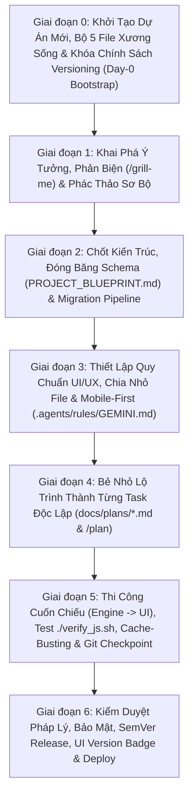

# Cẩm Nang Toàn Diện: Quy Trình Phát Triển App Bằng Antigravity (Tối Ưu Token, Kiến Trúc, Bảo Mật & Pháp Lý)

Tài liệu này là **cẩm nang hợp nhất duy nhất** của dự án `pyRetrait`, được sắp xếp **theo đúng trình tự thời gian từ lúc khởi tạo dự án (Giai đoạn 0) đến khi vận hành thực tế (Giai đoạn 6)**. Mọi kiến thức có liên kết với nhau (Kiến trúc & Schema Migration, Quy chuẩn UI & Tương thích Mobile, Thi công & Gỡ lỗi 2-Strike, Bảo mật OWASP & Pháp lý GDPR) đều được đặt cạnh nhau tại đúng giai đoạn tương ứng, giúp bạn tra cứu tức thì, **tiết kiệm 65% – 85% lượng token tiêu thụ** và **ngăn ngừa 95% lỗi hồi quy, ảo giác cũng như rủi ro pháp lý**.

---

## Phần I. Nền Tảng Cốt Lõi: Vì Sao Token Bị Tiêu Tốn Nhanh & 10 Nguyên Tắc Thao Tác Hàng Ngày

### 1. Ba Nguyên Nhân Gây Đốt Token Nhanh Nhất

1. **Hiệu Ứng Tuyết Lăn Của Ngữ Cảnh (Cumulative Context):**
   - Mỗi khi bạn gửi một tin nhắn mới, hệ thống không chỉ gửi riêng câu nói đó mà phải **đóng gói và gửi lại toàn bộ lịch sử từ đầu phiên chat**, bao gồm:
     - Quy tắc hệ thống (`.agents/rules/GEMINI.md`).
     - Toàn bộ các câu hỏi – đáp trước đó.
     - Lịch sử các công cụ đã chạy (`view_file`, `grep_search`, lệnh terminal).
     - Ảnh chụp màn hình từ Browser Subagent (mỗi ảnh ngốn hàng ngàn token).
   - **Hệ quả:** Ở lượt chat thứ 1, một câu lệnh ngắn chỉ tốn ~5.000 token. Nhưng đến lượt chat thứ 30, **cùng một câu lệnh 5 chữ ("sửa tiếp chỗ này") có thể ngốn 150.000 – 250.000 token** vì phải cõng toàn bộ lịch sử phía trước!

2. **Mò Mẫm Tìm Kiếm Trong File Khổng Lồ (Context Hunting):**
   - Trước đây `ui.js` từng dài hơn 8.200 dòng, nay đã được tách thành **bộ 6 file UI theo từng Tab độc lập** (`ui.js`, `ui-tab1-charts.js`, `ui-tab1-streams.js`, `ui-tab2-health.js`, `ui-tab3-taxes.js`, `ui-modals.js`) cùng với `frontend/index.html` (~4.614 dòng) và `frontend/css/styles.css` (~8.500+ dòng).
   - Kết hợp với bản đồ chỉ mục dòng code (`docs/CODEBASE_MAP.md`), mỗi lần bạn yêu cầu sửa 1 nút bấm hay 1 hàm ở Tab nào, AI chỉ cần mở đúng file của Tab đó và nhảy thẳng tới đúng 50–100 dòng cần sửa, giảm 90% token đọc file!

3. **Vòng Lặp Thử – Sai Mù Quáng & Gửi Tin Nhắn Vụn Vặt (Micro-Prompts):**
   - Yêu cầu code ngay khi chưa chốt thiết kế hoặc gửi liên tiếp 3–4 tin nhắn ngắn rời rạc (*"đổi chữ A"*, rồi lại *"xóa dòng B"*, rồi lại *"cho mục C xuống dòng"*) khiến AI phải nạp lại toàn bộ lịch sử 100k+ token nhiều lần liên tiếp.

---

### 2. Bốn Lệnh Slash Commands Đặc Quyền Của Antigravity (Dùng Đúng Thời Điểm)

Hãy tận dụng tối đa 4 lệnh nội bộ của Antigravity tương ứng với từng giai đoạn phát triển:

| Lệnh Slash | Thời điểm vàng để gõ lệnh | Tác dụng thực tế |
| :--- | :--- | :--- |
| **`/grill-me`** | **Giai đoạn 1** (Khi mới có ý tưởng lớn nhưng chưa rõ hết các góc khuất) | AI sẽ đóng vai Kiến trúc sư trưởng phỏng vấn ngược lại bạn từng câu ngắn gọn, giúp phát hiện các trường hợp biên (edge cases) trước khi viết 1 dòng code nào. |
| **`/plan`** | **Giai đoạn 4** (Khi bắt đầu chia nhỏ tính năng lớn thành các bước thực thi) | Kích hoạt chế độ lập kế hoạch có cấu trúc chặt chẽ trước khi chạm vào code. |
| **`/compact`** | **Giai đoạn 5** (Khi đang làm dở việc mà cuộc trò chuyện đã qua 10–12 lượt) | Nén toàn bộ lịch sử dài phía trước thành bản tóm tắt tinh gọn, giải phóng 85% bộ nhớ ngữ cảnh để làm tiếp mượt mà. |
| **`/learn`** | **Sau khi bạn vừa sửa lưng AI hoặc tìm ra 1 quy tắc hay** | Ra lệnh cho Antigravity đúc kết bài học vừa rồi và ghi nhớ vĩnh viễn vào quy tắc dự án/hệ thống để **không bao giờ mắc lại lỗi đó lần thứ 2**. |

---

### 3. Mười Hai Nguyên Tắc Vàng Trong Thao Tác Hàng Ngày

1. **Nguyên Tắc "1 Nhiệm Vụ = 1 Phiên Chat Mới" (Quan Trọng Số 1):**
   - **Bắt buộc bấm `New Chat (+)` khi:** (a) Vừa hoàn thành xong 1 Task trong file kế hoạch hoặc sửa xong 1 bug lớn; (b) Chuẩn bị chuyển từ việc sửa thuật toán (`engine.js`) sang việc chỉnh giao diện (`index.html`, `styles.css`); (c) Phiên chat đã chạm ngưỡng **10 – 12 lượt đối thoại**.
   - Nếu đang làm dở việc mà hội thoại bắt đầu dài: Gõ lệnh **`/compact`** để AI tóm tắt gọn ngữ cảnh trước khi làm tiếp.

2. **Kỹ Thuật Gộp Yêu Cầu (Prompt Batching — Không Gửi Lắt Nhắt):**
   - Thay vì gửi 3–4 tin nhắn ngắn nối tiếp nhau, hãy gom tất cả các chỉnh sửa giao diện/văn bản vào **1 danh sách đánh số duy nhất** rồi gửi 1 lần:
     > **❌ Cách tốn gấp 3 lần token (Gửi 3 lượt rời rạc):**
     > - Lượt 1: *"Xóa chữ (rút 4%/năm)..."*
     > - Lượt 2: *"Đổi tiêu đề Cách Tính Mục Tiêu thành Điều Kiện..."*
     > - Lượt 3: *"Mục 3 phải cùng cỡ chữ với mục 2 và xuống dòng..."*
     >
     > **✅ Cách chuẩn tiết kiệm token (Gom vào 1 lượt duy nhất):**
     > *"Đọc `@docs/CODEBASE_MAP.md` và sửa trong `frontend/index.html` (khu vực Tab 1) các điểm sau:*
     > *1. Đổi tiêu đề thẻ 'Cách Tính...' thành 'Điều Kiện...'*
     > *2. Xóa các đoạn chữ '(rút 4%/năm)'*
     > *3. Đổi chấm tròn '• Đạt chuẩn an toàn' thành '3. Đạt chuẩn an toàn', cùng cỡ chữ với mục 2 và ngắt dòng nội dung bên dưới."*

3. **Luôn Đính Kèm Bản Đồ Dòng Code (`@docs/CODEBASE_MAP.md`) Khi Sửa File Lớn:**
   - Khi cần sửa các file UI (`ui-tab1-charts.js`, `ui-tab1-streams.js`, `ui-tab2-health.js`, `ui-tab3-taxes.js`, `ui-modals.js`, `ui.js`), `styles.css`, `index.html`, `patrimoine.js`, `engine.js` hoặc `i18n.js`, hãy nhắc tên hàm/thẻ hoặc đính kèm `@docs/CODEBASE_MAP.md`. AI sẽ nhảy thẳng tới đúng 80 dòng liên quan thay vì đọc mò hàng ngàn dòng.

4. **Kiểm Soát Chặt `browser_subagent` — Ưu Tiên Kiểm Thử Bằng `./verify_js.sh`:**
   - Một lần gọi `browser_subagent` mở trình duyệt và chụp 5 tấm ảnh màn hình tiêu tốn **40.000 – 90.000 token** (đắt gấp 10–15 lần một lượt sửa code).
   - Trong `.agents/rules/GEMINI.md`, AI đã **bị cấm tự ý bật `browser_subagent`** nếu bạn không yêu cầu rõ. Thay vào đó, AI dùng `./verify_js.sh` (kiểm tra cú pháp 16 file JS, chạy thử công thức toán học và cập nhật `CODEBASE_MAP.md` trong **0.15 giây**, tốn **~150 token**).
   - Khi thực sự cần kiểm tra bố cục phức tạp bằng trình duyệt, bạn chỉ cần thêm cụm từ *"kiểm tra bằng browser"* vào cuối câu lệnh (AI sẽ chỉ kiểm tra trên Tiếng Việt `vi`, chụp 1 ảnh rồi đóng ngay).

5. **Đóng Bớt Các Tab File Lớn Không Dùng Đến Trên Editor:**
   - Antigravity tự động đính kèm metadata của các file đang mở (Active & Open Tabs) vào mỗi lượt chat. Khi đã sửa xong file nào, hãy đóng bớt tab của nó trên IDE.

6. **Chọn Mô Hình (Model Tier) Phù Hợp Với Độ Khó:**
   - **Flash / Medium Thinking:** Nhanh, tiết kiệm hạn ngạch, phù hợp cho **85% công việc hàng ngày** (sửa HTML/CSS, thêm từ điển `i18n.js`, nối biến DOM, sửa hàm nhỏ đã có sẵn công thức).
   - **Pro / High Thinking:** Chỉ bật khi thiết kế kiến trúc lớn (`PROJECT_BLUEPRINT.md`), phản biện (`/grill-me`, `/plan`) hoặc gỡ lỗi toán học đa biến phức tạp.

7. **Hạn Chế Dán Ảnh Chụp Màn Hình Khi Chỉ Sửa Chữ / Nhãn Hiển Thị:**
   - Mỗi tấm ảnh dán (`Cmd+V`) vào ô chat sẽ bị gửi lặp lại ở mọi câu hỏi tiếp theo trong phiên đó (~1.500 – 3.000 token × số lượt chat).
   - Nếu chỉ sửa câu chữ/số liệu: Hãy **copy dòng chữ đó dạng văn bản (text)** dán vào chat (tốn ~20 token và giúp AI định vị dòng code nhanh gấp 5 lần). Nếu bắt buộc phải dán ảnh để chỉ lỗi lệch khung, hãy bấm **`New Chat (+)`** ngay sau khi sửa xong bức ảnh đó.

8. **Không Đính Kèm (`@mention`) Cùng Lúc Nhiều Tài Liệu Nghiên Cứu Dài (`DOCS_*.md`):**
   - Trong các phiên lập trình hàng ngày, **chỉ cần đính kèm `@PROJECT_BLUEPRINT.md` và `@docs/CODEBASE_MAP.md`**. Chỉ chỉ định đọc các file `DOCS_*.md` (20–40 KB/file) khi thực sự cần tra cứu lại một quy định thuế/lương hưu chuyên biệt.

9. **Quy Tắc "Cấm Đọc Lại File Vừa Sửa" & "Cập Nhật Đa Ngôn Ngữ (`i18n.js`) Trong 1 Lượt":**
   - Khi `replace_file_content` đã thành công và `./verify_js.sh` báo `[OK]`, AI không gọi thêm `view_file` chỉ để "nhìn lại đoạn vừa sửa".
   - Nhờ `docs/CODEBASE_MAP.md` đã đánh chỉ mục chính xác dòng bắt đầu/kết thúc của cả 3 khối `vi`, `en`, `fr` trong `frontend/js/i18n.js`, AI sẽ chèn bản dịch cho cả 3 ngôn ngữ trong cùng 1 lượt.

10. **Tự Động Hóa 100% Việc Cập Nhật `docs/CODEBASE_MAP.md` (Tốn 0 Token):**
    - Bạn không bao giờ cần nhắc AI sửa file `docs/CODEBASE_MAP.md` bằng tay. Mọi thao tác quét lại số dòng mới đều được tích hợp tự động bên trong `./verify_js.sh` (chạy bằng Python hệ thống trong 0.05 giây, **tốn 0 token**).

11. **Kiểm Thử Kịch Bản UI Tĩnh Bằng Mock DOM Trong Node.js (0-Token UI Runner):**
    - Khi kiểm tra tương tác UI động (đổi quốc gia thì thẻ nào ẩn/hiện, chọn độc thân thì ẩn bạn đời, cưới thì hiện 2 cột song song), **tuyệt đối không bật browser để click từng nút**.
    - Tích hợp mock DOM tối giản (`document.getElementById`, `classList`, `style.display`) vào `./verify_js.sh` để chạy tự động hàng chục kịch bản giao diện (ví dụ: bộ 42 test cases) trong **0.25 giây**, phát hiện lỗi logic giao diện tức thì mà **tốn 0 token browser**.

12. **Kỷ Luật Quản Lý Versioning Toàn Diện (Asset, Schema, SemVer & Git Tagging):**
    - **Asset Cache-Busting (`?v=...`):** Mỗi khi sửa file JavaScript hoặc CSS, bắt buộc phải tăng query version parameter (`?v=YYYYMMDD_vNNN`) trong thẻ `<link>` và `<script>` của `index.html`. Tránh tuyệt đối tình trạng người dùng/tester mở web vẫn dính cache cũ và lầm tưởng code AI bị lỗi.
    - **Data Schema Versioning (`_schemaVersion`):** Mọi đối tượng lưu trữ (`localStorage`, JSON backup, SQLite) bắt buộc có số phiên bản dữ liệu (`_schemaVersion: 1, 2, 3...`). Khi nâng cấp app, luôn có pipeline chuyển đổi tuần tự (migration) để dữ liệu cũ không bao giờ bị hỏng hay mất.
    - **Semantic Release Versioning (`SemVer`):** Đánh số phiên bản phát hành (`vMAJOR.MINOR.PATCH`) hiển thị rõ trên UI và gắn Git tag để dễ dàng truy vết và rollback tức thì trong 1 giây nếu gặp sự cố.

---

## Phần II. Quy Trình Khép Kín Phát Triển Ứng Dụng Từ Con Số 0 Đến Khi Vận Hành Thực Tế (Giai Đoạn 0 ➔ Giai Đoạn 6)

Để một ứng dụng web vừa **kiến trúc sạch, không lỗi vặt, bảo mật cao & tuân thủ pháp lý**, vừa **tiết kiệm 70–85% token** trong suốt vòng đời phát triển, hãy đi theo đúng trình tự **từ Giai đoạn 0 đến Giai đoạn 6** dưới đây:



---

### Giai Đoạn 0: Khởi Tạo Dự Án Mới & Hệ Thống 5 File Hạ Tầng Chống Đốt Token (Day-0 Bootstrap)

Khi bắt đầu một dự án mới tinh (hoặc chuẩn hóa một dự án hiện có), **tuyệt đối không bảo AI viết tính năng ngay**. Việc đầu tiên là thiết lập **Bộ 5 File Xương Sống Kèm Khóa Chính Sách Versioning Ngay Từ Ngày Đầu Tiên** để bảo vệ token và duy trì kỷ luật kiến trúc tự động:

| File hạ tầng | Vai trò bảo vệ Token & Kỷ luật Kiến trúc |
| :--- | :--- |
| **1. `.agents/rules/GEMINI.md`** | Khóa cứng quy tắc giao tiếp Tiếng Việt, kiến trúc tách 3 tầng chống file khổng lồ, quy chuẩn biến màu Dark/Light Mode, ngôn ngữ đại chúng, kỷ luật versioning và cấm tự ý bật `browser_subagent`. |
| **2. `PROJECT_BLUEPRINT.md`** | Bản thiết kế gốc chứa mục tiêu, những thứ cố tình không làm (Out-of-Scope), đơn vị chuẩn nội bộ, quy ước SemVer ứng dụng (`v1.0.0`) và **Bảng JSON Schema dữ liệu duy nhất** (khóa cứng `_schemaVersion: 1`). |
| **3. `docs/CODEBASE_MAP.md`** | **Bản đồ tọa độ dòng code (`StartLine` – `EndLine`) tự động 100%** của mọi hàm, thẻ HTML, phân mục CSS và khối từ điển. Giúp AI nhảy thẳng tới đúng 50–100 dòng cần sửa. |
| **4. `./verify_js.sh`** | **Công cụ kiểm thử & đồng bộ chỉ mục tự động (tốn 0 token cập nhật map, chạy 100% trong Sandbox):** Kiểm tra cú pháp toàn bộ file JS, chạy thử công thức toán học, quét rò rỉ API Key/từ vựng pháp lý, kiểm tra tính hợp lệ của schema version và tự động cập nhật `docs/CODEBASE_MAP.md` trong 0.15 giây. |
| **5. `.antigravityignore`, `CHANGELOG.md` & `deploy.sh`** | `.antigravityignore` chặn công cụ tìm kiếm quét vào file nhị phân SQLite (`*.db`), thư viện nén (`*.min.js`), cache; `CHANGELOG.md` theo dõi lịch sử phiên bản phát hành; `deploy.sh` đẩy code lên VPS an toàn và tự động sao lưu database. |

- **Câu lệnh Khởi Tạo Dự Án Mới Từ Con Số 0 (Day-0 Bootstrap Prompt — Copy & Paste):**
  ```text
  Tôi bắt đầu một dự án mới tên là [Tên Dự Án].
  Mục tiêu cốt lõi của ứng dụng: [Mô tả ngắn gọn 3-5 câu về bài toán cần giải quyết và đối tượng người dùng].
  Tech stack mong muốn: [Ví dụ: Vanilla JS + FastAPI + SQLite / hoặc Next.js + PostgreSQL].

  Khoan viết code giao diện hay tính năng. Hãy khởi tạo ngay Bộ 5 File Xương Sống chuẩn hóa sau đây:
  1. .agents/rules/GEMINI.md: Khóa cứng quy tắc giao tiếp Tiếng Việt, kiến trúc tách 3 tầng (Core Engine độc lập DOM, State/Sync, và UI chia nhỏ theo từng Tab dưới 1.500 dòng/file), hỗ trợ Dark/Light Mode bằng biến CSS, kỷ luật tăng ?v=... cache-busting khi sửa CSS/JS, cấm tự ý bật browser_subagent.
  2. PROJECT_BLUEPRINT.md: Định nghĩa mục tiêu, những thứ cố tình không làm (Out-of-Scope), đơn vị chuẩn nội bộ, chính sách SemVer (v1.0.0) và Bảng JSON Schema dữ liệu duy nhất (kèm trường _schemaVersion: 1).
  3. CHANGELOG.md: Khởi tạo nhật ký phiên bản chuẩn Keep a Changelog (bản [1.0.0] - Ngày khởi tạo).
  4. .antigravityignore: Chặn các thư mục/file nặng (*.db, *.min.js, node_modules, __pycache__, .git, data/).
  5. verify.sh (chmod +x): Script chạy 100% trong Sandbox giúp (a) kiểm tra cú pháp toàn bộ file code, (b) tự động quét vị trí dòng code của mọi hàm/thẻ HTML/CSS để sinh ra docs/CODEBASE_MAP.md tốn 0 token, (c) quét rò rỉ API Key/Secret và từ vựng pháp lý.
  6. deploy.sh: Script rsync đẩy code lên Server VPS an toàn (tự động exclude .env, database thật, file nháp preview.html và tự động backup database trên server trước khi restart).
  ```

---

### Giai Đoạn 1: Khai Phá Ý Tưởng, Phản Biện Nghiệp Vụ (`/grill-me`) & Xem Sơ Bộ Giao Diện (Chưa Sửa Code Chính)

Khi bạn vừa nảy ra một ý tưởng mới hoặc một phân hệ lớn, bạn có thể gõ lệnh **`/grill-me`** để AI hỏi ngược lại các trường hợp biên, sau đó dùng **1 trong 3 cấp độ Xem Sơ Bộ Giao Diện (Visual Prototyping)** dưới đây để nhìn thấy ngay hình hài tính năng mà **không làm xáo trộn hay tốn token đọc các file lớn của dự án**:

#### Cấp độ 1 — Phác Thảo Khung Bố Cục Ngay Trong Chat (ASCII Wireframe — Tốn ~300 Token, Nhanh 3 Giây)
- **Khi nào dùng:** Khi bạn mới có ý tưởng sơ khởi, muốn hình dung nhanh có mấy cột, gồm những ô nhập nào và kết quả gì để phát hiện ngay thông tin còn thiếu.
- **Câu lệnh Prompt ví dụ (Copy & Paste):**
  ```text
  Tôi muốn thêm tính năng [Ví dụ: So sánh Thuế Thừa Kế Pháp - Việt cho BĐS và Danh mục cổ phiếu].
  Tuyệt đối khoan sửa code dự án. Hãy làm 2 việc:
  1. Vẽ sơ đồ khung bố cục giao diện bằng ASCII Wireframe (chia rõ Cột Trái: các ô nhập liệu, Cột Phải: các thẻ kết quả & biểu đồ).
  2. Chỉ ra 5 thông số hoặc trường hợp thực tế mà người dùng hay quên nhưng rất quan trọng để tôi bổ sung vào giao diện.
  ```
- **Kết quả AI trả về ngay trong chat (~300 token):**
  ```text
  +-------------------------------------------------------------------------+
  | [Tiêu đề Thẻ: Lưới An Toàn Y Tế Pháp - Việt]          [Trạng thái: Đạt] |
  +------------------------------------+------------------------------------+
  | CỘT TRÁI: THÔNG SỐ ĐẦU VÀO         | CỘT PHẢI: KẾT QUẢ DỰ PHÓNG         |
  | - Nơi nghỉ hưu: [Pháp / Việt Nam]  | - Chi phí y tế tự trả: 1.200 €/năm |
  | - Bảo hiểm CFE: [x] Có tham gia    | - Tỷ lệ bảo vệ:        92%         |
  | - Quỹ dự phòng: [ 30.000 € ]       | [Thanh mức độ an toàn: ████████░░] |
  +------------------------------------+------------------------------------+
  ```
- **Câu lệnh Prompt chỉnh sửa tiếp theo (nếu thấy thiếu):**
  ```text
  Khung này dễ hình dung rồi. Hãy sửa lại khung ASCII một chút:
  1. Cột trái thêm ô nhập "Số người con nhận thừa kế" và "Độ tuổi trao tặng (trước hay sau 70 tuổi)".
  2. Cột phải thêm dòng hiển thị "Số tiền thuế tiết kiệm được nếu tặng trước 70 tuổi".
  Vẽ lại khung ASCII đã chốt để chuẩn bị đưa vào kế hoạch.
  ```

#### Cấp độ 2 — Tạo 1 File Nháp Giao Diện Độc Lập (`frontend/preview.html` — Tốn ~1.500 Token, Đẹp Giống Thật 100%)
- **Khi nào dùng:** Khi bạn muốn **nhìn màu sắc thật, thẻ Card thật, font chữ thật và bấm thử trên trình duyệt** ở cả Dark Mode & Light Mode mà không chạm vào các file lớn của dự án.
- **Câu lệnh Prompt — Bước 1: Tạo bản nháp (Copy & Paste):**
  ```text
  Tôi muốn xem trước giao diện thực tế của tính năng [Tên tính năng] để dễ hình dung những điều còn thiếu.
  Tuyệt đối KHÔNG đọc hay sửa index.html, ui.js hay i18n.js lúc này.
  Hãy tạo duy nhất 1 file nháp độc lập tại frontend/preview.html:
  1. Nhúng sẵn <link rel="stylesheet" href="css/styles.css"> của dự án và có nút bấm chuyển đổi Dark/Light Mode ở góc trên.
  2. Dựng đầy đủ bố cục thẻ Card, các ô nhập, bảng kết quả và điền sẵn các con số giả lập mẫu (hardcode số mẫu hợp lý).
  3. Không gọi browser_subagent — tôi sẽ tự mở http://localhost:8000/preview.html trên trình duyệt của tôi để xem.
  ```
- **Câu lệnh Prompt — Bước 2: Tinh chỉnh trên bản nháp (sau khi xem trên trình duyệt):**
  ```text
  Tôi đã xem localhost:8000/preview.html, nhìn rất rõ ràng! Hãy sửa nhanh trong file frontend/preview.html 3 điểm sau:
  1. Chuyển 2 ô nhập [A] và [B] lên cùng 1 hàng ngang cho gọn.
  2. Thêm 1 hộp giải thích công thức tính ở cuối cột phải.
  3. Đổi màu viền thẻ kết quả sang màu xanh ngọc (emerald).
  ```
- **Câu lệnh Prompt — Bước 3: Chốt & Lập kế hoạch ghép vào dự án chính:**
  ```text
  Giao diện trong frontend/preview.html đã hoàn hảo 100% đúng ý tôi rồi!
  Bây giờ hãy dựa trên giao diện chuẩn của frontend/preview.html, @PROJECT_BLUEPRINT.md và @docs/CODEBASE_MAP.md để:
  1. Lập kế hoạch ghép tính năng này vào dự án chính trong file docs/plans/[ten_tinh_nang].md (chia Task: viết hàm tính trong engine.js trước -> ghép HTML/JS vào Tab thật -> thêm từ điển i18n.js).
  2. Sau khi ghép xong ở bước thực thi thì xóa file nháp frontend/preview.html.
  ```

#### Cấp độ 3 — Dựng Khung HTML Tĩnh Trên Trang Chính Trước, Khoan Viết Logic & Đa Ngôn Ngữ (UI Skeleton First)
- **Khi nào dùng:** Khi bạn muốn đặt thử thẻ mới nằm ngay bên trong Tab thật của ứng dụng (`index.html`) để xem nó đứng cạnh các thẻ hiện có trông có cân đối không.
- **Câu lệnh Prompt — Bước A: Chỉ dựng khung HTML tĩnh (Copy & Paste):**
  ```text
  Tra cứu @docs/CODEBASE_MAP.md để tìm vị trí cuối Tab 2 (#tab-estate) trong frontend/index.html.
  Hãy chèn thử khung HTML tĩnh (kèm số liệu mẫu bằng Tiếng Việt) cho thẻ [Tên thẻ mới] vào đúng vị trí đó để tôi F5 trình duyệt ngắm bố cục tổng thể.
  Lưu ý bắt buộc để tiết kiệm token:
  - Khoan viết hàm tính toán trong engine.js.
  - Khoan viết sự kiện DOM trong ui-tab2-health.js.
  - Khoan thêm bản dịch tiếng Anh/Pháp vào i18n.js.
  - Không gọi browser_subagent.
  ```
- **Câu lệnh Prompt — Bước B: Nối công thức & hoàn thiện 1 lần duy nhất (sau khi F5 thấy ưng mắt):**
  ```text
  Tôi đã F5 xem khung HTML trên trang chính, bố cục rất đẹp rồi!
  Bây giờ hãy hoàn thiện trọn gói tính năng cho khung HTML vừa tạo:
  1. Viết hàm tính toán vào frontend/js/engine.js và kiểm chứng bằng ./verify_js.sh.
  2. Nối sự kiện input và hiển thị kết quả trong frontend/js/ui-tab2-health.js.
  3. Bổ sung đầy đủ từ điển vi / en / fr vào frontend/js/i18n.js trong 1 lượt.
  ```

---

### Giai Đoạn 2: Thiết Kế Kiến Trúc, Đóng Băng Schema (`PROJECT_BLUEPRINT.md`) & Bảo Toàn Dữ Liệu Cũ (Schema Migration)

90% lỗi đập đi xây lại (tốn hàng triệu token) xuất phát từ việc **vừa viết giao diện vừa tự bịa tên biến**, hoặc **khi nâng cấp tính năng mới (`v2`) làm hỏng cấu trúc dữ liệu cũ (`v1`) của người dùng đang lưu trong `localStorage` / `SQLite`**.

#### 1. Ba Trụ Cột Bất Biến Trong `PROJECT_BLUEPRINT.md`
1. **Nguyên tắc Kiến trúc:** Ví dụ Local-First (100% tính toán ở trình duyệt, offline-ready) kết hợp FastAPI + SQLite đồng bộ đám mây.
2. **Chuẩn hóa Đơn vị Nội bộ (Internal Canonical Units):** Mọi số tiền lưu trong bộ nhớ đều quy về `EUR/năm` (hoặc `USD` cho kịch bản Mỹ), tỷ lệ phần trăm lưu thống nhất (`4.0` nghĩa là `4%`). Chỉ khi hiển thị ra màn hình mới nhân tỷ giá.
3. **Bảng Schema Dữ Liệu Duy Nhất (Single Source of Truth JSON Schema):** Liệt kê đầy đủ tên trường (`camelCase`), kiểu dữ liệu, giá trị mặc định của toàn bộ đối tượng dữ liệu (User, Plan, Asset, Health...).

#### 2. Chiến Lược Quản Lý Versioning Dữ Liệu & Đường Ống Di Trú Tuần Tự (Zero-Data-Loss Schema Versioning & Sequential Migration Pipeline)

Một trong những thảm họa lớn nhất khi phát triển app là **nâng cấp tính năng mới (`v2`, `v3`) làm vỡ nát dữ liệu cũ của người dùng** đang lưu trong `localStorage` hoặc cơ sở dữ liệu. Để đảm bảo ứng dụng đạt chuẩn thương mại bền vững qua nhiều năm tháng, hãy áp dụng quy chuẩn Versioning Dữ Liệu 4 lớp sau:

1. **Định danh phiên bản dữ liệu bằng trường bắt buộc `_schemaVersion`:**
   - Mọi đối tượng lưu trữ (`Plan`, `Patrimoine`, `Settings`) khi lưu vào `localStorage`, JSON export/backup hay SQLite đều bắt buộc phải có thuộc tính `_schemaVersion: 1`, `2`, `3`...
   - Đây là "chứng minh thư" của gói dữ liệu, giúp code biết chính xác cấu trúc dữ liệu đang ở thế hệ nào.

2. **Đường ống di trú tuần tự theo bậc thang (`Sequential Migration Chain`):**
   - **Tuyệt đối KHÔNG viết rẽ nhánh nhảy cóc** (`if (v === 1) {...} else if (v === 2) {...}`), vì khi app lên `v5`, `v10` sẽ sinh ra hàng chục nhánh rẽ hỗn loạn, dễ bỏ sót biến.
   - **Bắt buộc dùng chuỗi nâng cấp tuần tự theo từng nấc thang:**
     ```javascript
     function migratePlan(rawPlan) {
       let plan = { ...rawPlan };
       let v = plan._schemaVersion || 1;
       
       // Bước 1: Nâng từ v1 lên v2 (Ví dụ: Thêm quốc gia làm việc & Hôn nhân)
       if (v < 2) {
         plan.workCountry = plan.workCountry || 'FR';
         plan.maritalStatus = plan.maritalStatus || 'single';
         plan.taxParts = (plan.maritalStatus === 'married' ? 2.0 : 1.0);
         v = 2;
       }
       // Bước 2: Nâng từ v2 lên v3 (Ví dụ: Thêm Lương hưu Đức & BHXH VN cho 2 người)
       if (v < 3) {
         plan.germanPensionDetails = plan.germanPensionDetails || {
           spouse1: { grossAnnualSalary: 45000, yearsContributed: 35, claimAge: 67 },
           spouse2: { grossAnnualSalary: 38000, yearsContributed: 35, claimAge: 67 }
         };
         v = 3;
       }
       plan._schemaVersion = v;
       return ensurePlanDefaults(plan); // Bù đắp an toàn các giá trị biên
     }
     ```
   - **Lợi ích vàng:** Dù người dùng không mở app suốt 2 năm hoặc nhập lại file backup từ ngày đầu tiên (`v1`), hệ thống vẫn tự động chạy tuần tự `v1 ➔ v2 ➔ v3`, nâng cấp trơn tru lên bản mới nhất mà **không mất 1 byte dữ liệu nào**!

3. **Tương thích ngược & xuôi với File Sao Lưu Dự Phòng (`Backup & Restore Compatibility`):**
   - Khi xuất file sao lưu JSON (`export.js`): Bắt buộc đính kèm `_schemaVersion: N` và `appVersion: "x.y.z"`.
   - Khi người dùng bấm *"Nhập dữ liệu dự phòng"* (Import Restore): Đọc `_schemaVersion` của file tải lên, chạy qua pipeline `migratePlan()` để chuẩn hóa trước khi ghi đè vào `state.js`. Không bao giờ quăng lỗi `undefined` hay làm đơ giao diện.

4. **Quản trị phiên bản SQLite Backend bằng `PRAGMA user_version` (Safe Migration):**
   - SQLite có sẵn thanh ghi nội bộ siêu nhẹ: `PRAGMA user_version`.
   - Khi Backend khởi động (`backend/database.py`), kiểm tra phiên bản hiện tại. Nếu `current_version < TARGET_DB_VERSION`:
     - Chạy tuần tự các câu lệnh `ALTER TABLE ... ADD COLUMN ... DEFAULT ...` an toàn.
     - Nâng số `PRAGMA user_version = TARGET_DB_VERSION`.
     - **Tuyệt đối CẤM dùng `DROP TABLE` trên môi trường thật**.

---

#### 3. Các Câu Lệnh Prompt Hiệu Quả Ở Giai Đoạn 2 (Copy & Paste)

- **Tình huống 2A — Khi khởi tạo dự án mới (Tạo mới `PROJECT_BLUEPRINT.md` kèm Schema Version 1):**
  ```text
  Dựa trên ý tưởng và khung giao diện sơ bộ vừa thống nhất ở Giai đoạn 1, hãy tạo file PROJECT_BLUEPRINT.md làm nguồn chân lý duy nhất (Single Source of Truth) cho dự án.
  Tuyệt đối KHOAN viết code tính năng lúc này. Hãy thiết kế đầy đủ 4 phần sau trong PROJECT_BLUEPRINT.md:
  1. Nguyên tắc Kiến trúc & Phạm vi: Xác định rõ kiến trúc (ví dụ: Local-First 100% tính toán ở client + FastAPI/SQLite đồng bộ), chính sách Semantic Versioning ứng dụng (SemVer v1.0.0), và liệt kê rõ những thứ cố tình KHÔNG làm (Out-of-Scope) để tránh phình dự án.
  2. Đơn vị Chuẩn Nội Bộ (Internal Canonical Units): Quy định thống nhất đơn vị lưu trữ trong bộ nhớ (ví dụ: tiền tệ luôn quy về EUR/năm, tỷ lệ % lưu dạng số thực 4.0 hay 0.04, ngày tháng theo chuẩn ISO) — chỉ khi hiển thị ra UI mới đổi tỷ giá/đơn vị.
  3. Bảng JSON Schema Dữ Liệu Đóng Băng: Liệt kê chính xác tên biến (camelCase), kiểu dữ liệu, giá trị mặc định (default) và giới hạn min/max của mọi đối tượng dữ liệu, bắt buộc khóa cứng trường _schemaVersion: 1.
  4. Sơ đồ Luồng Dữ Liệu (Data Flow): Mô tả ngắn gọn dữ liệu đi từ Ô nhập UI -> State (localStorage) -> Core Engine -> Render Biểu đồ/Bảng như thế nào.
  ```

- **Tình huống 2B — Khi thêm tính năng mới vào dự án đang chạy (Nâng cấp Schema Version & Viết Migration Pipeline):**
  ```text
  Tôi chuẩn bị thêm tính năng [Tên tính năng mới, ví dụ: Mô phỏng Thuế Thừa Kế / Bảo hiểm nhân thọ / Mở rộng PPP Đa quốc gia].
  Khoan sửa code giao diện. Hãy đọc @PROJECT_BLUEPRINT.md hiện tại và thực hiện:
  1. Đề xuất các trường dữ liệu mới cần thêm vào Schema (tên biến tiếng Anh chuẩn camelCase, kiểu dữ liệu, đơn vị tính, giá trị mặc định an toàn) và kiểm tra không trùng lặp tên biến cũ.
  2. Cập nhật trực tiếp các trường mới vào @PROJECT_BLUEPRINT.md và tăng _schemaVersion từ [N] lên [N+1].
  3. Thiết kế pipeline nâng cấp tuần tự trong state.js: viết hàm di trú if (v < N+1) để tự động bù đắp giá trị mặc định an toàn cho người dùng cũ hoặc khi người dùng import file JSON backup từ phiên bản trước.
  4. Nếu cần lưu thêm trên SQLite: đề xuất câu lệnh ALTER TABLE ADD COLUMN an toàn kèm DEFAULT, tuyệt đối không DROP TABLE.
  ```

---

### Giai Đoạn 3: Thiết Lập Quy Chuẩn Chia Nhỏ File, UI/UX & Tương Thích Điện Thoại (`.agents/rules/GEMINI.md`)

Trước khi bắt tay vào viết code hoặc khi mở rộng phân hệ mới, hãy khóa các quy tắc thiết kế trong `.agents/rules/GEMINI.md` để AI tự động tuân thủ ở mọi phiên chat:

#### 1. Quy Tắc Chống File Khổng Lồ (Anti-Monolith Rule — Kiến Trúc 3 Tầng)
Không bao giờ gom toàn bộ code vào 1 file `ui.js` hay `styles.css` dài gần 9.000 dòng. Mỗi file không vượt quá **800 – 2.200 dòng**, tách bạch thành 3 tầng rõ rệt:
- **Tầng 1 — Core Engine (Logic & Toán học thuần túy):** Chỉ nhận vào JSON và trả ra JSON (`engine.js`, `taxOptimizer.js`, `monteCarlo.js`, `patrimoine.js`, `scenarios.js`). Tuyệt đối không chứa `document.getElementById` để có thể kiểm thử tự động trong 0.1 giây bằng terminal!
- **Tầng 2 — State, Sync & I18n (`state.js`, `i18n.js`, `auth.js`, `geminiAdvisor.js`, `export.js`):** Quản lý dữ liệu `localStorage`, đồng bộ API, kết nối AI và từ điển đa ngôn ngữ.
- **Tầng 3 — Giao diện tách theo từng Tab độc lập (`ui.js`, `ui-tab1-charts.js`, `ui-tab1-streams.js`, `ui-tab2-health.js`, `ui-tab3-taxes.js`, `ui-modals.js`, `community.js`):** Khi sửa Tab nào chỉ cần mở đúng file của Tab đó, tiết kiệm 90% token đọc file!

#### 2. Quy Chuẩn Hệ Thống Thiết Kế (Design System & Plain Language)
- **Dark Mode & Light Mode chuẩn WCAG AA:** Khai báo 100% bảng biến màu CSS (`--bg-app`, `--bg-card`, `--text-main`, `--text-muted`, `--border-subtle`). Cấm hardcode nền tối `rgba(0,0,0,...)` hay màu chữ xám nhạt cố định.
- **Đồng nhất Typography (`--font-sans`):** Không dùng font `monospace` cho văn bản đa ngôn ngữ hay công thức giải thích; tách riêng con số và đơn vị đo lường.
- **Ngôn ngữ đại chúng:** Dễ hiểu cho 100.000+ người dùng phổ thông, không dùng thuật ngữ hàn lâm và cấm dùng cú pháp LaTeX.

#### 3. Quy Chuẩn "Bất Tử Hóa Giao Diện Khi Mạng Yếu & Tương Thích Điện Thoại 100%" (Resilience & Mobile-First)
70% người dùng cuối mở ứng dụng trên điện thoại hoặc mạng 4G chập chờn. Mọi tính năng UI đều phải thỏa mãn 3 tiêu chuẩn Defensive UI:
1. **Chống treo đơ khi gọi API/AI bên thứ ba (Timeout & Graceful Fallback):** Mọi hàm `fetch()` phải có `AbortController` giới hạn thời gian chờ (15–20 giây) và khối `try / catch / finally` để luôn tắt vòng quay loading, hiện thông báo thân thiện kèm nút *"Thử lại"*.
2. **Chống vỡ khung trên màn hình điện thoại (`375px` Viewport Rule):** Mọi lưới nhiều cột (`grid-template-columns`) phải tự thu về 1 cột dọc ở màn hình dưới `768px`; bảng nhiều cột bọc trong `overflow-x: auto`; dùng `max-width: 600px; width: 100%` thay vì chiều rộng cố định.
3. **Bảo vệ ô nhập số liệu trước dữ liệu lạ (Input Sanitization & Clamping):** Luôn bọc `Number.isFinite(val) ? val : defaultVal` và giới hạn `Math.max(min, Math.min(max, val))` để người dùng để trống ô hoặc gõ số âm vô lý cũng không bao giờ sinh ra `NaN` hay `Infinity`.

#### 4. Khử Ràng Buộc Chéo Giữa Các Tab UI (Cross-Tab Decoupling & Central State)
Khi chia nhỏ giao diện thành các module Tab độc lập (`ui-tab1-streams.js`, `ui-tab2-health.js`, `ui-tab3-taxes.js`, `ui-modals.js`), nếu các Tab gọi trực tiếp biến hoặc hàm nội bộ của nhau sẽ dẫn đến "Spaghetti Code" và lỗi vỡ trang (`ReferenceError`) khi thứ tự tải script trong HTML thay đổi:
- **Giao tiếp qua Single Source of Truth:** Mọi Tab con chỉ đọc trạng thái kế hoạch từ `getActivePlan()` trong Tầng 2 (`state.js`).
- **Nhạc trưởng điều phối (`ui.js`):** Khi một Tab làm thay đổi dữ liệu (ví dụ: đổi quốc gia làm việc, đổi tình trạng hôn nhân từ Cá nhân sang Vợ chồng), Tab đó chỉ ghi dữ liệu vào `plan` và gọi hàm điều phối trung tâm của `ui.js` (hoặc Event Bus) để re-render đồng bộ toàn bộ các Tab liên quan, tuyệt đối không truy cập trực tiếp biến cục bộ của Tab khác.

#### 5. Quy Hoạch Tham Số Địa Phương Tập Trung (Localized Profile Configuration)
Mọi thông số mang tính địa phương (chi phí sinh hoạt PPP, chi phí y tế theo độ tuổi `healthCostBase`, chính sách hỗ trợ gia đình/CAF, biểu thuế lũy tiến) rất dễ bị hardcode rải rác nếu không có quy hoạch từ đầu:
- **Bảng Hằng Số Tập Trung:** Toàn bộ dữ liệu quốc gia phải được quy hoạch trong một cấu hình duy nhất (ví dụ: `COUNTRY_PPP_PROFILES` trong `taxOptimizer.js`).
- **Tra cứu nhất quán:** Mọi module UI (Tab 1 dòng tiền, Tab 2 sức khỏe, Tab 3 thuế) và Engine chỉ việc tra cứu theo `plan.workCountry` hoặc `plan.retireCityKey`, đảm bảo thay đổi hệ số ở một nơi là toàn bộ ứng dụng tự động phản ánh chính xác.

#### 6. Nguyên Tắc Kỹ Thuật Trung Thực (Anti-Hallucination & Honest Fallback Principle)
Khi ứng dụng mở rộng ra phạm vi quốc tế hoặc nhiều nghiệp vụ phức tạp, AI hoặc lập trình viên rất dễ mắc bẫy **"tự bịa công thức chung/generic phỏng đoán"** (ví dụ: lấy bừa 50% lương làm lương hưu cho mọi nước chưa có luật tự động):
- **Tuyệt đối không đoán mò số liệu tài chính:** Trong ứng dụng tài chính cá nhân, y tế hay pháp lý, việc đoán mò sẽ làm sai lệch hoàn toàn kế hoạch cả đời của người dùng.
- **Khối thông báo minh bạch (`#callout-...-unsupported`):** Khi người dùng chọn quốc gia chưa được lập trình mô hình hưu trí tự động, hệ thống ẩn toàn bộ các thẻ tự động và hiển thị một thông báo trang nhã, minh bạch: giải thích rõ hệ thống chưa hỗ trợ mô hình tự động cho nước này, và hướng dẫn người dùng tự ước tính độc lập rồi thêm qua nút `[+ Thêm Thu Nhập]`.

#### 7. Các Câu Lệnh Prompt Hiệu Quả Ở Giai Đoạn 3 (Copy & Paste)

- **Tình huống 3A — Khi thiết lập quy chuẩn cho dự án mới (Tạo `.agents/rules/GEMINI.md`):**
  ```text
  Dựa trên @PROJECT_BLUEPRINT.md, hãy tạo file quy tắc hệ thống tại .agents/rules/GEMINI.md để khóa cứng kỷ luật kỹ thuật và UI/UX cho toàn bộ dự án:
  1. Kiến trúc 3 Tầng Chống File Khổng Lồ (Anti-Monolith):
     - Tầng 1 (Core Engine): Hàm thuần túy (pure functions) chỉ nhận/trả JSON, tuyệt đối cấm gọi DOM (document.getElementById) để test được bằng dòng lệnh trong 0.1 giây.
     - Tầng 2 (State & I18n): Quản lý localStorage, đồng bộ API, hàm migrateState() bảo vệ dữ liệu cũ và từ điển đa ngôn ngữ.
     - Tầng 3 (UI tách theo từng Tab): Mỗi Tab giao diện nằm ở 1 file JS riêng biệt (tối đa 1.500 dòng/file), ui.js chỉ làm nhạc trưởng điều phối.
  2. Quy chuẩn UI/UX, Mobile-First & Resilience:
     - Hỗ trợ song song Dark Mode & Light Mode bằng 100% biến CSS (--bg-app, --bg-card, --text-main, --text-muted, --border-subtle). Cấm hardcode màu nền tối rgba(0,0,0,...) hay màu chữ xám nhạt cố định.
     - Dùng 100% font giao diện chính (--font-sans) cho văn bản và công thức giải thích; ngôn ngữ đại chúng, cấm dùng LaTeX.
     - Tương thích màn hình điện thoại 375px, bọc kiểm tra NaN/Infinity cho mọi ô input và có timeout khi gọi API.
  3. Kỷ luật Bảo vệ Token & Pháp lý:
     - Cấm tự ý bật browser_subagent nếu người dùng không yêu cầu rõ; ưu tiên kiểm thử bằng ./verify_js.sh.
     - Cấm đọc lại file ngay sau khi vừa replace_file_content thành công.
     - Luôn bọc escapeHtml() cho dữ liệu người dùng nhập và tuân thủ miễn trừ trách nhiệm pháp lý.
  ```

- **Tình huống 3B — Khi dự án mở rộng hoặc cần siết lại quy chuẩn UI/Module (Cập nhật `.agents/rules/GEMINI.md`):**
  ```text
  Tôi thấy file [Tên file, ví dụ: frontend/js/ui-tab3-taxes.js hoặc styles.css] đang bắt đầu dài ra, hoặc chuẩn bị có thêm phân hệ giao diện mới [Tên phân hệ].
  Hãy đọc @.agents/rules/GEMINI.md và @docs/CODEBASE_MAP.md để:
  1. Quy hoạch rõ trách nhiệm của các file module hiện tại trong .agents/rules/GEMINI.md: hàm nào thuộc Engine (Tầng 1), hàm nào thuộc State (Tầng 2), hàm render nào thuộc file UI Tab nào (Tầng 3).
  2. Bổ sung quy tắc kiểm soát cụ thể cho tính năng mới (quy chuẩn màu sắc Light/Dark Mode, chống vỡ khung Mobile 375px, và quy tắc đa ngôn ngữ i18n) vào .agents/rules/GEMINI.md để các phiên chat thi công sau cứ thế tuân theo 100%.
  ```

- **💡 Mẹo Kết Hợp "Gộp Giai Đoạn 2 + 3 Trong 1 Lượt" (Tiết Kiệm Token Nhất — Copy & Paste):**
  ```text
  Ý tưởng và bố cục ở Giai đoạn 1 đã chốt. Bây giờ hãy thực hiện đồng thời Giai đoạn 2 và Giai đoạn 3 (khoan viết code tính năng):
  1. Cập nhật @PROJECT_BLUEPRINT.md: Khai báo đầy đủ JSON Schema dữ liệu mới (tên trường camelCase, kiểu dữ liệu, đơn vị chuẩn nội bộ, giá trị mặc định an toàn cho dữ liệu cũ).
  2. Cập nhật @.agents/rules/GEMINI.md: Phân bổ rõ các hàm dự kiến sẽ nằm ở file nào theo đúng kiến trúc 3 tầng (Engine / State / UI từng Tab) để không làm phình file, và khóa quy chuẩn hiển thị Dark/Light Mode cho phân hệ này.
  ```

---

### Giai Đoạn 4: Lập Kế Hoạch Thực Thi Chia Nhỏ Theo Từng Task (`docs/plans/*.md` & `/plan`)

Khi đã có `PROJECT_BLUEPRINT.md` và `.agents/rules/GEMINI.md`, hãy mở một phiên chat (có thể kết hợp lệnh **`/plan`**) để lập danh sách công việc cụ thể cho tính năng sắp làm:

- **Câu lệnh Prompt mẫu Giai đoạn 4 (Copy & Paste):**
  ```text
  Dựa trên @PROJECT_BLUEPRINT.md và @docs/CODEBASE_MAP.md, hãy lập kế hoạch triển khai chi tiết vào file docs/plans/[ten_ke_hoach].md.
  Yêu cầu:
  1. Chia thành các Task nhỏ độc lập theo đúng thứ tự: (Task 1) Core Engine & Schema Migration -> (Task 2) Giao diện HTML/CSS & DOM -> (Task 3) Đa ngôn ngữ i18n.js. Mỗi Task chỉ sửa tối đa 2-3 file để thực hiện trọn vẹn trong 1 phiên chat.
  2. Với mỗi Task, ghi rõ: File cần sửa, tọa độ dòng code dự kiến, công thức/logic đầu vào - đầu ra, và biểu thức kiểm thử bằng ./verify_js.sh.
  3. Tuyệt đối chưa viết code ở bước này.
  ```
- Sau khi AI xuất file `docs/plans/[ten_ke_hoach].md`, bạn có thể đọc lướt và chỉnh sửa trực tiếp trên file Markdown nếu muốn đổi thông số (tốn **0 token**).

---

### Giai Đoạn 5: Thi Công Cuốn Chiếu ("Engine Trước – Giao Diện Sau"), Kiểm Thử Toán Học & Gỡ Lỗi Thông Minh

Đây là giai đoạn viết code thực tế. Hãy luôn tuân thủ quy trình **"Xây Lõi Tính Toán trước ➔ Kiểm thử đúng 100% số học ➔ Nối vào Giao diện HTML/DOM sau ➔ Đóng dấu Git Checkpoint"**.

#### 1. Quy Trình Chạy Từng Task & Đóng Dấu An Toàn (`Git Checkpoints`)
1. **Bấm `New Chat (+)`** để bắt đầu với bộ nhớ trống 100%.
2. **Chạy từng Task một** bằng câu lệnh ngắn gọn (Copy & Paste):
   ```text
   Đọc @docs/plans/[ten_ke_hoach].md và @docs/CODEBASE_MAP.md.
   Hãy thực thi duy nhất Task 1.
   Chỉ đọc đúng khoảng dòng đã ghi, sửa bằng replace_file_content, chạy ./verify_js.sh để kiểm chứng toán học và tự động cập nhật CODEBASE_MAP, đánh dấu [x] vào Task 1 rồi dừng lại.
   ```
3. **Đóng dấu Git Checkpoint ngay sau mỗi Task hoàn chỉnh:**
   - Ngay khi `./verify_js.sh` báo `[OK]`, hãy lưu điểm an toàn để bất cứ lúc nào thử nghiệm tiếp theo không ưng ý cũng có thể quay lại trong 1 giây:
     ```bash
     git add -A && git commit -m "checkpoint: hoan thanh [ten_task]"
     ```

#### 2. Quy Trình Kiểm Tra Tính Đúng Đắn Của Công Thức Toán & Tài Chính (`./verify_js.sh`)
Thay vì bật `browser_subagent` (tốn 50.000 token và không biết lỗi do công thức hay do lấy sai ID ô input HTML), mọi hàm trong Tầng 1 (`engine.js`, `taxOptimizer.js`, `monteCarlo.js`, `patrimoine.js`) đều được kiểm chứng trực tiếp bằng `./verify_js.sh "<biểu_thức>"` trong **0.15 giây (chỉ tốn ~150 token)**:

- **Các lệnh kiểm tra mẫu thông dụng:**
  ```bash
  # 1. Kiểm tra Thuế lũy tiến Pháp hoặc Việt Nam
  ./verify_js.sh "window.TaxOptimizer.calculateProgressiveTax(45000, 'FR')"

  # 2. Kiểm tra Lương hưu Pháp & Phạt Décote quý thiếu (Lương 3.500€, 160/172 quý, nghỉ hưu tuổi 64)
  ./verify_js.sh "window.TaxOptimizer.calculateFrenchPension(3500, 160, 172, 64)"

  # 3. Kiểm tra định giá Khấu hao Chung cư vs Nhà mặt đất
  ./verify_js.sh "computeApartmentMetrics({ price: 200000, monthlyRent: 850, loanTermYears: 20, interestRate: 0.035 })"

  # 4. Kiểm tra Lợi suất danh mục theo tỷ lệ phân bổ tài sản
  ./verify_js.sh "window.RetirementEngine.calculateWeightedReturn({ stocks: 60, bonds: 30, real_estate: 10 })"

  # 5. In chi tiết biến trung gian của 1 năm cụ thể (ví dụ năm 65 tuổi) trong dự phóng 40 năm
  ./verify_js.sh "(() => { const res = window.RetirementEngine.runProjection(plan); return res.timeline.find(y => y.age === 65); })()"
  ```

- **Phương pháp 3 bước đối chiếu "Ground Truth" (Số liệu chuẩn):**
  1. *Trường hợp cực hạn (Edge Cases):* Tài sản = 0 (không được ra `NaN`/`Infinity`), Tuổi hiện tại = Tuổi nghỉ hưu, Lạm phát = 0%.
  2. *Kiểm chuẩn bài toán mẫu (Benchmark):* Đối chiếu với bài toán kinh điển đã biết trước kết quả (ví dụ: Quy tắc 4% trên 1.000.000€ năm đầu rút đúng 40.000€; đối chiếu biểu thuế với `impots.gouv.fr`).
  3. *In giá trị trung gian (Intermediate Trace):* Kiểm tra từng biến con (`grossIncome`, `taxes`, `livingExpenses`, `netSavings`, `portfolioBalance`).

- **Câu lệnh Prompt mẫu khi nhờ AI kiểm chứng công thức mới (Copy & Paste):**
  ```text
  Hãy kiểm tra công thức tính [tên_công_thức] trong frontend/js/engine.js. Chạy ./verify_js.sh với 2 trường hợp: (1) Người độc thân thu nhập 35.000€, (2) Trường hợp có 2 người phụ thuộc + trường hợp biên tài sản = 0. Phân tích kết quả in ra xem từng con số đã khớp chuẩn chưa.
  ```

#### 3. Chiến Thuật "Thoát Vòng Lặp Tử Thần Khi AI Sửa Lỗi Mãi Không Xong" (2-Strike Anti-Spiral Protocol)
Khi gặp một bug khó, nếu AI đoán mò sửa lần 1 không trúng, sửa lần 2 đẻ thêm lỗi mới, đến lần 4–5 thì cả phiên chat dày tới 200.000 token mà code lại rối tung. Hãy áp dụng **Quy tắc Quá 2 Lần Thử Là Dừng Ngay (The 2-Strike Rule)**:
1. **Bước 1 — Khôi phục code sạch (Clean Rollback):** Nếu AI sửa **2 lượt liên tiếp** cho cùng một lỗi mà chưa khỏi, **DỪNG NGAY** việc gõ *"vẫn lỗi, sửa lại đi"*. Chạy `git checkout -- <tên_file_vừa_sửa_hỏng>` (hoặc bảo AI hoàn tác đoạn vừa sửa) để đưa code về điểm Checkpoint ổn định trước đó.
2. **Bước 2 — Mở `New Chat (+)` và dùng "Prompt Cô Lập Nguyên Nhân Gốc Rễ" (Root-Cause Isolation — Copy & Paste):**
   ```text
   Tôi đang gặp lỗi sau: [Mô tả đúng hiện tượng: Khi bấm X hoặc nhập số A thì chỉ số Y hiển thị Z thay vì lý thuyết phải là W].
   Tuyệt đối KHOAN SỬA CODE lúc này.
   Hãy tra @docs/CODEBASE_MAP.md và làm 2 việc để tìm nguyên nhân gốc rễ:
   1. Liệt kê 3 giả thuyết có khả năng cao nhất gây ra lỗi này (do công thức trong Engine, do lấy sai ID ô input HTML, hay do thứ tự sự kiện DOM?).
   2. Chạy ./verify_js.sh với biểu thức in ra các biến trung gian của hàm tính toán để kiểm chứng xem con số bị lệch ở tầng Engine hay tầng UI. Sau khi tìm ra đúng 100% thủ phạm thì mới đề xuất dòng cần sửa.
   ```

#### 4. Kiểm Thử Tĩnh Tương Tác UI Bằng Mock DOM Trong Runner (UI Static Assertion 0-Token)
Kiểm tra tương tác UI động (đổi dropdown thì thẻ nào ẩn/hiện, chọn độc thân thì ẩn bạn đời, kết hôn thì hiện 2 cột song song) **hoàn toàn có thể tự động hóa 100% bằng dòng lệnh** mà không cần mở trình duyệt:
- **Mock DOM Siêu Nhẹ Trong Node.js:** Nhúng một mock object tối giản vào script test runner (`./verify_js.sh`):
  ```javascript
  const document = {
    getElementById: (id) => ({
      value: '', style: {}, classList: { add(){}, remove(){} },
      addEventListener(){}, innerText: '', innerHTML: ''
    }),
    querySelector: () => null,
    querySelectorAll: () => []
  };
  ```
- **Kiểm Thử 40+ Trường Hợp Giao Diện Trong 0.25 Giây:**
  - Nhóm 1: Tình trạng hôn nhân & Bố cục gia đình (Cá nhân vs Vợ chồng).
  - Nhóm 2: Giới tính & Tuổi nghỉ hưu theo luật (Nam 62t, Nữ 60t).
  - Nhóm 3: Quốc gia làm việc & Nơi nghỉ hưu (bật/tắt thẻ độc lập theo `workCountry` / `retireCountry`).
  - Nhóm 4: Ràng buộc logic Popup & Ngân sách tự động điều chỉnh theo PPP.
- **Hiệu quả:** Toàn bộ 42 bài test UI chạy xong trong **0.25 giây**, tốn **0 token browser**, đảm bảo giao diện vững chắc trước khi người dùng kịp mở trình duyệt.

#### 5. Quy Trình Versioning Khi Hoàn Thành Task (Asset Cache-Busting, Git Commit & Rollback Safety Net)

Mỗi khi thi công xong 1 Task, hãy thực hiện quy trình chốt Version 3 lớp để đảm bảo code sạch, trình duyệt nhận file mới ngay và có lưới an toàn khôi phục:

1. **Lớp 1 — Asset Cache-Busting Versioning (`?v=...`):**
   - **Vì sao bắt buộc:** Trình duyệt web luôn chủ động lưu bộ nhớ đệm (cache) cho các file tĩnh (`.css`, `.js`). Nếu bạn sửa code mà không tăng query version, người dùng hoặc tester mở web vẫn chạy trên file cache cũ trong máy, dẫn đến lỗi giao diện hoặc tính toán sai, khiến dev/AI lầm tưởng code vừa sửa bị hỏng!
   - **Quy tắc thực hiện:** Mỗi khi sửa đổi bất kỳ file nào trong `frontend/css/` hoặc `frontend/js/`, bước cuối cùng của Task bắt buộc phải **tăng query version parameter trong `frontend/index.html`**:
     ```html
     <link rel="stylesheet" href="css/styles.css?v=20261019_v169">
     <script src="js/engine.js?v=20261019_v169"></script>
     <script src="js/ui-tab1-streams.js?v=20261019_v169"></script>
     ```
   - **Quy ước đặt tên version:** `?v=YYYYMMDD_vNNN` (ví dụ `20261019_v169` nghĩa là ngày 19/10/2026, bản build số 169). Chỉ sau khi tăng version và chạy `./verify_js.sh` báo `[OK]`, mới chuyển sang bước đóng dấu Git.

2. **Lớp 2 — Git Commit Convention & Checkpoint An Toàn:**
   - Chuẩn hóa tiền tố thông điệp commit để dễ tra cứu lịch sử:
     - `checkpoint: [tên_task]` — Đóng dấu an toàn sau khi hoàn thành 1 task nhỏ trong kế hoạch.
     - `feat: [tên_tính_năng]` — Hoàn thành một tính năng mới.
     - `fix: [tên_lỗi]` — Sửa lỗi tính toán hoặc lỗi hiển thị giao diện.
     - `refactor: [nội_dung]` — Tái cấu trúc, tách nhỏ file, tối ưu mã nguồn không đổi logic.
     - `docs: [tên_tài_liệu]` — Cập nhật blueprint, cẩm nang quy trình hoặc codebase map.

3. **Lớp 3 — Lưới An Toàn Rollback Trong 1 Giây:**
   - Nếu commit vừa rồi gặp lỗi bất ngờ hoặc thử nghiệm không như ý, bạn có thể đưa mã nguồn quay về điểm an toàn trước đó ngay lập tức:
     ```bash
     # Hoàn tác đoạn code vừa sửa trong file
     git checkout -- frontend/js/engine.js
     # Hoặc quay lại commit checkpoint trước
     git reset --hard HEAD~1
     ```

---

### Giai Đoạn 6: Kiểm Duyệt Pháp Lý, Bảo Mật OWASP, Hoàn Thiện Thương Mại & Triển Khai (`./deploy.sh`)

Sau khi hoàn thành toàn bộ các Task tính năng, trước và sau khi đưa ứng dụng lên Server VPS cho người dùng thực tế, hãy thực hiện trọn vẹn 5 bước khóa chốt dưới đây:

#### Bước 6.1 — Kiểm Tra Nhanh Giao Diện Bằng Mắt Thường & Checklist Hoàn Thiện Sản Phẩm Thương Mại (Product Polish)
1. **Kiểm tra giao diện bằng mắt thường (Tốn 0 Token):** Tự mở `http://localhost:8000` trên máy, bấm thử tính năng mới ở cả **Dark Mode & Light Mode** (tiết kiệm 60.000 token so với `browser_subagent`). Gom các chỉnh sửa nhỏ vào 1 danh sách đánh số (Prompt Batching) để sửa 1 lần.
2. **4 tiêu chuẩn biến Code thành Sản phẩm Thương mại hoàn chỉnh:**
   - **Thẻ chia sẻ mạng xã hội & SEO (`OpenGraph` / `meta` tags trong `index.html`):** Đầy đủ `og:title`, `og:description`, `og:image`, `favicon` để khi dán link lên Facebook, Zalo, Telegram, LinkedIn luôn hiện thẻ giới thiệu sắc nét.
   - **Trải nghiệm 10 giây đầu tiên (Onboarding & Default Demo Data):** Người dùng mới mở web thấy ngay dữ liệu mẫu sinh động hoặc *Quick Setup Wizard 4 bước*, không bao giờ đối mặt với màn hình trắng trơn.
   - **Sao lưu & Khôi phục hồ sơ cá nhân (`JSON Backup / Restore` trong `export.js`):** Cho phép tải file dự phòng `.json` và nhập lại bất cứ lúc nào ngay cả khi không đăng ký tài khoản.
   - **Cơ chế tự phục hồi trên Server (`Healthcheck` & `Auto-Restart`):** Backend có `GET /health` trả về `{"status": "ok"}` và dịch vụ VPS cấu hình `Restart=always`.

---

#### Bước 6.1B — Quản Lý Phiên Bản Ứng Dụng (SemVer), Hiển Thị UI Version Badge & Nhật Ký Phát Hành (`CHANGELOG.md`)

Để vận hành ứng dụng chuyên nghiệp phục vụ hàng trăm ngàn người dùng, việc đánh số phiên bản phát hành và minh bạch hóa lịch sử là tiêu chuẩn bắt buộc:

1. **Chuẩn Semantic Versioning (SemVer: `vMAJOR.MINOR.PATCH`):**
   - **MAJOR (x.0.0):** Khi có thay đổi kiến trúc mang tính bước ngoặt, tái cấu trúc schema dữ liệu lớn có thể gây xung đột nếu không tương thích (Breaking Changes).
   - **MINOR (0.x.0):** Khi phát hành phân hệ tính năng mới (ví dụ: Chế độ Vợ chồng song hành, Mô hình PPP Đa quốc gia, Thẩm định BĐS LMNP) nhưng vẫn giữ tương thích ngược 100%.
   - **PATCH (0.0.x):** Khi sửa lỗi nhỏ (bug fixes), chỉnh sửa màu sắc CSS, bổ sung từ vựng dịch trong `i18n.js` hoặc tối ưu hiệu năng tính toán.

2. **Huy Hiệu Phiên Bản Trực Quan Trên Giao Diện (UI Version Badge):**
   - Đặt thẻ hiển thị phiên bản trang nhã ở chân trang (Footer) hoặc trong Hộp thoại Giới thiệu / Modal Thông tin:
     ```html
     <span class="version-badge">pyRetrait v2.4.0 • Build 20261019_v169</span>
     ```
   - **Ý nghĩa sống còn:**
     - *Hỗ trợ gỡ lỗi người dùng (Bug Reporting):* Khi người dùng gặp sự cố và chụp ảnh màn hình gửi hỗ trợ, đội ngũ kỹ thuật nhìn thấy ngay phiên bản họ đang dùng. Loại bỏ hoàn toàn sự cố hiểu lầm do người dùng đang mở tab cũ chưa tải bản cập nhật mới.
     - *Minh chứng tính mới:* Người dùng ngay lập tức biết họ đang được thụ hưởng bản cập nhật mới nhất với những cải tiến gì.

3. **Duy Trì Nhật Ký Phiên Bản Minh Bạch (`CHANGELOG.md` chuẩn Keep a Changelog):**
   - Mọi phiên bản phát hành đều được ghi lại trong `CHANGELOG.md` theo 5 mục chuẩn hóa:
     - `Added`: Tính năng mới đưa vào hệ thống.
     - `Changed`: Thay đổi trong chức năng hiện có.
     - `Deprecated`: Tính năng sắp dừng hỗ trợ trong các bản tới.
     - `Fixed`: Các lỗi đã được xử lý triệt để.
     - `Security`: Nâng cấp bảo mật, vá lỗ hổng hoặc cập nhật thư viện an toàn.
   - Giúp các phiên chat AI trong tương lai nắm bắt trọn vẹn lịch sử tiến hóa của phần mềm mà không cần đọc lại hàng ngàn dòng git log.

4. **Gắn Thẻ Phát Hành Git Tag & Quy Trình Rollback 30 Giây Trên Server VPS:**
   - Khi chuẩn bị upload bản phát hành ổn định lên Server VPS:
     ```bash
     git tag -a v2.4.0 -m "Release v2.4.0: Ho tro vo chong song hanh & PPP da quoc gia"
     git push origin v2.4.0
     ```
   - **Quy trình Khôi phục Khẩn cấp (Emergency Rollback):** Nếu bản deploy mới trên VPS gặp lỗi bất ngờ:
     1. Chạy `git checkout v2.3.0` để đưa mã nguồn về bản ổn định trước đó.
     2. Nếu cấu trúc DB bị xung đột: lấy ngay file sao lưu SQLite tương ứng từ thư mục `backups/` mà `./deploy.sh` đã tự động lưu trước lúc deploy.
     3. Khởi động lại dịch vụ bằng `sudo systemctl restart pyretrait` ➔ Hệ thống trở lại bình thường trong **30 giây**.

---

#### Bước 6.2 — Kiểm Duyệt Pháp Lý, GDPR & AI Tự Động (`Compliance-as-Code`)

Dự án `pyRetrait` hoạt động tại giao điểm của **Tài chính - Thuế, Y tế - Sức khỏe, và Dữ liệu cá nhân / AI** tại Pháp (EU), Việt Nam và Mỹ. Hệ thống kiểm soát **5 rủi ro pháp lý trọng yếu** thông qua **4 bài kiểm tra tự động**:

1. **5 Nguyên Tắc Bảo Vệ Pháp Lý Bắt Buộc Trong Mã Nguồn:**
   - **Ranh giới "Mô phỏng toán học" vs "Tư vấn Tài chính/Thuế trái phép" (AMF/ORIAS Pháp, SEC Mỹ, UBCKNN VN):** Định vị xuyên suốt `pyRetrait` là *"Công cụ phần mềm mô phỏng toán học & giáo dục tài chính cá nhân"*. Mọi nhãn hiển thị và AI chỉ dùng ngôn từ *"Mô phỏng kịch bản / Ước tính tham khảo"*, nghiêm cấm khuyến nghị mua/bán mã cổ phiếu/crypto cụ thể và nghiêm cấm cam kết lợi nhuận.
   - **Miễn trừ trách nhiệm Y khoa (Tab 2 — `ui-tab2-health.js`, chuẩn EU MDR):** Các chỉ số *Tuổi sinh học (Bio-Age)*, *Healthspan* và gợi ý lối sống luôn kèm tuyên bố chỉ mang tính ước tính thống kê phục vụ dự phóng tài chính, không thay thế chẩn đoán bác sĩ.
   - **Bảo vệ Dữ liệu Cá nhân (GDPR / CNIL Pháp & Nghị định 13/2023/NĐ-CP VN):**
     - Khi chạy Offline/Local (`state.js`): Dữ liệu chỉ nằm trong `localStorage` máy người dùng.
     - Khi bật Đồng bộ Cloud (`backend/main.py`, `backend/auth.py`): Đảm bảo đủ 3 quyền GDPR gồm *Đồng thuận (Consent)*, *Trích xuất dữ liệu JSON/CSV (Điều 20 GDPR - `export.js`)* và *Quyền được lãng quên / Xóa vĩnh viễn tài khoản & dữ liệu SQLite (Điều 17 GDPR)*.
     - Khi gọi Gemini AI (`geminiAdvisor.js`) hoặc chia sẻ Cộng đồng (`community.js`): **Ẩn danh hóa 100% (Data Anonymization)** — lọc bỏ hoàn toàn email, tên, token (PII) trước khi gửi payload.
   - **Đạo luật AI Châu Âu (EU AI Act — `geminiAdvisor.js`):** Gắn nhãn minh bạch *"Phân tích tham khảo bởi AI"* và khóa cứng System Prompt Guardrails từ chối phím mã chứng khoán, trốn thuế hoặc kê đơn y tế.
   - **Luật LCEN Pháp & Bản quyền Mã nguồn mở:** Chân trang (Footer) có đủ *Mentions Légales / CGU*; toàn bộ thư viện (`FastAPI`, `Uvicorn`, `PyJWT`, `Pydantic`, `Chart.js`) giữ nguyên giấy phép thương mại tự do (**MIT / BSD / Apache 2.0**), không dính GPL/AGPL.

2. **4 Bài Kiểm Tra Pháp Lý Tự Động (Tích hợp trong `./verify_js.sh`):**
   - *Bài Test 1 (Automated Legal Wording Linter):* Quét tĩnh `i18n.js` và `ui-*.js`, báo `[FAIL]` ngay nếu phát hiện cụm từ cấm (`"cam kết lợi nhuận"`, `"đảm bảo 100% có lãi"`, `"guaranteed return"`, `"rendement garanti"`) hoặc thiếu Guardrail trong `geminiAdvisor.js`.
   - *Bài Test 2 (Disclaimer Presence Check):* Kiểm tra sự hiện diện của Disclaimer tại 4 vị trí: Chân trang `index.html` & Modal Pháp lý, từ điển `i18n.js` (`vi`/`en`/`fr`), bản xuất báo cáo PDF (`export.js`) và khung kết quả AI (`geminiAdvisor.js`).
   - *Bài Test 3 (Privacy & GDPR Test):* Kiểm tra hàm tạo prompt AI không rò rỉ `email`/`username`/`token` và API xóa tài khoản xóa sạch 100% bản ghi trong `users`, `user_plans`, `user_patrimoine`.
   - *Bài Test 4 (License Audit):* Kiểm tra `requirements.txt` và thư viện JS đảm bảo 100% chuẩn MIT/BSD/Apache.

- **Câu lệnh Prompt để AI chạy Kiểm duyệt Pháp lý & GDPR (Copy & Paste):**
  ```text
  Hãy thực hiện Kiểm duyệt Pháp lý & Tuân thủ GDPR (Legal & Compliance Audit) cho dự án:
  1. Kiểm tra từ điển frontend/js/i18n.js (vi/en/fr) và frontend/js/geminiAdvisor.js xem có câu chữ nào vi phạm quy định tư vấn tài chính/thuế/y tế trái phép (cam kết lợi nhuận, khuyên mua mã cụ thể) hoặc thiếu System Prompt Guardrail không.
  2. Kiểm tra sự hiện diện của Tuyên bố miễn trừ trách nhiệm (Disclaimer Tài chính - Thuế - Y tế) tại chân trang frontend/index.html, bản in frontend/js/export.js và hộp thoại AI.
  3. Kiểm tra GDPR & Quyền riêng tư: Đảm bảo payload gửi sang Gemini API trong geminiAdvisor.js đã ẩn danh hóa (không lộ email/tên/token) và backend có đủ cơ chế xóa sạch dữ liệu tài khoản theo Điều 17 GDPR.
  4. Báo cáo kết quả từng mục [PASS]/[WARN]/[FAIL] và đề xuất sửa ngay các mục còn thiếu.
  ```

---

#### Bước 6.3 — Khóa Chốt 7 Lớp Phòng Thủ Bảo Mật OWASP Trước Khi Upload Lên Server VPS

Dự án đã tích hợp sẵn các chốt chặn tự động trong `./verify_js.sh`, `deploy.sh` và `backend/main.py` gồm **7 lớp bảo vệ chuẩn OWASP**:

1. **Lớp 1 — Chống Rò Rỉ Khóa Bí Mật (`Secret Leak Scanner` trong `./verify_js.sh`):** Tự động quét toàn bộ code (`frontend/js/*.js`, `frontend/*.html`, `backend/*.py`) đảm bảo không có khóa `AIzaSy...` hay `sk-...` nào bị viết cứng (hardcode).
2. **Lớp 2 — Cách Ly File Nhạy Cảm & Tự Động Sao Lưu DB Khi Upload (`deploy.sh`):**
   - Lệnh `rsync` trong `./deploy.sh` khóa cứng `--exclude` đối với `.env`, `data/pyretrait.db*`, `data/settings.json`, `data/plans.json`, `frontend/preview.html` và `.agents/`.
   - Trước khi khởi động lại dịch vụ trên VPS, `deploy.sh` tự động sao lưu file SQLite (`data/pyretrait.db`) kèm nhãn thời gian vào thư mục `backups/` trên Server (giữ 10 bản gần nhất).
3. **Lớp 3 — Khóa Ký JWT Mạnh & Băm Mật Khẩu Chuẩn Quân Đội (`backend/config.py` & `backend/auth.py`):** Trên VPS, `.env` bắt buộc khai báo `PYRETRAIT_SECRET_KEY` dài tối thiểu 48 ký tự ngẫu nhiên (`python3 -c "import secrets; print(secrets.token_urlsafe(48))"`). Mật khẩu băm bằng `PBKDF2-HMAC-SHA256` kèm `salt` riêng và `hmac.compare_digest`.
4. **Lớp 4 — Ẩn Tài Liệu API Nội Bộ & Khóa Chặt CORS Trên Production (`backend/main.py`):** Đặt `ENV=production` trong `.env` để tự động tắt `/docs`, `/redoc`, `/openapi.json`; đặt `CORS_ORIGINS=https://ten-mien-cua-ban.com`.
5. **Lớp 5 — Gia Cố OWASP HTTP Security Headers & Chống Tràn Bộ Nhớ (`backend/main.py`):** Tự động gắn 4 header (`X-Frame-Options: DENY`, `X-Content-Type-Options: nosniff`, `Referrer-Policy: strict-origin-when-cross-origin`, `Permissions-Policy: camera=(), microphone=(), geolocation=()`) và giới hạn payload tối đa **2MB** (`MAX_PAYLOAD_BYTES = 2MB`).
6. **Lớp 6 — Chống Độc Mã XSS Trên Giao Diện (`escapeHtml`):** Mọi chuỗi do người dùng nhập khi vẽ ra HTML đều đi qua `escapeHtml()`; không lưu mật khẩu trong `localStorage`.
7. **Lớp 7 — Kích Hoạt Ổ Khóa HTTPS Chuẩn Quốc Tế Miễn Phí 100% (Xóa Cảnh Báo *"Votre connexion n'est pas sécurisée"*):**
   - **Nguyên nhân:** Truy cập trực tiếp bằng IP trần (`http://144.217.95.231:8080`) qua giao thức `http://` không được Let's Encrypt cấp chứng chỉ SSL.
   - **Giải pháp A — Nếu CHƯA mua tên miền (Miễn phí 100% trong 1 phút với `sslip.io` + Caddy):**
     ```bash
     sudo apt install -y caddy
     sudo bash -c 'cat > /etc/caddy/Caddyfile <<EOF
     144-217-95-231.sslip.io {
         reverse_proxy 127.0.0.1:8080
     }
     EOF'
     sudo systemctl reload caddy
     ```
     Sau đó truy cập bằng **`https://144-217-95-231.sslip.io`** ➔ Có ngay ổ khóa HTTPS hợp lệ 100%.
   - **Giải pháp B — Nếu ĐÃ có tên miền riêng (`fire.ten-mien.com`):** Trỏ DNS `A Record` về IP VPS, dùng Nginx Reverse Proxy hoặc Caddy và cấp chứng chỉ Let's Encrypt tự động.

- **Câu lệnh Prompt để AI Kiểm duyệt Bảo mật Mã nguồn trước khi chạy `./deploy.sh` (Pre-Deploy Audit — Copy & Paste):**
  ```text
  Tôi chuẩn bị chạy ./deploy.sh để upload phiên bản mới lên Server VPS.
  Hãy thực hiện kiểm duyệt bảo mật trước khi deploy (Pre-Deploy Security Audit):
  1. Chạy ./verify_js.sh để kiểm tra cú pháp toàn bộ 16 file JS và quét rò rỉ API Key/Secret.
  2. Kiểm tra các đoạn code vừa mới thêm gần đây xem có chỗ nào nối chuỗi HTML trực tiếp từ dữ liệu người dùng nhập mà quên bọc escapeHtml() (nguy cơ XSS), thiếu kiểm tra NaN/Infinity hoặc lộ thông tin nhạy cảm ra console.log không.
  3. Kiểm tra file index.html đã tăng số phiên bản ?v=... cho các file CSS/JS vừa sửa chưa.
  4. Báo cáo ngắn gọn kết quả [AN TOÀN ĐỂ DEPLOY] hoặc các điểm cần khóa lại ngay.
  ```

---

#### Bước 6.4 — Bắn 7 Bài Test Tấn Công Bảo Mật Trực Tiếp Trên Đường Link Web Thật (`Post-Deploy Live Penetration Test`)

Sau khi đã upload lên Server và có đường link web thật, bạn **KHÔNG CẦN mở `browser_subagent`**. Bộ công cụ **`./verify_js.sh --live <ĐƯỜNG_LINK_WEB>`** sẽ tự động bắn **7 bài test tấn công giả lập** vào đường link thật trong 1.5 giây (chỉ tốn **~200 token**):
1. Kiểm tra chứng chỉ HTTPS/SSL.
2. Kiểm tra 4 OWASP Security Headers thực tế trả về từ Server.
3. Thử tấn công đọc trộm các file nhạy cảm (`/.env`, `/.git/config`, `/data/pyretrait.db`, `/data/settings.json`, `/backend/main.py`).
4. Kiểm tra xem trang tài liệu API nội bộ (`/docs`, `/openapi.json`) đã được khóa ẩn chưa.
5. Giả lập trang web độc hại (`Origin: https://evil-hacker-domain.com`) gọi trộm API để test tường lửa CORS.
6. Thử gửi Token giả mạo (`Bearer fake.jwt.token`) vào `/api/auth/me` và `POST /api/patrimoine` xem Server có chặn `401 Unauthorized` không.
7. Thử tấn công SQL Injection (`' OR '1'='1' --`) vào API đăng nhập `/api/auth/login`.

- **Câu lệnh Prompt sau khi đã có link Web thật (Copy & Paste):**
  ```text
  Web của tôi đã chạy trên server tại địa chỉ: http://144.217.95.231:8080 (hoặc https://144-217-95-231.sslip.io).
  Không mở browser_subagent. Hãy chạy lệnh ./verify_js.sh --live <đường_link_trên> để thực hiện 7 bài test tấn công bảo mật trực tiếp trên web thật, phân tích kết quả từng mục [PASS]/[WARN]/[FAIL] và hướng dẫn tôi đóng kín mọi lỗ hổng còn cảnh báo.
  ```

---

## Phần III. Bảng Tra Cứu Nhanh Các Câu Lệnh Mẫu Toàn Diện (Theo Đúng Thứ Tự Giai Đoạn 0 ➔ 6 — Copy & Paste)

| Giai đoạn / Tình huống | Câu lệnh mẫu tối ưu Chất lượng, Bảo mật, Pháp lý & Token nhất |
| :--- | :--- |
| **Giai đoạn 0. Khởi tạo dự án mới tinh từ con số 0 (Day-0 Bootstrap & Khóa Versioning)** | *"Tôi bắt đầu dự án mới [Tên App] giải quyết bài toán [X] bằng [Tech Stack]. Khoan viết tính năng, hãy khởi tạo ngay **Bộ 5 File Xương Sống**: `.agents/rules/GEMINI.md`, `PROJECT_BLUEPRINT.md` (kèm Schema `_schemaVersion: 1`), `CHANGELOG.md` (SemVer v1.0.0), `.antigravityignore`, `./verify.sh` (tự động sinh `docs/CODEBASE_MAP.md` tốn 0 token) và `deploy.sh`."* |
| **Giai đoạn 1A. Lên ý tưởng & Xem khung bố cục chữ (300 token)** | *"Tôi muốn làm tính năng [X]. Khoan sửa code. Hãy vẽ **khung bố cục ASCII Wireframe** (các cột, ô nhập, kết quả hiển thị) và chỉ ra 5 điểm thực tế dễ bị thiếu nhất để tôi hình dung."* |
| **Giai đoạn 1B. Xem thử giao diện thật trên file nháp (1.500 token)** | *"Tạo 1 file giao diện nháp độc lập tại `frontend/preview.html` (nhúng sẵn `css/styles.css`, nút đổi Dark/Light Mode và số liệu mẫu) cho tính năng [X]. Không sửa các file chính và không mở `browser_subagent` — tôi sẽ tự mở `localhost:8000/preview.html` xem."* |
| **Giai đoạn 1C. Dựng khung HTML tĩnh trên trang chính trước** | *"Tra `@docs/CODEBASE_MAP.md`, chỉ chèn khung HTML tĩnh kèm số mẫu của thẻ [X] vào `#tab-estate` trong `frontend/index.html` để tôi F5 xem bố cục. Khoan viết `engine.js`, `ui-*.js` và `i18n.js`."* |
| **Giai đoạn 2. Chốt Kiến trúc, Đóng băng Schema & Migration Pipeline (`PROJECT_BLUEPRINT.md`)** | *"Tôi chuẩn bị làm tính năng [X]. Khoan sửa code JS/HTML. Hãy đọc `@PROJECT_BLUEPRINT.md`, cập nhật JSON Schema mới, tăng `_schemaVersion` từ [N] lên [N+1] và viết hàm di trú tuần tự trong `state.js` để dữ liệu cũ của người dùng hoặc file backup cũ luôn được tự động nâng cấp an toàn."* |
| **Giai đoạn 3. Thiết lập Quy chuẩn UI/UX, Chia nhỏ File & Mobile (`.agents/rules/GEMINI.md`)** | *"Đọc `@.agents/rules/GEMINI.md` và `@PROJECT_BLUEPRINT.md`, quy hoạch rõ trách nhiệm file theo kiến trúc 3 tầng (Engine thuần túy / State / UI từng Tab tối đa 1.500 dòng), khóa quy chuẩn biến màu Dark/Light Mode, chống vỡ khung Mobile 375px và cấm tự bật `browser_subagent`."* |
| **Giai đoạn 3 (Đa quốc gia). Quy hoạch Tham số Tập trung & Minh bạch Dữ liệu** | *"Khi mở rộng đa quốc gia [X], hãy tập trung cấu hình vào `COUNTRY_PPP_PROFILES` trong Tầng 1. Đối với các nước chưa có mô hình luật tự động, tuyệt đối không đoán mò công thức generic; hãy tạo khối `#callout-unsupported` hướng dẫn người dùng tự thêm qua `[+ Thêm Thu Nhập]`."* |
| **Giai đoạn 2+3 (Gộp). Chốt Schema & Quy chuẩn File trong 1 lượt** | *"Ý tưởng Giai đoạn 1 đã chốt. Hãy đồng thời: (1) Cập nhật `@PROJECT_BLUEPRINT.md` thêm JSON Schema dữ liệu mới kèm `_schemaVersion` và migration pipeline an toàn; (2) Cập nhật `@.agents/rules/GEMINI.md` phân bổ hàm vào đúng file 3 tầng và khóa quy chuẩn Dark/Light Mode. Khoan viết code."* |
| **Giai đoạn 4. Lập kế hoạch thực thi chia nhỏ Task (`docs/plans/`)** | *"Dựa trên `@PROJECT_BLUEPRINT.md` và `@docs/CODEBASE_MAP.md`, hãy lập kế hoạch vào `docs/plans/[ten_file].md` chia thành các Task độc lập (Engine trước, UI sau, kèm tương thích dữ liệu cũ Migration), ghi rõ tọa độ dòng code cần sửa. Chưa viết code."* |
| **Giai đoạn 5A. Thi công từng Task trong kế hoạch** | *"Đọc `@docs/plans/[ten_file].md` và `@docs/CODEBASE_MAP.md`. Thực hiện duy nhất **Task 1**, kiểm tra bằng `./verify_js.sh`, đánh dấu `[x]` vào file plan rồi dừng lại."* |
| **Giai đoạn 5B. Sửa nhanh nhiều điểm giao diện / CSS / chữ (Prompt Batching)** | *"Tra cứu `@docs/CODEBASE_MAP.md`, mở đúng khu vực trong `frontend/index.html` (hoặc `styles.css`) và sửa 3 điểm sau: 1... 2... 3... Sau đó chạy `./verify_js.sh`."* |
| **Giai đoạn 5C. Kiểm tra lỗi tính toán khi thấy số liệu lạ** | *"Trong Tab X, khi tôi chỉnh biến A từ 0% lên 10% thì kết quả B nhảy từ X lên Y bất thường. Hãy tra `@docs/CODEBASE_MAP.md` để kiểm tra hàm tính trong `frontend/js/engine.js`, sửa lại và chạy `./verify_js.sh` với biểu thức kiểm chứng."* |
| **Giai đoạn 5D. Thoát vòng lặp khi AI sửa 2 lần chưa hết lỗi (2-Strike Rule)** | *"Dừng sửa code! Hãy hoàn tác đoạn vừa sửa hỏng, liệt kê 3 giả thuyết nguyên nhân gốc rễ gây lỗi [X] và dùng `./verify_js.sh` in ra giá trị biến trung gian để tìm đúng 100% thủ phạm trước khi sửa lại."* |
| **Giai đoạn 5E. Kiểm thử toàn diện 40+ kịch bản UI bằng Mock DOM & Tăng `?v=...`** | *"Chạy `./verify_js.sh` để test tự động toàn bộ 42 kịch bản UI, tăng query version parameter `?v=YYYYMMDD_vNNN` trong `index.html` cho các file CSS/JS vừa sửa, và đóng commit checkpoint."* |
| **Giai đoạn 6A. Kiểm duyệt Pháp lý, Miễn trừ trách nhiệm & GDPR** | *"Thực hiện Kiểm duyệt Pháp lý & GDPR: kiểm tra từ vựng cam kết trái phép trong `i18n.js`, guardrail trong `geminiAdvisor.js`, sự hiện diện của Disclaimer (Tài chính/Thuế/Y tế) trên UI & bản in PDF, và kiểm tra ẩn danh hóa PII khi gọi AI."* |
| **Giai đoạn 6B. Đóng dấu Release SemVer, Cập nhật UI Badge & CHANGELOG.md** | *"Chuẩn bị phát hành phiên bản mới [vX.Y.Z]: (1) Cập nhật huy hiệu UI Version Badge trong `index.html`; (2) Ghi chép các thay đổi (Added, Changed, Fixed) vào `CHANGELOG.md`; (3) Kiểm tra bảo mật và sẵn sàng gắn Git Tag `vX.Y.Z`."* |
| **Giai đoạn 6C. Kiểm duyệt Bảo mật & Chống sập trước khi Upload** | *"Tôi chuẩn bị upload lên Server. Hãy chạy `./verify_js.sh`, rà soát các code mới thêm xem có nguy cơ XSS (thiếu `escapeHtml`), thiếu `NaN/Infinity` guard, lộ API Key hay quên tăng `?v=...` trong `index.html` không, rồi báo cáo trạng thái sẵn sàng deploy."* |
| **Giai đoạn 6D. Test tấn công Bảo mật trực tiếp trên Link Web thật (200 token)** | *"Web thật đang chạy tại `http://144.217.95.231:8080`. Không mở `browser_subagent`, hãy chạy `./verify_js.sh --live http://144.217.95.231:8080` để bắn 7 bài test bảo mật thực tế và báo cáo kết quả."* |
| **Khi phiên chat đã dài 10–12 lượt hoặc vừa rút ra kinh nghiệm mới** | Gõ `/compact` (nếu đang dở việc), gõ `/learn` (để AI nhớ vĩnh viễn quy tắc vừa dạy), hoặc bấm **`New Chat (+)`** (nếu đã xong việc). |
